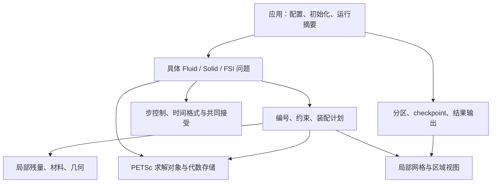
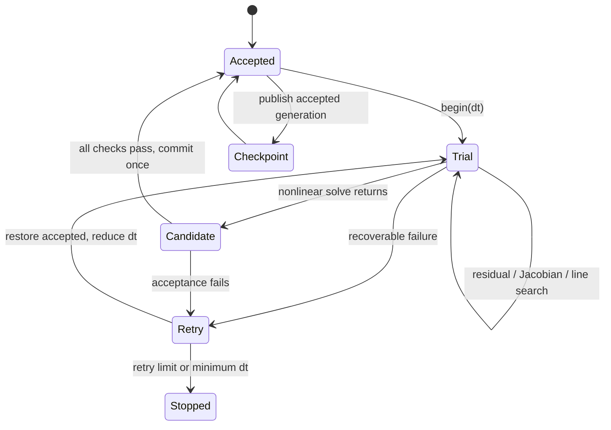

# EONSim 下一阶段详细设计

阅读范围：本文中的 BE 位移/惯性公式是原始推导基线；当前 BDF2/generalized-alpha 的状态与链式系数统一见 [时间契约](../development/TIME_INTEGRATION.md)。不将原建议中的类型名称视为现有 API。

原设计日期：2026-10-29；2026-10-31 同步 PR #23/#24 交付状态。范围：在现有 C++17、Tet4、MPI、PETSc、单体 FSI 主线上提高可靠性、精度和规模能力。

**最新扩展规划：** [通用 FEM 架构规划](GENERAL_FEM_ARCHITECTURE_PLAN.md) 集中规定多拓扑/多格式、有限元空间、一般边界、非一致界面、DoF 排列与预条件树、稀疏图、时间积分及并行输出；[20 组上游学习矩阵](../research/FEM_FRAMEWORK_LEARNING_2026-10-30.md) 给出逐项目取舍。G0B/G0/G5/G1 已通过 PR #23 交付；G2/G4 只实施必需子集，其余目标仍 deferred。本文保留已有可靠性主线，不将新方案写成已实现能力。

本文是用户要求的深入设计方案，**不是下列接口已经实现的声明，也不新增日常审批或全量验证门禁**。历史复现依据见 [架构审查](../research/EONSIM_ARCHITECTURE_AUDIT_2026-10-29.md)，最新实现和验证见 [集成验收](../development/FEM_INTEGRATION_VALIDATION.md)。沿用现行 L1/L2 决策；新增方案在对应功能落地时归并到所属主题文件，避免长期维护两份规范。

当前 B0–B5 已有小算例实现与记录。审查期间更新的 Schur/GAMG、压力归一化反力和局部 AD 已复验；以下方案面向这一基线继续完善，不重复安排已完成的修复。[B5 精度与性能记录](../development/B5_ACCURACY_AND_PERFORMANCE.md) 已显示压力误差随网格下降、固定空间网格的时间收敛趋势及小规模 CPU 成本，仍未证明网格无关迭代或大规模扩展。

## 产品定位与技术路线

建议把 EONSim 定位为“具有可信离散、明确状态和可扩展求解组织的多物理场 FEM 应用内核”。近期交付对象是独立流体/固体和共形单体 FSI；多物理通用性来自可复用的局部方程、编号和时间状态，不能靠预建大量抽象基类证明。

保留一个 `eonsim_core`、一个 `eonsim` 应用和现有 case 入口。暂不整体迁移 MFEM/deal.II，不并行维护第二套网格/DoF。理由是现有分布式与耦合闭环已经可用，而目前发现的问题主要位于接受规则、后处理、恢复和预条件，整体换库不会自动解决这些问题。

若真实业务开始要求 hp、复杂非协调约束、曲边高阶或分布式 AMR，应重新比较“扩充自有 FEM”与“由一个成熟库接管 mesh/space/constraint/assembly”的成本。只做一个代表算例的替换验证：流固界面消元、PETSc field IS、历史恢复和观测量必须贯通。MFEM 与 deal.II 互为候选，libCEED 是局部算子层候选；它们不是三层必须同时链接的依赖。

## 上游参考如何进入本项目

下表中的“取用”是 EONSim 的设计判断。链接为本次读取的官方资料；默认分支及在线 release 文档可能变化，不充当依赖锁文件。早期固定源码快照保留在 [上游研究](../research/UPSTREAM_ARCHITECTURE_REVIEW.md)。

| 参考 | 读取到的关键组织方式 | EONSim 取用与边界 |
|---|---|---|
| MFEM | 网格/空间与形式、真自由度转换；装配表示可变化 | 显式分开物理场与受约束代数向量，保留 assembled 基线；低阶 Tet4 不自动获得高阶 tensor-product 加速。[装配说明](https://mfem.org/performance/) |
| deal.II | `AffineConstraints` 参与稀疏图、装配与解恢复 | 约束只有一个来源；几何评价按需要准备。先实现真实 Dirichlet/FSI 映射，再考虑 hanging/MPC。[step-6](https://github.com/dealii/dealii/blob/master/examples/step-6/step-6.cc) |
| libCEED | restriction、basis、QFunction、operator，局部数据与全局并行职责分开 | 局部核不含 MPI/PETSc；setup/apply 分开；满足目标单元与预条件条件后才接 adapter。[接口概念](https://libceed.org/en/latest/libCEEDapi/) |
| PETSc | KSP/PC 的算子与预条件分离、field-split 与嵌套求解 | 保留 SNES 主循环，显式 IS、options prefix、持久对象和失败原因；不再自建 Krylov/Newton 框架。[KSP](https://petsc.org/release/manual/ksp/) |
| preCICE | 迭代 checkpoint、耦合窗口、不同物理量的映射约束 | 借鉴完整回滚与传递契约；未来独立应用耦合才加适配器。其隐式分离式迭代不替代当前单体残量。[回滚](https://precice.org/docs/couple-your-code/step-by-step/implicit-coupling/)、[映射](https://precice.org/docs/configuration/basics/mapping/) |
| SimVascular/svFSI/svMultiPhysics | svFSI 到 C++ 的应用迁移；old/current/intermediate 与积分器边界 | 借鉴多域 FSI 应用链、时间层和状态所有权。采用其中某个求解组织思想不代表复制其全部模型或当前算法。[项目](https://github.com/SimVascular/svMultiPhysics/blob/main/README.md)、[状态](https://github.com/SimVascular/svMultiPhysics/blob/main/Code/Source/solver/SolutionStates.h)、[积分器](https://github.com/SimVascular/svMultiPhysics/blob/main/Code/Source/solver/Integrator.h) |
| Kratos | 分析初始化、时间步准备、求解、完成和输出的生命周期 | C++ 薄应用负责这些阶段；共同 commit 仍由 EONSim 明确控制，不照搬任意回调仓库。[AnalysisStage](https://github.com/KratosMultiphysics/Kratos/blob/master/kratos/python_scripts/analysis_stage.py) |
| MOOSE | 材料产生属性，Kernel/边界消费属性，Executioner 管理求解时间 | 材料与弱式项解耦；局部属性依赖保留导数。无需把每一弱式项做成运行时对象。[Materials](https://mooseframework.inl.gov/syntax/Materials/index.html)、[Executioner](https://mooseframework.inl.gov/syntax/Executioner/index.html) |
| OpenFOAM | 网格/材料、数值控制、初值/场文件职责清楚 | case 逻辑上分离模型、算法、状态与观测；近期仍一份 YAML，读取一次后变成强类型数据。引用 Foundation v13 文档，不混用分支 API。[case 结构](https://doc.cfd.direct/openfoam/user-guide-v13/case-file-structure) |
| Firedrake | UFL 表达 PDE，代码生成与 PETSc 求解组合 | 保留方程结构与导数信息；只有生成多种核的实际维护成本出现时才评估 form compiler。[官方概览](https://www.firedrakeproject.org/)、[TSFC 论文](https://arxiv.org/abs/1705.03667) |
| MLIR | 多层 IR 与分阶段 lowering | 未来编译器基础设施候选；不承担当前物理、MPI、网格或求解器语义。[设计理由](https://mlir.llvm.org/docs/Rationale/Rationale/) |
| AMReX | Box/DistributionMapping/MultiFab、valid/ghost 与局部块存储 | 借鉴分布式数据与批处理组织；块结构 AMR 不是现有非结构 Tet4 的可替换执行后端。[数据模型](https://amrex-codes.github.io/amrex/docs_html/Basics.html) |
| OpenMDAO | 隐式组件、层级求解和整体导数、变量/残量缩放 | 作为未来设计优化与模型组织参考；不放进积分点循环，也不视为 GPU 编译后端。[求解组织](https://openmdao.org/newdocs/versions/latest/features/core_features/controlling_solver_behavior/set_solvers.html)、[缩放](https://openmdao.org/newdocs/versions/latest/theory_manual/scaling.html) |
| Kokkos | execution space、memory space、View、布局和异步完成责任 | 自有核确需跨 CPU/GPU 时采用；独立历史要独立存储，View 浅复制不构成 checkpoint。编译器标准按选定发行版确认。[View](https://kokkos.org/kokkos-core-wiki/ProgrammingGuide/View.html) |

## 职责、依赖与改造位置



箭头表示调用/依赖。`Solver` 只消费布局、回调和求解选项；不知道某个 Neo-Hookean 类型或 FSI case。局部核不反向读取配置或提交状态。

| 现有位置 | 下一步具体改造 | 不随改造扩大到的范围 |
|---|---|---|
| `src/main.cpp`、`src/core/config.cpp` | 分离公共运行摘要与各应用执行；为有歧义的边界种类建立具体类型 | 不引入插件加载器、脚本解释器或服务容器 |
| `mesh.hpp`、`fsi_domains.cpp` | 保留局部网格；新增外部映射需求时保留源域/源 ID | 不为每个物理场复制整张 mesh |
| `field_layout.cpp`、`reduced_layout.cpp` | 分清自由变量、展开、行投影与 field IS | 不先实现任意约束图引擎 |
| `nonlinear_system.cpp` | 保留已有 Vec/Mat 复用、字段验收和错误分类；按具体需求扩展图/布局 | 持久 SNES/PC 根据测量暂缓，不封装第二套 SNES |
| `fluid/solid/fsi.cpp` | 准备数据、数值评价、候选检查、提交、观测分段 | 不靠目录拆分掩盖状态依赖 |
| `checkpoint.cpp` | generation 发布、失败保留旧代、模式版本 | 不把可视化文件当作可恢复状态 |

独立流体/固体和 FSI 已经是局部 kernel 的真实共同使用者，现在可以提取重复的边界数值函数、残量装配缓冲与求解会话。`src/coupling/` 只有在移动实际 FSI 组合代码时才创建；目录移动本身不作为阶段成果。

### 一次初始化的确定顺序

1. 解析 YAML 和命令行，拒绝未知/重复/相互冲突选项；打印实际使用的求解器配置。
2. 读本地分区，检查 communicator、区域/边界覆盖和参考几何；串行 prepare 路径仍独立。
3. 构建区域单元表、边界 facet、接口配对与 owner 信息；建立所需物理字段。
4. 解析约束，确定独立代数编号，再建立 ghost、IS、稀疏图与观测积分计划。
5. 新运行构造相容初态，恢复运行读取 accepted 状态并核对布局、时间和物理签名。
6. 创建持久 PETSc 对象和必要参考缓存，进入统一时间循环。

初态的“相容”包括界面速度相等、网格/结构位置一致和给定约束。现有静止初态加小载荷保留；未来非零初值可能需要一个约束/不可压投影或耦合初始化求解。不能仅把两个独立解拼在一起就称为相容初态，也不能偷偷修改用户初值。

## 数据和编号契约

保留三类身份：输入实体身份、分布式 mesh 身份、自由代数编号。输入身份在双域中用 `(domain, source_id)` 唯一；代数编号按 rank owned 连续区间生成，允许随分区变化。当前三维分区 v2、二维分区 v3，checkpoint 容器 v3 仅支持同分区；跨分区恢复仍待设计。

每个 field 明确：物理量、分量、所在区域、参考/当前构形、owned/ghost、独立量/恢复量、单位。字段布局的所有权、约束、IS、nullspace 和输出必须消费同一最终映射。没有相应区域的字段不进入代数系统；物理输出对非该域节点应移除或带有效掩码，避免把零填充值视为解。

材料参数在 prepare 阶段由标签转换为紧凑索引/连续数组；热循环不查 YAML 或字符串。当前区域常参数和无历史超弹性无需材料历史框架。塑性/黏弹进入时，积分点历史按本地 owned 单元和积分规则拥有，输入 accepted 只读，输出 trial 独立；AMR/重网格之后还需保守/物理相容的历史转移，不能靠重新编号解决。

### 试探展开与测试行投影要分别表达

普通固定仿射约束可以写为 `z=C x+g`，残量为 `Cᵀr(z)`。FSI 不能把所有字段机械地套成同一 `Cᵀ`：网格界面位移依赖结构速度，但人工网格边界残量不应贡献结构力。

更准确的装配描述是：

```text
z = K(dt) x + g(accepted, dt)          # 物理变量展开
R(x) = Wᵀ r(z) + r_global(x)         # 物理测试行投影
J(x) = Wᵀ J_local(z) K(dt) + J_global
```

在当前 BE/固定共形映射下，K/W 对本次未知量固定。K 含界面 `d_m=d_s,n+dt*v_s` 的 dt 系数；W 累加流体与结构界面动量，同时丢弃网格界面测试行。刚体质量/阻尼/弹簧项只在唯一 owner 添加。G0 已用 `ReducedLayout::slot` 集中表达试探列、测试行、系数与 lifting；G5 再由实际时间格式提供系数。

当前使用具体 slot 映射和普通装配循环；原建议中的 trial_map/test_map 不是必须新增的 API。不要求显式形成 K/W 矩阵。未来姿态相关刚体映射或移动非匹配投影若依赖 x，必须重新求导，包括映射自身的导数。

## 数学与数值内核

### 流体与 ALE

现有基线保留：不可压 Newtonian 流体，`sigma=-p I+2 mu epsilon(u)`，参考节点随 ALE 位移得到当前几何，对流速度为 `u-w`。BE 时间导数、当前体积/梯度、稳定化、边界面积和运动学消元共同构成一个离散残量。

局部接口在语义上提供三种模式，但近期只需落实前两种：

```text
residual(geometry, trial, accepted, parameters, output)
residual_and_tangent(..., residual_output, tangent_output)
apply_tangent(..., direction, output)    # matrix-free 进入后才实现
```

输出明确是覆盖还是累加。纯局部核不做 MPI、PETSc 插入、I/O 或永久历史写入。求残量时不计算被丢弃的切线，固定参考 Laplace 数据在 prepare 阶段缓存。

当前稳定化是冻结 tau 的 SUPG/PSPG；记录其密度/黏度/时间因子、速度统计和几何尺度定义。独立流体与 FSI 的 tau 策略差异先在文档中显式化，再以同一制造解或退化固定网格算例决定是否统一。若改用 accepted 相对速度 `u_n-w_n`，它属于数值算法改动，需要针对性证据。若 tau 改为依赖 trial，则应包含对应导数，不能继续称冻结 tau Newton。

四点 Tet4 规则对二次多项式精确，但当前 SUPG 含更高次项。扩大对流强度时先做相同残量/切线积分规则的比较；增加积分阶数、改变稳定化或更换空间都属于不同数值改动，分开验收。

ALE 当前常量保持测试继续保留。若目标扩展到守恒输运/强瞬态，需要明确守恒 ALE 弱式及离散几何守恒关系，评价体积变化、网格通量与时间积分的一致性。仅把 BE 换成 BDF2 不会自动得到高阶守恒 ALE。

### 固体、材料和载荷

当前可压缩 Neo-Hookean 使用参考构形：`F=I+Grad(d_s)`、`J=det(F)>0`、一阶 Piola 应力 P；残量包含参考质量、内力和参考面积载荷。动态独立量为 `v_s`，恢复 `d_s=d_s,n+dt*v_s`，材料切线必须带 dt。

边界种类应明确区分：

| 种类 | 数学含义 | 几何/导数要求 |
|---|---|---|
| 固定位移 | 指定参考位置处 d 的分量 | 速度未知量需由时间关系转换 |
| 参考牵引 | `P N = T0`，每单位参考面积力 | 若 T0 独立于 trial，外力切线为零 |
| 当前压力 | `sigma n=-p n` | 经 `n da = J F^{-T} N dA` 转到参考面，并求载荷切线 |
| 全局笛卡尔分量约束 | 指定 x/y/z 中若干分量 | 不能当作任意曲面的法向滑移 |

当前固体 `pressure` 属冻结参考面载荷，应先澄清名称/说明，再以独立功能加入随动压力。近不可压缩材料需要混合空间/稳定化与相应块求解；不能只将 nu 推到 .5 并把锁死当作材料变硬。

### 局部 AD 的边界

工作区的固定宽度 `Dual<28>` 加仿射几何解析种子，是当前低阶 FSI 可行的直接方案。保留 double 残量和有限差分诊断入口；复用同一残量表达避免两套公式漂移。材料已有可靠解析切线可继续使用，不需要把所有代码改成 AD。

AD 只能微分实际被表达的依赖，不能补出未进入残量的几何/边界/历史项。几何有效性判断用 primal 值，不能微分穿过网格反转。宽度随局部 DoF 增大时内存和寄存器成本增加；只有高阶真实出现后才比较方向 AD、解析 Jv 或生成核。

## PETSc 求解组织

### 生命周期与算子

当前 `NonlinearSystem` 已跨 solve 持有 Vec、Mat 与本地暂存，SNES/KSP/PC 仍逐次创建。SOLVER-01/02 的审计与多步测量已使进一步持久化 `NonlinearSession` 暂缓，见 [多步 setup 研究](../research/MULTISTEP_SETUP_PROFILE_2026-10-30.md)。不再把该重构列为当前必做项；未来由目标规模证据触发时，才扩大会话所有权，并证明回调上下文/accepted 状态的生命周期相容。

拓扑和约束结构不变时复用分配、图和通信计划。每次 Newton 更新必要矩阵数值；PC 数值重建、AMG 插值复用、Jacobian 滞后分别计时和控制。ALE 坐标或 dt 改变只使相关数值缓存失效，不强制重分区。

保留 `J_op` 与 `P_mat` 两个角色：当前可以同一 Mat，后续 P 可以是简化耦合、低阶或冻结系数矩阵。矩阵之外的字段、约束、压力基准、尺度仍必须一致。通过 options prefix 配置每个具体会话/子块，避免当前全局 options 默认值污染其他问题。

### 按方程块接受

设变量尺度对角阵 `D_x`、方程行尺度 `D_r`，求解使用：

```text
x = D_x * x_hat
R_hat = D_r^{-1} * R
J_hat = D_r^{-1} * J * D_x
```

字段尺度须结合已装配残量单位；不能把压力未知量的 Pa 直接当作连续性方程行尺度。必要时用参考单元/节点控制体积和特征量构造行尺度。Dirichlet 替换行单独按其变量约束尺度处理。D_x/D_r 在一次时间步内冻结，缩步后可据新的 dt 重算。

对有效、owned、物理方程行按块计算，例如 `e_b=||R_hat_b||₂/sqrt(N_b)`，并要求每一块满足 `e_b <= atol_b + rtol_b*e_b,initial`；初始已很小时绝对容差仍有效。没有该块本地行的 rank 参与全局统计，不造成除零。更细的网格相容加权范数由目标离散决定，不能宣称上述 RMS 天然网格无关。

SNES 负责迭代/线搜索，应用侧负责最终每块残量、几何有效性和必要约束检查。若用户选择仅按增量停止等策略，最终接受条件仍应执行。将字段范数放入同一次小数组规约，避免每块单独 Allreduce。原始反力残量另存，不包含约束替换后的单位对角行。

已落地增量（2026-10-29）：`solver.fields` 配置每字段方程残量尺度和容差，`NonlinearSystem::solve` 按有效 owned 编号检查物理 RMS 与独立的约束最大误差；默认回调延迟未达标的停止，所有正停止原因仍需通过最终重新装配验收。初始范数取施加边界后的本次初态，重试重新计算。1/2 rank 的极端行系数小系统、双域 FSI、失败不提交和重启已验证。现行契约见 [离散与算子](L2_DISCRETIZATION_AND_OPERATORS.md#求解-operator-与预条件器各有职责)。上面的 `D_x/D_r` 对 Newton 方程和线搜索的完整变换尚未实现，当前仅缩放接受范数。

### 速度—压力 Schur

从实际约束后的流体矩阵提取：

```text
J_f = [ A  B ]     S_p = D - C A^{-1} B
      [ C  D ]
```

A 含质量、黏性、对流与稳定化；D 包含 PSPG，不能套成无稳定化的零块。`A^{-1}` 表示求解作用，不显式求逆。压力规范必须与完整流体问题一致；存在自然压力载荷时不能为了让子块可解而随意增加物理规范点。

选择顺序：先在现有小例上验证 field IS 覆盖、子块局部编号和预条件正确工作；再测试网格、dt、黏度变化下的迭代数。`SELFP` 是诊断候选，其对角近似不代表最终方案。对于常系数低 Re 问题，研究压力质量与压力 Laplace 组合；典型 Stokes 极限的逆 Schur 尺度包含黏性质量逆和 `rho/dt` 加权 Laplace 逆，但精确符号、系数、边界及 PSPG 项必须由本项目离散推导。对流增强时再评估 PCD/LSC，而非同时实现全部策略。

GAMG 的向量近零空间来自物理字段与边界：弹性刚体平移/转动模式需投影到自由 DoF；质量项使模式成为近零空间，不一定是真零空间。压力常数零空间也只在相应连通闭域存在。不能仅凭“AMG 能工作于一个小矩阵”宣布网格无关收敛。[GAMG 接口](https://petsc.org/release/manualpages/PC/PCGAMG/)

### FSI 块与附加质量

将速度/压力统记为 f，结构/刚体记为 s，ALE 内部变量记为 m：

```text
J = [ J_ff  J_fs  J_fm ]
    [ J_sf  J_ss  J_sm ]
    [   0   J_ms  J_mm ]
```

网格块可以继续显式保留。若以后在预条件器中消元，结构引起的内部网格变化必须传播：`J̃_fs=J_fs-J_fm J_mm^{-1}J_ms`，`J̃_ss=J_ss-J_sm J_mm^{-1}J_ms`，残量也作相应变换。不能只删 ALE 行列却冻结几何反馈。

进一步的结构 Schur 为 `S_s=J̃_ss-J_sf J_ff^{-1}J̃_fs`；其中流体反馈体现附加质量等效应。当前简单乘法分块作为基线，强耦合/低结构密度时要用保留界面反馈的近似。测试应包含结构/流体密度比、dt 与刚度变化；不能将普通 velocity-pressure Schur 成功等同于 FSI 预条件完成。

外层使用 FGMRES 容纳变化的子解。内层也是 Krylov 时，还需满足其算子线性和重复应用条件；外层 FGMRES 不会自动修复一个在内部 Schur MatMult 中不一致的变精度算子。分块的执行顺序显式指定，不由 `std::map` 字典顺序隐式决定数值策略。

## 状态、失败与恢复



这是目标时序说明，不要求新建状态机框架。accepted 由外层拥有；trial 几何、材料临时结果、输出候选值在评价中可覆盖。提交前集中检查，提交后 I/O 失败报错并保留已接受内存状态/上一完整磁盘 generation，不回过头把已接受步解释为未求解。

| 事件 | 处理 |
|---|---|
| 输入非法、参考网格非法、布局错误 | 初始化失败，不能缩 dt 修复 |
| 当前 Newton trial 导致非法几何/材料域 | 同步错误类别；让受支持的 SNES 线搜索尝试合法候选 |
| 线搜索/非线性迭代确实失败 | 从同一 accepted 重算，按明确上限缩 dt |
| 子 PC 配置或因子构造失败 | 打印子块原因并终止；只有证据表明是可恢复数值问题才缩 dt |
| 通信或不可恢复 I/O 失败 | 作业级失败，避免 rank 分歧挂起 |

B4 已保存 actual time/next_dt，G5 已统一二阶时间的运动学、接口系数及 checkpoint 历史，见 [时间契约](../development/TIME_INTEGRATION.md)。误差估计式自适应仍未实现；非线性收敛不代表时间误差足够小。

已实现的失败分类：局部域失败集体传播并排空部分装配，通过 PETSc domain-error 协议交给 SNES；默认 Newton 回溯在同一 dt 内恢复已通过 1/2 rank 检查。线性/PC 故障终止且输出顶层 SNES/KSP/PC reason，普通输入故障不缩步。递归原因报告已覆盖当前 FieldSplit、ASM/BJacobi、MG/GAMG 粗层和下平滑器，并保留 rank 与选项前缀；已补充顶层 KSP 累计耗时及按物理字段重新计算的线性残量；子层累计时间、独立 PC setup 时间和子 KSP 真实残量仍未实现。`solver_failures` 另覆盖单 rank 域拒绝前的远程残量插入、Jacobian 域拒绝、迭代耗尽和真实零主元 PC 失败。

### 检查点 generation 设计

```text
checkpoint/
  current                    # 最后发布的 generation 名称
  generation_<unique-id>/manifest
  generation_<unique-id>/state_rank*.h5
  generation_<another-id>/... # 未发布写入；根目录读取端忽略
```

已实现：每 rank 完成本地写入并检查 flush/close 成功，再 collective 确认；协调 rank 发布 generation manifest，最后替换 `current`。当前保留全部代，旧代可按显式路径读取，未提供自动清理策略；后续若引入清理，只能在新代发布后按读取者与保留契约处理。原子 rename 要发生在同一文件系统；若部署要求断电持久性，另按所用文件系统实现并验证同步协议。

manifest 记录格式版本、物理签名、布局/分区标识、accepted step/time、next_dt、字段/历史 schema 和文件清单。大文件校验和是否启用由恢复风险与 I/O 成本决定，不加入日常热循环。跨 rank 恢复将来通过稳定 mesh/field 身份重分布，再重建 ghost 和代数编号；无需保存 PETSc 因子或把旧代数编号当永久身份。

## 观测量与可解释结果

把算例几何假设从后处理移到明确观测定义。近期只实现当前需要的三种：标签面流量/平均压力、标签面平均位移/速度、指定支座分量反力。

面平均用 `integral_Gamma q dA / area`，与节点算术平均区分；使用参考面积还是当前面积必须写明。固体支座反力从边界替换前残量的真实约束分量取得；流体表面应力积分与离散节点动量反力各有用途，不相互冒充。

已落地的最小增量（2026-10-29）：独立固体自动汇总已配置的边界标签，输出参考面积及全局 x/y/z 的面积平均位移/速度；反力仅输出该标签施加位移约束的分量。另用合并约束输出去重后的总支座反力，交线标签的各自反力不承诺可相加。平移双材料杆、旋转非单位杆和重叠约束在 1/2 rank 通过；现行契约归入 [B2 离散与算子](L2_DISCRETIZATION_AND_OPERATORS.md#区域与分量约束b2)。任意方向探针、当前面积选项与 FSI 观测扩展仍是后续设计。

G5 已为共形 FSI 增加接口离散功率对照，alpha 日志明确标记 stage 量；更一般接口仍须检查有方向的力与功。若交换的是结点积分力，`u_f=H v_s` 时配对 `f_s=-Hᵀ f_f`；若交换牵引密度，要包括面积/质量权重。比如离散内积矩阵为 M_f/M_s，则相容关系可写为 `M_s t_s=-Hᵀ M_f t_f`。守恒总力不自动保证力矩或离散功守恒，需按目标接口检验。[preCICE 映射语义](https://precice.org/docs/configuration/basics/mapping/)

所有应用共用简短运行摘要：代码 commit/dirty、构建与依赖版本、输入/分区标识、rank/线程、实际时间/步长、各字段残量、SNES/KSP/子 PC reason、主要物理量和分阶段成本。性能日志中的 assembly 若含 ghost/MatAssembly，则这些子项不能相加成总耗时。

## MPI、缓存与性能路线

保持单元唯一积分、owner 唯一状态、ghost 只读借用；节点/场贡献反向加到 owner，与状态正向同步分开。短小全局刚体状态可复制，本地全场不能在每次求解中 gather。编号交换改为整数通信时，补 1/2 rank 对照即可。

| 缓存 | 复用范围 | 失效条件 |
|---|---|---|
| 拓扑、约束结构、IS、ghost、稀疏图 | 一次固定离散运行 | 分区、空间、约束连接变化 |
| 参考梯度、质量和网格 Laplace | 固定参考构形 | 参考几何/积分规则/相关系数变化 |
| 当前梯度、体积、法向、面积 | 同一 trial 几何 | ALE trial 更新 |
| 冻结 tau、时间链式系数 | 同一求解时间步 | 缩 dt 或接受下一步 |
| Jacobian 数值/PC 数值/AMG 插值 | 各自明确策略 | 状态、dt、系数及迭代表现；三者不共用一个 valid 标记 |

成本优化按现有问题选择：先改善有证据的求解瓶颈，复用对象/参考数据和 residual-only。PR #21 已交付独立固定网格流体的可选 COO Jacobian，见 [HPC-02 实测范围](../research/FLUID_COO_ASSEMBLY_2026-10-30.md)；FSI/ALE/残量 COO 与通信重叠仍未实现。COO 坐标映射一次准备、重复贡献允许，但可能增加中间值存储，扩展前须比较端到端时间和峰值内存。[PETSc COO](https://petsc.org/release/manualpages/Mat/MatSetPreallocationCOO/)

Release 规模研究以能够占据足够求解时间的网格为对象。先 1/2/4 rank；后续硬件可用再增加 rank/节点，不承诺未经测量的效率。报告强扩展和弱扩展时分别说明固定总问题/固定每 rank 工作量，同时给出迭代数、setup/solve/I/O、最慢 rank 时间、owned/ghost、nnz 与峰值内存。总作业还要计入串行预处理。

## 编译器与异构的延后设计

当前“模板化布局＋局部 AD”已经足够支撑 B5。未来方向分成不同层，不要求全部接入：

```text
物理/弱式与历史语义                 可参考 Firedrake/UFL
        ↓
基函数、积分、局部张量/导数表示      有实际需求时选择生成器或 MLIR
        ↓
单元批次、gather/scatter、内存布局   自有 C++ / libCEED 路径择一
        ↓
CPU SIMD / GPU 执行                 需要时选 Kokkos 或已有库后端

MPI ownership、constraints、SNES/KSP、checkpoint 由宿主控制
```

代码生成前先定义最小语义边界：输入/输出字段、坐标构形、积分规则、只读历史、哪些系数被冻结、微分变量、别名/累加约定。编译器优化必须保持这些语义；不能跨 commit 移动状态写入，不能把浮点重排的性能结果当成严格相同停止行为。只有当多个实际单元/物理模型需要生成核、手写核维护成为瓶颈，并有可测收益时才引入 IR。

GPU 接入必须一起设计残量/Jv、几何、状态、向量、预条件和 MPI 缓冲的驻留。禁止每次积分核执行前后往返拷贝全场；跨库边界负责完成依赖和 memory-space 可访问性。Kokkos 与 PETSc 使用一致的设备归属和明确同步协议，不能由“Kokkos 支持 GPU”推断 GPU-aware MPI 已可用。

MFEM/libCEED 若已拥有设备存储，不在外层复制另一套 Kokkos owner。低阶 Tet4 的收益必须包含通信、数据搬运和 PC 成本；单核速度不代表端到端加速。AMReX 仅在后续出现真实笛卡尔/块结构物理子域时评估，属于新增离散/数据域；OpenMDAO 仅在参数优化、0D/1D/3D 模型组织或整体灵敏度业务出现时评估，属于应用外层。

## 实施顺序与验收

下表是拆分开发任务的依据，不是要求一次实现全部内容。每个增量沿一个现有算例完成，涉及公式/通信时才增加对应检查。

| 顺序 | 具体结果与修改点 | 完成证据 |
|---|---|---|
| 1 观测可信（基础修复完成） | 标签固体按参考面积输出 x/y/z 均值，约束反力按标签及去重总量汇总；任意方向配置仍待实际案例 | 已验证平移双材料杆 `0.0075 m / -1 N`、侧面面积均值及旋转非单位几何、重复约束，1/2 rank 一致 |
| 2 接受规则（字段验收与失败分类完成） | 已实现字段尺度/RMS、独立约束误差、最终验收及 domain/线性失败分类；Newton 变量/方程缩放仍待推进 | 1/2 rank 小系统改变方程系数不掩盖物理残量；双域 FSI 各块达标；域失败可由回溯恢复，PC 故障不缩步 |
| 3 可恢复长任务（发布改造完成） | v3 generation checkpoint，保留旧代，rank 写入/关闭及发布失败集体传播 | 单 rank HDF5 写入失败、指针发布失败后恢复旧代；1/2 rank 同分区重启与连续结果一致；断电持久性仍未验证 |
| 4 导数证据完善（整体矩阵阈值完成） | 解析 PETSc 装配 Jacobian/有限差分矩阵的相对 Frobenius 误差，断言有限且小于 1e-6；保留局部 Jv、AD/FD 与直接解/Schur 基线 | 独立双域 1/2 rank 至少五次诊断；当前最大误差约 4.5e-10，不作为离散精度证据 |
| 5 求解复用（局部计算与代数存储已复用） | residual-only、FSI 参考缓存、跨步 ghost Vec/AIJ 图及本地 trial 缓冲已实现；SNES/PC 仍逐次建立 | 局部残量/能量一致；重复求解、约束释放、拒绝后恢复及实际重启对照通过；性能限具体测量 |
| 6 扩大精度证据 | 在 B5 已有记录基础上增加目标标签通道与有限变形 FSI 的空间、时间、积分/稳定化研究 | 分开改变 h、dt，报告压力/流量、位移历程、散度、界面力与观测误差；报告实际收敛区间 |
| 7 规模证据 | 依据数据完善流体/结构/附加质量预条件，扩大本地 CPU/MPI 问题 | 迭代数随 h/dt/密度比变化、强/弱扩展、端到端时间/内存；硬件范围如实报告 |

区域材料的新增闭环是 [两层 Couette](../../cases/fluid/layered_channel.yaml)：共形界面 y=0.5，两层黏度 1/4 Pa·s，壁面速度 0/1 m/s，端面施加解析牵引。速度在每层线性、斜率随黏度改变，界面剪应力连续。`verify_regions.py` 对黏度 1/4 和 4/1 分别检查节点场、两侧梯度恢复的剪应力、壁面反力、流量与散度；Release 1/2 rank 最大字段误差 1.74e-14。该精确 patch 补充原常速度例，仍不替代非线性或非共形材料界面的收敛研究。

空间研究尽量压低时间误差；时间研究使用足够细空间网格，在相同物理时刻对比观测历程。BE 预期一阶，但只有进入渐近区后才能从数据判断阶数。若采用公开 FSI benchmark，先对齐维数、材料、边界、单位、时间格式和观测定义，不把 3D 挤出例与二维表值直接对照。

二阶时间及 Tri3/Quad4 二维标量已按 [通用 FEM 规划](GENERAL_FEM_ARCHITECTURE_PLAN.md) 交付；非匹配界面、三维混合体与高阶仍 deferred。六自由度、近不可压缩材料、跨 rank 恢复、分离式 preCICE、AMR/GPU 保持具体业务触发。各扩展需要独立算例和证据，均不属于当前 B5 或 PR #21 的实现声明。
