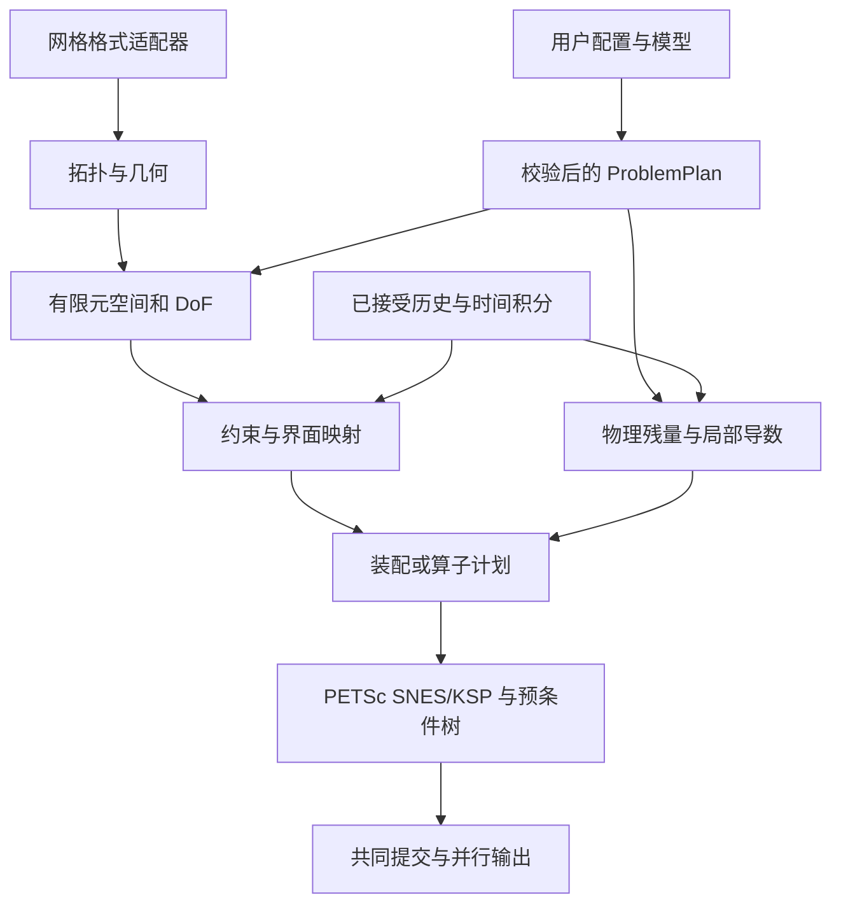

# EONSim 通用有限元、多物理耦合与高性能执行规划

日期：2026-10-30。源码基线：`38a5e516ffe129d1b70c7c1bd8365deb5ded101a`（main，PR #21）。**状态：设计草案；本轮仅修改文档，不开发、不编译、不运行求解器。** 下述类型名、配置和阶段是建议契约，不是现有 API 或功能声明。

本文件扩展 [下一阶段详细设计](EONSIM_NEXT_STAGE_DESIGN.md)，集中回答多拓扑、网格格式、有限元空间、通用边界、非一致界面、DoF/预条件、稀疏图、时间积分与并行输出。它是这些扩展的单一规划入口；已有 L1/L2 中的实现契约继续有效。上游证据与学习顺序见 [20 组项目学习矩阵](../research/FEM_FRAMEWORK_LEARNING_2026-10-30.md)。

## 1. 当前能力：不能从类型名推断完整支持

“支持”应逐层说明：能导入 → 能表示拓扑/几何 → 有空间与积分 → 物理模型适用 → 并行/边界/输出闭环 → 有验证证据。只通过第一层不能称为可求解。

| 项目 | 当前代码静态确认 | 扩展缺口 |
|---|---|---|
| 三角形 | Tri3 用于 Tet4 的边界几何和积分；Gmsh type 2 | 没有二维三角形计算域求解闭环；2D 流体、平面应力/应变及边界线积分须分别验证 |
| 四边形 | 没有 Quad4 体域/面求解路径 | 拓扑、双线性映射、积分、DoF、物理核及输出 |
| 四面体 | 三维线性 Tet4/P1 主线；稳定化等阶流体、固体、ALE、单体 FSI | Tet10 等高阶、曲边几何、不同阶混合空间未实现 |
| 六面体 | 没有 Hex8 读入和求解路径 | 三线性映射、Q1 空间、四边形面、积分、稳定性和并行 |
| 混合网格 | 多区域 Tet4、独立流固 Tet4 域可用 | 不支持同维度多拓扑体网格；Tet4+边界 Tri3 不属于混合体网格 |
| 网格输入 | Gmsh 2.2 ASCII；Tet4、边界 Tri3，线和点可读后忽略 | Gmsh 4.1/binary、CGNS、Exodus 等；不能静默丢弃未知体单元 |
| 空间/DoF | 固定节点分量，node-major；具备字段 IS 和 FSI 缩减映射 | 边/面/单元内部 DoF、不同场不同阶、modal、H(div)/H(curl) |
| 边界 | 指定速度/位移分量、牵引、压力；常量/仿射及部分时间 ramp | 通用标量/向量 BC、Robin、局部法/切向、非线性和随动载荷；固体配置语义应独立命名 |
| FSI 界面 | 独立但共形的双域网格，配对界面节点/三角形并消元 | 非匹配 trace 空间、mortar/Nitsche、跨分区界面搜索 |
| 时间 | BE，加实际时间/有限缩步重试；静力阶段另行处理 | BDF2、generalized-α、误差估计式自适应、多速率 |
| 稀疏图 | 节点邻接×分量，PETSc AIJ；独立固定网格流体可选缓存 COO Jacobian | 通用 FE/面项/约束扩展的图；现有 COO 不覆盖 FSI/ALE/固体或残量 |
| 输出 | 各 rank 写体域/边界 ASCII VTU，再写 PVTU 索引 | 混合/高阶/DG 字段、二进制压缩、PVD 时间序列与更稳健发布 |

代码依据：[拓扑与布局](../../include/eonsim/discretization.hpp)、[网格存储](../../include/eonsim/mesh.hpp)、[Gmsh 导入](../../src/mesh/gmsh.cpp)、[节点布局](../../src/fem/field_layout.cpp)、[VTU](../../src/io/vtu.cpp)、[当前离散契约](L2_DISCRETIZATION_AND_OPERATORS.md)、[当前 FSI 契约](L2_MONOLITHIC_FSI.md)。本轮“确认”是源码阅读结论；没有重新验证历史数值或性能记录。

## 2. 核心决策与依赖

继续采用一个 C++17 native 核心、PETSc/MPI 和现有案例入口。优先解除固定 Tet4/节点布局的耦合，不预建全功能框架。区分以下事实来源：

| 概念 | 唯一负责的语义 | 禁止隐含的假设 |
|---|---|---|
| MeshTopology | 顶点/边/面/单元、连接、方向、标签、分区 | 所有单元有四节点；所有面是三角形 |
| GeometryMap | 几何阶数、坐标系、参考/当前坐标、Jacobian | 几何节点等于解的 DoF；曲面维数等于嵌入维数 |
| FiniteElement / FunctionSpace | 参考空间、DoF 泛函、基、连续性、映射、分量 | Lagrange/Legendre 名称足以决定全局连续性 |
| DofMap / Constraints | 语义身份、owner/ghost、单元映射、独立未知量和展开 | 一个节点拥有所有物理场的相同数目 DoF |
| Form / CouplingTerm | 体、外边界、内面、界面的残量和导数 | 稀疏图仅来自单元节点邻接 |
| AssemblyPlan / OperatorPlan | 批次、gather/scatter、图、缓存、执行入口 | 所有算子都必须显式存矩阵 |
| TimeIntegrator | 试算到状态/导数/评价时间层及链式系数 | 改 dt 只需替换 kernel 中一个常数 |
| SolverPlan | 变量/方程尺度、独立的预条件分组、options prefix | 物理标签就是连续存储块，PC 分组就是物理方程定义 |
| OutputPlan | 可视化采样、字段关联、分片元数据 | 系数向量可以直接作为 PointData |



数据对象使用 RAII 与显式 owner/view；策略在准备期选定。库依赖单向：physics kernel 不含 MPI/PETSc/I/O；assembly 连接局部核与代数；algebra 不包含具体 fluid/solid。名称表示职责，不要求每项独立基类或 library。

## 3. 多拓扑、混合网格与文件格式

### 3.1 拓扑与几何

拓扑描述至少包含 `CellType`、topological dimension、vertex/edge/face 数与局部连接、facet type、方向置换。几何另有 embedding dimension、geometry family/degree 和控制点。Tri3/Quad4 是二维域单元，也可作三维体边界；二者的法向、积分和物理含义不同。

存储采用按 `(cell type, geometry degree)` 分组的连续 CellBlock；通用输入层可用 `offsets + connectivity + types`，热循环进入同类型批次。面邻接记录 `(cell, local face, orientation)`；对非流形、悬挂面、未配对面明确区分，不能由“共享几个节点”猜测所有相邻关系。拓扑实体必须有唯一 owner；cell 积分唯一执行，ghost 数据服务依赖。

先完成 Tri3/P1、Quad4/Q1 的标量二维闭环，再做 Hex8/Q1 三维及混合体网格。Quad/Hex 一般不是仿射映射，Jacobian/梯度要在积分点评价；不得复制 Tet4 的常梯度和体积公式。几何质量检查覆盖 detJ 的采样及更强检查需求，不把有限积分点处为正当作全单元无翻转的数学证明。

**混合拓扑的面必须相容。** 一个四边形面与两个三角形面几何重合，不构成一对一共形面；Tet–Hex 过渡通常需要 pyramid/prism 等过渡单元，或显式非协调约束/界面方法。初期只接受明确支持的面匹配组合，其他情况在准备期拒绝。为“支持混合”将 Hex 任意拆 Tet 会改变离散，须是用户显式转换，并保存转换映射。

混合拓扑不等于混合有限元：Tet+Hex 是前者，速度 P2/压力 P1 是后者，二者可独立组合。分区权重以后按局部 DoF、积分成本和面通信估计，不能永远按单元个数均分。

### 3.2 输入适配器与规范化

统一流程：`探测格式/版本 → reader → MeshImportData → 拓扑/方向/标签校验 → 能力校验 → 分区包`。reader 只处理格式；不得自行决定材料和方程。规范化数据保留原 `(domain, source id)`、物理区域/边界集合、元素类型、节点顺序、单位、周期关系及几何阶数；建立来源到内部身份的映射。

| 顺序 | 格式候选 | 保留的关键数据 | 实施方式 |
|---|---|---|---|
| 1 | Gmsh 2.2 兼容 + 4.1 ASCII/binary | entity 与 physical group、稀疏标签、多个区域标签、周期、曲边节点排列 | 评估官方库/DMPlex reader；严格记录支持子集，避免长期手写全部格式 |
| 2 | VTU / legacy VTK | connectivity、offsets、cell type、显式 region/boundary 数组约定 | 适合作为转换入口；文件未提供边界集合时要求显式补充，不能从结果字段猜 BC |
| 3 | Exodus II | element block、side set、node set、编号和材料区域 | 使用官方 Exodus/Ioss 或已选网格库能力 |
| 3 | CGNS | zone、element section、BC、跨 zone 连接与坐标单位 | 先声明非结构子集；不承诺自动转换所有结构/多面体/overset 表达 |
| 按需 | Abaqus INP、UNV、Medit、SU2 等 | 集合、单元类型及原 ID | 可采用离线转换工具；输入/输出语义必须有往返对照 |

HDF5 是容器，不自行定义通用网格语义；现有分区包应继续有版本和 schema。STL 是表面三角片，不能直接当体 FEM 网格。转换成功后要验证标签计数、区域体积/边界面积、节点置换和未支持单元清单，禁止“能画出来”作为读入正确的唯一依据。

选择 DMPlex 作为网格承载的理由是已有 PETSc；选择 MFEM/deal.II 的理由是空间/约束体系复用。未来在代表性混合阶 FSI 案例上比较后选**一个**权威 mesh/space owner；本轮不引入库。依据：[DMPlex](https://petsc.org/release/manual/dmplex/)、[Gmsh MSH](https://gmsh.info/doc/texinfo/gmsh.html#MSH-file-format)、[CGNS SIDS](https://cgns.org/standard/SIDS/convention.html)、[Exodus](https://sandialabs.github.io/seacas-docs/html/index.html)。

## 4. 不同有限元空间与基函数

有限元由参考单元、函数空间和 DoF 泛函共同定义；实现还需 basis tabulation、trace、orientation 和物理映射。`ElementSpec` 至少描述 topology、family、degree、continuity、value shape、mapping；几何阶数另设。一个 mixed space 是多个子空间的 product，各自有独立的 cell-to-DoF。

| 需求 | 推荐表达 | 必须处理的事项 |
|---|---|---|
| Lagrange | simplex 上 Pp；quad/hex 上 Qp，默认 H1 conforming | 顶点/边/面/内部 DoF、高阶节点位置、共享方向、trace 匹配 |
| Legendre modal | 正交多项式基，可用于 L2/DG；H1 用有边界/内部划分的 hierarchical 基 | modal 系数不是节点值；独立单元的普通 Legendre 展开不会自动连续 |
| GLL nodal | 以 Gauss–Lobatto–Legendre 点构造的 Lagrange 基 | “Legendre 点”不代表使用 modal Legendre；积分、质量集块及 aliasing 要分别规定 |
| 不可压混合空间 | 稳定化 P1/P1 继续作为基线；以后 P2/P1 或适用的 Q2/Q1 | 离散 inf-sup 或稳定化验证；不能仅换 order 配置就移除稳定项 |
| H(div)/H(curl) | RT/BDM、Nédélec 等按业务引入 | 法向/切向 trace、边面方向符号/置换或变换；Piola 映射与物理量定义 |
| DG/HDG | 不共享内部 DoF；内面双侧算子或新增 trace space | 面通信、数值通量、边界弱施加、静态凝聚和 trace 预条件 |

统一 tabulation 请求 value/grad/div/curl 中实际需要的量。参考数据按空间、积分规则与方向缓存；物理梯度按几何 epoch 更新。非多项式材料、曲边几何和非线性对流没有一个仅由 p 决定的“万能精确积分阶数”；配置默认规则并提供过积分对照。参考正交性不等于变形物理单元上的质量矩阵仍对角。

H1 高阶 modal 约束应作用于边界 trace 的 DoF 泛函或投影系数，不能将所有系数设为边界点值。基函数的更换还应更新可视化采样、误差积分、checkpoint 与预条件 transfer。借鉴 [MFEM 的空间结构](https://mfem.org/fem/) 与 [NGSolve 的空间/trace](https://docu.ngsolve.org/latest/how_to/symbolic_integrators.html)，不是通过多加一个枚举就宣布支持。

## 5. 一般边界条件

### 5.1 边界数据与施加机制分离

`BoundarySpec` 描述 region/tag、field、分量或法/切向选择、参考/当前构形、单位、评价时间及数据函数。`BoundaryPlan` 在准备期把它变成 trace DoF、约束或边界积分批次。数据先支持常量、仿射、表格时间函数与 native 函数；以后增加受限表达式，解析和名称查找只做一次。

边界角色为 essential、natural、mixed/Robin、interface；接口不同时充当重复施加的外边界。冲突按“同一 trace 分量与时间范围”检查；同一面不同分量可用不同条件。法向/切向约束需要旋转或一般线性约束，当前 Cartesian component mask 不能代替。多个标签在棱角相遇时检查值相容，而非简单选最后一个。

### 5.2 固定符号的标量例子

以 `−div(k grad u)=f`、外法向 n 为例，定义这里的 Neumann 数据为 `g_N = k grad u·n`。若用户输入物理外向热通量 `q·n` 且 `q=−k grad u`，须显式换号。对自由测试函数 v：

```text
R(u;v) = ∫Ω k grad(v)·grad(u) − ∫Ω v f
         − ∫ΓN v g_N + ∫ΓR v(αu − r)
Robin: k grad(u)·n + αu = r
```

- **Dirichlet `u=g`：** 优先统一仿射约束 `z=Cx+g`；固定 C 下 `R̂=CᵀR`、`Ĵ=CᵀJC`。线性系统 lifting 为 `Cᵀ(b−Ag)`。保留全部行时，线性 SPD 问题需一致行列处理；不能将当前非线性行替换方式概括为所有问题都保持对称。
- **Neumann：** 进入边界残量；与未知量有关的通量必须有导数。纯 Neumann 系统需相容性与 nullspace/规范，不能默默固定任意节点改变物理问题。
- **Robin：** 线性 α 给边界矩阵和 RHS；非线性 α/r、辐射、阻抗或跨场依赖提供相应切线块。时间导数型阻抗还需积分器链式系数及历史。

向量动量用 `σn=t`，残量边界项为 `−∫v·t`；压力载荷 `t=−pn`。参考牵引、当前 Cauchy 牵引和随动压力分别命名。随动载荷的面积/法向依赖位移，必须求几何导数。反力从施加约束前的物理残量提取，不能从单位对角替换行读取。

对 DG、非匹配或难以强制的 trace，可采用 Nitsche/通量方法；应完整规定一致项、对称项、罚项及 h/p/材料尺度。大罚数不是强 Dirichlet 的通用替代。对于初始数据与时变 Dirichlet，位移/速度/加速度应与选定离散运动学相容；若直接给解析导数导致离散关系不相容，要明确采用哪一套边界定义。

## 6. 共形与非一致多物理界面

### 6.1 共形：共享的是 trace 空间，不只是坐标

只有几何、trace 空间、节点/方向、物理变量和评价时间均相容时，才通过别名消去重复自由度。相同坐标但 p 不同或 basis 不同，仍需插值/投影。当前 Tet4 共形 FSI 保留 `u_f,Γ=v_s,Γ`、`d_m,Γ=d_s,Γ`；物理动量行合并，人工 ALE 边界行不进入结构受力。

统一描述局部试探展开 K 和测试行投影 W：

```text
z = K x + g
R(x) = Wᵀ r(z) + r_global(x)
J    = Wᵀ J_local K + J_global      （K、W 对 x 固定）
```

普通 Galerkin 固定约束常有 W=K，但当前 FSI 的位移时间映射和被舍弃的人工网格测试行使二者必须分别表达。若 K、W 或 g 随未知量变化，使用 `dz/dx` 和 `d(Wᵀ)/dx · r` 等完整项；随时间变化但固定于本次 Newton 的系数也要在重试时重建。不能一律以 `CᵀJC` 代替 FSI 推导。

### 6.2 非一致：先确定离散耦合，再建立代数连接

| 方法 | 适用与优点 | 代价/约束 |
|---|---|---|
| 主从插值/投影消元 | 一侧 trace 可稳定表示另一侧；延续当前缩减路径 | 非对称偏置、精度与守恒检查；主从反转结果需评估 |
| Mortar / dual mortar | 独立界面空间，弱连续，适合不同网格/阶数 | 乘子空间稳定性、交叠积分、鞍点块与 Schur；dual 消元需要满足条件 |
| Nitsche | 无独立乘子，弱施加跳跃条件 | 一致性、参数尺度、稳定性与两侧材料/几何线性化 |
| 独立求解器映射 | 将来分离式、多代码耦合 | 时间窗口/回滚与整体收敛；不替代单体接口项 |

首个非匹配原型建议从固定界面的标量 CHT 或弹性 patch 开始，比较稳定投影与 mortar，然后再接移动 FSI。投影示例为 `M_f u_f = B_fs u_s`，即 `H=M_f⁻¹B_fs`（实现用求解作用，通常不形成稠密 H）。对于已积分的离散界面力，`δu_f=Hδu_s` 应配套 `f_s=−Hᵀf_f`，使两侧虚功和为零。若传递的是牵引系数，需要相应质量矩阵/面积权重，不能直接转置牵引插值。

力平衡需传递重现常量；力矩平衡还需重现刚体转动/坐标相关模式。只测试几何接近或节点值误差不足以证明功相容。Mortar 可定义 `B_f u_f−B_s u_s=0`，残量块为 `r_f+B_fᵀλ`、`r_s−B_sᵀλ` 和约束；共同积分面、双侧法向、面积与 λ 单位固定后再组装。

`InterfacePlan` 管理几何搜索候选、共同交叠面/积分点、两侧参考坐标、trace 映射、owner/ghost 与支撑图。搜索要检查未覆盖/重复覆盖、容差随尺度、不同 partition 的远程配对。移动界面即使连接不变也要更新权重/法向；搜索支撑改变使稀疏图失效。显式质量逆投影可能具有非局部支撑，不能把它的稠密影响误当局部节点邻接；必要时保留乘子/投影解算子。

单体一致 Newton 包含流体、结构、ALE、界面几何和映射的跨场导数。冻结搜索/投影可以作为有名的近似策略，但要检验完整残量并与一致基线比较。验收包括常量/线性重现、界面虚功、总力/力矩、跨 rank 对照、移动几何 Jv 和时间收敛。

## 7. DoF 语义、存储排列与预条件树

FEM-G0A 的源码映射、最小接口、三种分组编号、PETSc 双版本核对、标准库参考验证与迁移切片见 [专题设计](FEM_G0A_DOF_AND_BLOCK_DESIGN.md)。该设计子任务已于 2026-10-31 审查合入；G0 的 C++ 接入及真实数值验收尚未执行，G0 已按后续整体任务授权进入实现与真实验收，进展见 [实施记录](../development/FEM_INTEGRATION_VALIDATION.md)。具体契约在专题维护，不在本总纲重复。

### 7.1 三个独立层次

1. **语义身份：** `(domain, space, entity kind/id, local mode, component)`；附加 physics、quantity、region、interface 标签。mesh 原 ID、DoF 身份与 PETSc global index 分开。跨 repartition 可保留语义；换 basis/网格需显式传递，不能声称 ID 永远不变。
2. **存储排列：** 默认 rank-owned 连续，rank 内可 node/entity-major、physics-major、quantity-major 或批次友好排列。`Permutation` 给出双向映射，所有约束/ghost/输出统一消费。全局 field-major 与 rank 连续所有权不能随意同时假定；如需重分布必须计入通信成本。
3. **求解分组：** `BlockTree` 用语义选择器生成 owned IS；无须先重排向量即可改 PC。子块内索引必须映射到父块的局部子编号，不能把 world global index 直接传给第二级子矩阵。

置换仅改表示：若旧向量 `x=P y`，则 `R_new=PᵀR(P y)`、`J_new=PᵀJP`；变量/方程尺度是另一个变换，不能和排序混淆。预条件本身的改变会影响收敛，排序不自动改善谱或减少迭代。

### 7.2 FSI 的三种合法分组

以当前独立未知量 `[u_f,I, p_f, v_s, d_m,I]` 为例，界面流体速度已属于结构速度代表：

| 模式 | 一级 | 二级示例 | 关键解释 |
|---|---|---|---|
| 按物理场 | fluid / solid / ALE | fluid → velocity / pressure | alias 后的界面速度分配给一个唯一叶子；流体算子仍可依赖该结构叶子 |
| 按物理量 | velocity / pressure / mesh displacement | velocity → fluid interior / solid | 保留速度跨域耦合形成动量块，有利于研究流固附加质量影响 |
| 混合树 | physical dynamics / mesh motion | dynamics → velocity / pressure；velocity → fluid interior / solid | 外层处理 ALE，内层做压力 Schur，再按物理域处理速度块 |

另一种混合树是 physics 在外、quantity 在内。配置应支持递归树与命名 recipe，不将两种排序写成两个求解器。IS 可不连续。[PETSc PCFieldSplitSetIS](https://petsc.org/release/manualpages/PC/PCFieldSplitSetIS/) 是具体接入点；AIJ+IS 为起点，MatNest 是否有益须与子矩阵创建、求解器兼容和数据复制一起评估。

同一 DoF 可以拥有多个语义标签，但**普通分块树的同层叶子必须互斥并覆盖全部有效未知量**；共享界面 DoF 不在 fluid 和 solid 两块各放一次。若要有重叠子域，应单独选择有 restriction/prolongation 和权重的 Schwarz/PCShell，而不是误用分区树。约束消去后重建 IS、nullspace 与尺度；零本地 DoF 的 rank 仍正确参加集合操作。

对 `[velocity, pressure]`，Schur 为 `S=J_pp−J_pv J_vv⁻¹ J_vp`。在 FSI 中 J_vv 含跨域界面动量耦合；只独立近似两个速度块可能忽略附加质量。结构/ALE AMG 近零空间、压力规范及尺度与实际约束相容。可变内层精度采用合适 flexible Krylov；PC 不修改原残量定义。

建议先提供 `physics`、`quantity`、`hybrid` 三个 recipe，再开放显式树。每次输出解析后的块大小、父子映射、options prefix、重叠/覆盖检查、迭代和 setup/apply 时间。用解的置换等价性与物理量一致性验收，再比较预条件性能。

## 8. Sparse pattern：由最终离散连接生成

图的事实来源是方程项与有效 DoF 支撑，而不是物理场名字。准备流程如下：

1. 各体、边界、内面、界面及全局项声明 trial/test spaces 和可能的耦合块；参数恰好为零不意味着结构性零。
2. 枚举每个项的局部行/列 DoF，展开测试映射 W 和试探映射 K 的支撑，将可能的 `(row, col)` 对汇入 owner。普通固定约束是 `CᵀAC` 的图；非局部 MPC/投影会扩大连接。
3. owned 行上去重并分成 diagonal/off-diagonal 数量；确保保留约束行的对角位置、乘子块和全局刚体连接。
4. 创建 AIJ 或 COO 计划，保留局部贡献到数值槽的映射。稀疏图可能不同于算子预条件矩阵图，两者分别记录。
5. 每次数值评价清零/覆盖旧值，完成局部错误同步，再共同提交分布式装配；绝不让部分 rank 因异常跳过 collective。

**COO 与唯一 CSR 图不同。** COO 贡献表可保留重复项和远程行，由 PETSc 汇总；贡献序列固定，数值必须严格同序。高阶完整局部矩阵需 O(n_local_dof²) 缓冲，可能超过最终非零元存储；不要将当前 Tet4 COO 无条件推广到所有 p。已有独立流体选项保留作为实证基线，见 [HPC-02](../research/FLUID_COO_ASSEMBLY_2026-10-30.md)；不重述为 FSI 的收益。

| 事件 | 图 / 计划处理 |
|---|---|
| 拓扑、分区、p、空间、DoF 排列变化 | 重建编号、ghost、约束支撑、图及对应 PC setup |
| Dirichlet 数值、材料、dt、固定支撑的约束系数改变 | 更新数值；若消元集合不变通常不改图 |
| Dirichlet 活跃集合、接触/非匹配支撑变化 | 重建，或使用有界保守超图并量化内存；不能默认旧图足够 |
| ALE 仅坐标变化 | 更新几何/系数/投影权重；若界面搜索连接变化则另行重建图 |
| 改预条件分组 | 更新 IS/子矩阵与 PC；数学图未必变化，存储重排则另算 |

版本至少区分 topology、partition、space/layout、constraint support、geometry、coefficient/history、time。先以明确调用顺序实现，缓存增多再用简明 epoch。每个缓存注明输入和失效条件，不能用一个全局 `valid` 掩盖不同依赖。

matrix-free 仍需 ghost、restriction、约束和预条件图；“不存全矩阵”不是“不需要稀疏连接”。算子 `J_op` 与 `P_mat` 分开；以后可用 matrix-free Jv + assembled 低阶/近似物理预条件。sum factorization 主要针对张量积结构，不能假定原 Tet4 自动享受同样复杂度收益。

## 9. 时间离散：格式、时间控制和物理状态分开

### 9.1 接口语义

`TimeController` 管理终止时间、候选步长、拒绝/重试、输出时刻；`TimeIntegrator` 提供 stage time、accepted history 到 trial 状态/导数的映射和切线系数；`History` 保存已接受层。现有 `TimeStepper` 的缩步控制不等于已经支持不同积分格式。

先把物理表达整理成 `F(t,y,ydot)=0` 或结构 `G(t,d,v,a)=0`，保留质量矩阵随几何/状态变化的完整导数。物理核接收评价状态和系数，不自行决定 BE/BDF2。对一阶系统，链式 Jacobian 是 `F_y dy/dx + F_ydot dydot/dx`；新格式还会影响边界时间、ALE 网格速度、界面约束和材料更新。

### 9.2 BE 与 BDF2

BE 即 BDF1：`ydot_(n+1)=(y_(n+1)−y_n)/h`。先迁移现有实现到统一映射而保持结果，然后引入 BDF2。等步长 BDF2：

```text
ydot_(n+1) = (3 y_(n+1) − 4 y_n + y_(n−1)) / (2h)
```

变步长 `h=t_(n+1)−t_n`、`h_prev=t_n−t_(n−1)`、`r=h/h_prev`：

```text
ydot_(n+1) = [a0 y_(n+1) + a1 y_n + a2 y_(n−1)] / h
a0=(1+2r)/(1+r), a1=−(1+r), a2=r²/(1+r)
```

由此结构若以新速度为未知量，位移恢复为 `d_(n+1)=(h v_(n+1)−a1 d_n−a2 d_(n−1))/a0`，相应 `∂d/∂v=h/a0`。ALE 网格速度用同一离散关系；不能继续使用 BE 的 `d_n+h v`。首步可用 BE 启动；不连续事件/历史丢失后明确降阶重启。变步长系数、步长比限制和误差控制作为完整算法规定，不能在拒绝后仍使用常步长 3/2 系数，也不能任意变步长并宣称稳定。

先只支持 BDF1/BDF2；更高阶 BDF 需额外历史、稳定性和误差控制收益，当前不列为实现目标。

### 9.3 Generalized-α：一阶和二阶不能共用一套参数

固定本文约定 `q_(n+α)=(1−α)q_n+αq_(n+1)`，避免与文献中 `n+1−α` 约定混用。参数由 `ρ∞∈[0,1]` 表示高频数值耗散。

一阶方程采用：

```text
F(t_(n+αf), y_(n+αf), ydot_(n+αm)) = 0
y_(n+1) = y_n + h[(1−γ) ydot_n + γ ydot_(n+1)]
αm=(3−ρ∞)/(2(1+ρ∞)), αf=1/(1+ρ∞), γ=1/2+αm−αf
```

若未知量是 `y_(n+1)`，则 stage Jacobian 的系数为 `αf F_y + αm/(γh) F_ydot`，并计入 F 内部状态依赖。依据：[PETSc 一阶 radius](https://petsc.org/release/manualpages/TS/TSAlphaSetRadius/)、[参数约定](https://petsc.org/release/manualpages/TS/TSAlphaSetParams/)。

二阶结构采用 Newmark 运动学：

```text
d_(n+1)=d_n+h v_n+h²[(1/2−β)a_n+β a_(n+1)]
v_(n+1)=v_n+h[(1−γ)a_n+γ a_(n+1)]
G(t_(n+αf), d_(n+αf), v_(n+αf), a_(n+αm))=0
αm=(2−ρ∞)/(1+ρ∞), αf=1/(1+ρ∞)
γ=1/2+αm−αf, β=(1+αm−αf)²/4
```

若选 `d_(n+1)` 为独立量，则 `da/dd=1/(βh²)`、`dv/dd=γ/(βh)`，并乘相应 stage 权重；此时结构主未知量与当前速度格式不同，布局、尺度和界面约束必须同步改变。依据：[PETSc 二阶 radius](https://petsc.org/release/manualpages/TS/TSAlpha2SetRadius/)、[参数约定](https://petsc.org/release/manualpages/TS/TSAlpha2SetParams/)。这些参数不构成任意非线性 FSI、变步长或 DAE 的稳定性/二阶精度保证。

不可压压力是代数变量，不应机械加时间导数。流体一阶 α 与结构二阶 α 的 stage 契约、界面速度/牵引、压力评价时间及 ALE 几何守恒需要共同推导；相同参数名不保证相容。先验证独立流体和结构，再验证整体 FSI 的压力/位移/速度收敛及界面功，未通过前不开放任意积分器混搭。PETSc TS 是未来可选执行承载；若采用，则由 TS 统一控制步进与恢复，不能和现有 controller 双重管理 accepted 状态。

### 9.4 历史、拒绝和重启

checkpoint 记录格式/阶数、已接受时间序列、步长历史、启动阶段、必要 `y/ydot` 或 `d/v/a`、ALE 与材料状态以及空间/布局版本。失败不 rotate history；重试从同一 accepted 状态重建系数、边界和界面。完整步接受后共同提交并输出。输出命中时间的缩步也要使用正确变步长公式。

BDF2 验收包含常步长与变步长制造解、拒绝后恢复、首步/最后短步、重启等价；generalized-α 增加自由振动/阻尼频率响应与能量、压力时间精度、移动网格均匀流和整体 FSI 时间收敛。本轮不执行这些未来检查。

## 10. 并行 VTU 与可视化字段

现有实现已经分 rank 输出 VTU/PVTU，方向正确。升级保持无 rank-0 全量 gather：

1. 从 accepted state 构建 `VisualizationMesh` 和字段采样计划；每个 owned cell 只输出一次，点可跨分片重复。
2. 对每个 rank 写唯一的临时 `.vtu`：混合单元使用逐 cell type、offsets 与 connectivity；字段 schema 在准备期统一，空分片合法。
3. 各 rank 完成写入、flush/close 并汇总状态；失败时不发布新的全局索引，协调退出，不能让其他 rank 留在 barrier。
4. 所有分片完成后发布该步 `.pvtu`；`.pvd` 只登记已接受物理时间和完成的索引。文件命名避免重启覆盖已发布步，路径与 XML 属性正确转义。
5. 后续可选 appended binary、UInt64 大块头、压缩与有界聚合输出；先测 I/O 占比，再决定并行 HDF5/VTKHDF 等路径。数千个小文件的元数据瓶颈与 rank-0 数据瓶颈分别评估。

`PPointData/PCellData` 必须与所有 pieces 一致，活动 Scalars/Vectors 从实际字段选择；当前硬编码 `Scalars="u"` 应列入此阶段。`owner` 是项目元数据，不自动等价于 VTK `vtkGhostType`；只有实际重复/ghost 实体才按格式约定设置标志，分片点重复不意味着有一层 ghost cells。依据：[VTK XML 分片格式](https://docs.vtk.org/en/latest/vtk_file_formats/vtkxml_file_format.html)。

高阶曲边可输出正确 VTK Lagrange 类型及节点顺序，或细分到线性可视化单元；后者标明采样阶数。modal、DG、H(div)/H(curl) 等系数先评价成物理字段，DG 跳跃用独立可视化节点/CellData 保留；不能将不同侧节点平均后说成原解。积分点应力投影/外推应标注方法，原始积分点历史属于 checkpoint。二维平面输出可嵌入三维坐标，但不改变物理维数。

异步输出只消费不可变 accepted 快照，拥有明确完成/释放责任和内存上限；不引用下一步会覆写的 trial view。当前阶段先保持同步分片写，稳健发布优先于引入线程运行时。

## 11. 设计模式、模板与实际性能

### 11.1 模式只服务明确职责

| 手段 | 放置位置 | 预期作用与边界 |
|---|---|---|
| Strategy / 少量 enum dispatch | 积分器、输出格式、装配表示、PC recipe | 准备期选策略；不在每个积分点动态查表 |
| Adapter | mesh reader、PETSc、未来外部 FEM/libCEED | 数据转换和生命周期集中；避免复制完整状态 |
| Builder / 校验后的 plan | ProblemPlan、BoundaryPlan、AssemblyPlan | 一次解析和验证，把错误尽早定位到用户配置 |
| Composite | mixed space、BlockTree、形式项组合 | 表达有意义的层次；不强制所有物理都成为通用对象树 |
| traits / policy / 静态多态 | 拓扑、basis、quadrature、scalar type、局部材料 | 编译期常量与内联；优先普通函数和具体类型，不要求 CRTP |
| 受限依赖 DAG | 多材料/多个派生字段的评价计划 | 只执行所需数据；先在准备期排序/融合，规模需要后才做动态任务调度 |

设计模式不会自行带来加速。性能路径优先级通常是预条件与算法 → 数据/通信 → 装配与缓存 → 局部内核；具体顺序由本项目测量决定。

### 11.2 编译期与运行期的分工

适合模板参数的是 `Topology, Degree（常用少数）, Quadrature, Scalar, EvaluationMode`；运行期保留区域数、网格规模、材料参数、载荷、步长、用户标签和求解选项。按 `(topology, FE signature, quadrature, material, evaluation mode)` 形成 element batch，一次 runtime 分派到具体 kernel，内层使用连续数组和确定类型。

编译期元编程用于 `static_assert` 支持组合、固定尺寸索引、orientation 表、所需导数选择和小型张量运算。C++17 可使用 traits、`if constexpr`、constexpr；无需为此立即升级语言版本。有限显式实例化常用组合，其余用受限通用评价路径或明确拒绝。记录编译时间、二进制体积和维护成本，避免 topology×degree×family×material×backend 全笛卡尔积实例化。

不要总是展开大循环：高 p 的 stack/register 压力和指令缓存会抵消收益。小 Tet4 可用固定数组；高阶张量积使用 sum factorization、批次 SIMD 和共享 basis 表。SoA/AoSoA 按 kernel 与向量化方向选择，不要求全项目一种布局；转换限制在已测量的边界。

局部物理表达可用 `Scalar=double` 或 AD scalar；残量-only、残量+切线和 Jv 分开选择。现有固定宽度 forward AD 适合小单元，不能把高阶全部 DoF 塞入巨型导数数组。高阶可选方向 AD/Jv、分析导数、分块种子或 reverse/VJP；求导必须涵盖实际状态依赖。用户材料提供残量/能量时，未来 AD 生成切线可作为默认，但需 Jv 和能量/客观性检查。

多线程装配的策略比较是 coloring、线程局部贡献缓冲、批次 COO 或必要原子；不假设多线程并发调用 PETSc MatSetValues 安全。未来 GPU 需让字段、几何和 qdata 驻留，规范 MPI/后端同步与跨库 view；引入设备库前核对编译器和语言标准。kernel 加速、内存、setup、通信、PC 和最终 time-to-solution 同时报告。

当前 Vec/Mat 已跨 solve 复用，而 SNES/PC 每次 solve 创建。已有测量使持久化 NonlinearSession 暂缓；此规划**不重新把它列为优先重构**。固定 COO 已有独立流体实现，扩展前比较额外图/缓冲内存和端到端收益。

## 12. 易用前端与 native 性能

建议三层入口：普通用户用物理问题与边界名称配置；高级用户选空间、时间格式和求解 recipe；开发者以 native kernel/材料/边界函数扩展。积分点循环不回调 Python 或解析字符串。

计划示意（不是当前可运行 YAML）：

```text
mesh: format + file + named regions
spaces: fluid.velocity=P2, fluid.pressure=P1, solid.velocity=P2
boundaries: region + field + kind + data + frame
coupling: interface pair + matching/mortar + time contract
time: bdf2 + startup + step control
solver: hybrid recipe + tolerances + PETSc overrides
output: selected fields + accepted-time cadence + vtu pieces
```

前端统一降到经过能力校验的 `ProblemPlan`：空间/边界兼容、材料覆盖、网格类型、时间历史、压力规范、PC 块覆盖都在昂贵求解前检查。提供计划摘要与 dry-run/inspect 模式，告诉用户为什么某组合不可用以及可用替代。以上命令和 schema 是未来功能，不将示意当成已实现示例。

Python 以后可用于配置、参数扫描和工作流，native 层承担整个批次的计算；数组跨语言借用须明确生命周期。若将来支持公式 DSL/JIT，缓存键至少含弱式/材料版本、空间/积分、scalar/backend、编译器选项/目标架构和生成器版本；保存生成源码和配置位置映射。先 AOT 常用 kernels，模型组合与编译延迟确有需求再做 JIT。运行期外部用户函数不能被伪装成可任意自动求导；要求导数接口或明确近似策略。

## 13. 分阶段实施候选与验收

所有阶段的 C++ 实现当前均为 **deferred：尚未启动**。G0A 设计与独立代数参考验证已审查合入，不能据此将 G0 标记完成。本次分支合并不执行后续开发阶段。顺序表示依赖，不是工期承诺；每阶段以可求解垂直切片交付，保留现有 Tet4 基线，不先创建一批空接口。

| 阶段 | 最小交付 | 依赖 / 未来验收 |
|---|---|---|
| G0 语义与布局 | 将 DoF 语义、现有存储与 PC 分组分开；现有 Tet4 接口接入 | 现有解/反力/恢复不变；physics/quantity/hybrid 三树覆盖互斥、置换等价、1/2/4 rank 空块 |
| G1 拓扑与读入 | 规范化 reader、Gmsh4.1 子集、Tri3/Quad4 标量二维闭环 | G0；节点置换、标签、几何和边界积分、MMS；二维弹性/流体另行模型验收 |
| G2 空间与通用边界 | entity DoF、P1/P2 与 Q1；Dirichlet/Neumann/Robin；时间数据协议 | G0/G1；trace、非零 lifting、纯 Neumann、modal vs nodal、混合阶流体稳定性 |
| G3 六面体与混合 | Hex8/Q1、四边形面；按需 prism/pyramid 过渡和混合域 | G1/G2；真实相容混合网格 patch、体积/通量、MPI、输出；不靠静默拆分 |
| G4 通用图与输出 | 从 forms/约束支撑生成 AIJ/COO；混合空间并行 VTU/PVTU/PVD | G2；含面项/远程约束的无漏项图、重复装配、故障不发布、字段采样 |
| G5 时间格式 | 现有 BE 适配；BDF2 首先，generalized-α 分一阶/二阶随后 | G0 与边界时间数据协议，可先在现有 Tet4 实现而不等待 G2 全部完成；独立场→ALE→FSI，检查时间收敛、拒绝/重启、压力/界面功 |
| G6 非一致界面 | 固定界面标量/弹性投影或 mortar，之后移动单体 FSI | G2/G4/G5；trace 重现、力/功、交叠覆盖、分布式搜索、Jv、整体收敛 |
| G7 高阶执行 | tensor basis、partial assembly/matrix-free 与成套预条件 | G2–G4，已有代表高阶业务；相同算子对照、总耗时/内存/准备成本；再评估 libCEED |
| G8 易用性增量 | 命名区域、schema/dry-run、recipe 说明逐阶段提供；Python/DSL 后续 | 不阻塞 G0–G7；配置错误可定位、兼容迁移、生成与 native 路径可追溯 |

G5 可与 G1/G3 在语义边界稳定后独立推进；不是必须做完所有网格才有 BDF2。G4 随每个新空间增量交付，不能到后期才补稀疏图与输出。G0 先用现有 IS 能力实现配置/语义解耦，真正内存重排只有在局部性需求明确时再启用。

## 14. 额外建议与决策点

- **能力清单应可查询。** 记录 `(topology, dimension, geometry order, space, physics, boundary, time, assembly/backend)` 的已验证组合；未验证组合明确拒绝或标实验，模板能实例化不等于物理成立。
- **材料历史是独立轴。** 区分参数、积分点 accepted/trial 状态与导数；重试/线搜索不累积历史，重网格/p 变化需明确历史投影和能量误差。
- **三种“图”分清。** 网格拓扑图、方程/材料评价依赖图、代数稀疏图具有不同 owner 和失效条件，不能一个 DAG 包办。
- **物理与几何验证先于优化。** 单元 patch/MMS、方向不变性、纯边界守恒、整体 Jv、FSI 功、压力基准、时间收敛构成各功能的最小证据；按变更选取，不强制每次运行所有测试。
- **数值稳定性单独管理。** 不可压 inf-sup、固体体积锁死、Hex 减缩积分 hourglass、DG 通量稳定性和高阶 aliasing 都不是架构通用性可自动解决的问题。
- **适配和 AMR 留有迁移契约。** 先确定 solution/material/history transfer、误差度量及稳定身份，再讨论在线 repartition；当前相同分区重启保证不应暗中扩大。
- **性能预算需完整。** 每个 DoF/单元的几何、历史、COO、矩阵、PC、输出快照分别计内存；以 setup+所有时间步+I/O 总成本与误差比较。现有最多 4 rank 证据不证明集群扩展。
- **先选可维护的规模。** 若真实需求同时包含 hp、曲边混合、复杂悬挂约束、并行 AMR，重新评估由 MFEM/deal.II 接管空间/网格的成本；若主要是多格式和分布式拓扑，优先比较 DMPlex。决定后只保留一个权威存储。
- **伴随和优化预留语义即可。** 目标泛函、Jv/VJP、时间历史与确定性残量有助未来 SU2 式离散伴随；现阶段不实现通用 AD 编译器/优化平台。

建议下一次开发只启动 G0 的现有 Tet4 分组垂直切片，或因具体业务优先启动 G5 的 BE/BDF2 切片；不要同时启动通用网格、DSL、GPU 和非匹配 FSI。最终选择由第一个真实目标案例决定，本轮任务不自动授权后续开发。

## 15. 本轮证据边界

已执行：固定基线源码阅读；官方资料研究；文档更新；文档差异与本地链接检查（结果登记在会话日志）。未执行：项目配置/编译、数值测试、网格转换、性能测试、上游原型、网站构建或发布。文中所有验收列为未来工作，不是本轮通过记录。具体文件与变更范围见 [当前进度](../development/CODEX_PROGRESS.md)。
