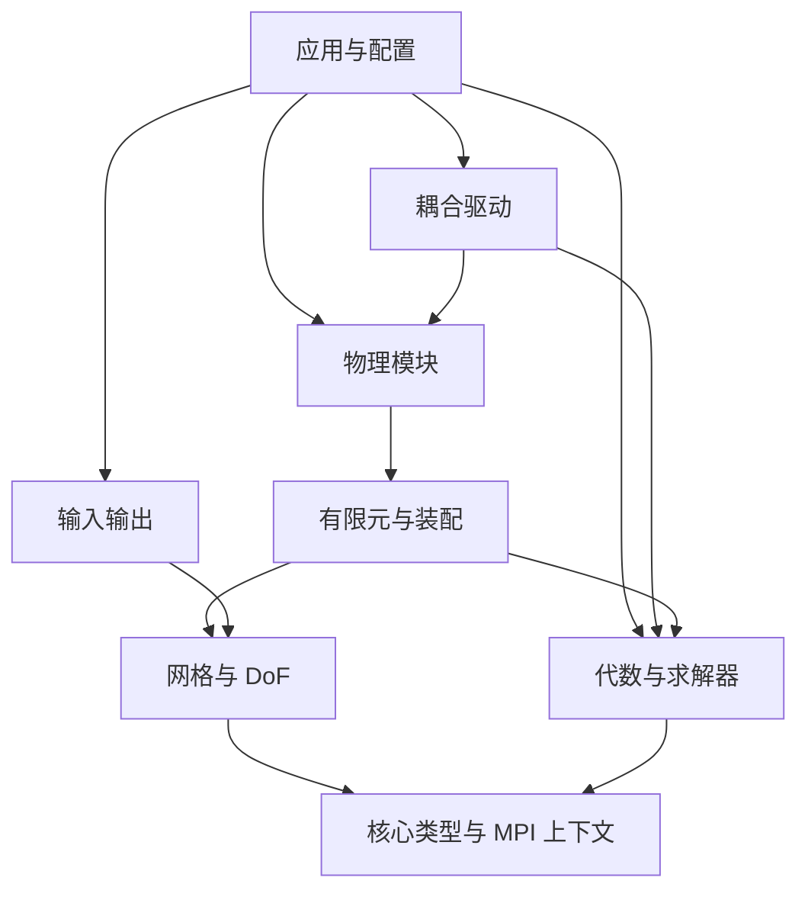

# L1：模块边界与依赖

状态：采用。只规定职责和依赖方向，不要求立即建立全部目录、类或 library。

2026-10-30 扩展设计见 [通用 FEM 规划](GENERAL_FEM_ARCHITECTURE_PLAN.md)。新增职责明确拆分拓扑、几何、有限元空间、DoF/约束、时间映射与执行计划；物理语义、存储排列和预条件分组互相独立。现有 Tet4 路径保持为实现基线，G0–G8 仅规划，不建立第二套后端或预建全部类。

## 首版范围与技术栈

| 项目 | 首版决策 | 扩展触发条件 |
|---|---|---|
| 平台 | Linux 为集群主线；Windows 用于开发与小算例，使用与 PETSc 一致的 MPI/编译器环境 | 真实部署需求再补平台，日常只验证当前主工具链 |
| 语言/构建 | C++17、CMake、Ninja、Debug/Release 两个独立构建目录 | 不因未来 GPU 提前升级整套技术栈 |
| 数值后端 | PETSc 实数双精度 Vec/Mat/KSP；非线性求解直接接 SNES，时间推进保持薄驱动 | 第二个后端有明确收益时才建立后端抽象 |
| 网格 | Gmsh 2.2 ASCII；3D Tet4 计算域，Tri3 仅作体网格边界 | Tri/Quad 二维域、Hex/Prism/Pyramid、高阶、非匹配界面按算例添加 |
| 分区 | METIS 离线分区；串行预处理输出各 rank 的 HDF5 分区包 | 全局预处理内存成为瓶颈，再引入并行读入/ParMETIS 或 DMPlex 路径 |
| 离散 | P1 标量基础与弹性；不可压流采用一套一致的稳定化 P1/P1 实现 | 首版不同时开发 Taylor–Hood、完整 RBVMS、FVM、VEM、DG |
| FSI | 先 monolithic 单轴运动刚体，再 monolithic 弹性体；共形 ALE、BE | 分离式耦合、6-DoF、非匹配和二阶时间格式在主线后按需加入 |
| 配置 | 一份 YAML＋PETSc options；解析一次后变为强类型结构 | 不建立通用表达式语言或运行时对象仓库 |
| 输出 | 分区 VTU/PVTU 可视化；HDF5 存分区与状态 | I/O 实测占比明显时再引入并行 HDF5/聚合写 |
| 并行 | MPI 优先；首版每 rank 单线程 | 装配成为热点后加 OpenMP；GPU 留在 CPU 规模路径完成之后 |

依赖尽量通过 CMake imported targets 和机器本地配置接入，不把机器绝对路径写入公共配置。先固定一套能用的 PETSc/MPI/BLAS 组合，记录版本；不为每个开发提交重建所有依赖。PETSc 自带能力可满足时，不直接再集成一套相同求解库。

## 最小架构与数据约定

### 目录与依赖

```text
apps/                 # mhpc：配置、对象组装、prepare/solve/post 子命令
include/mhpc/         # 少量稳定公共类型
src/core/             # 索引、配置结构、计时、错误传播
src/mesh/             # 输入、分区、局部网格、DoF、边界标签
src/fem/              # 几何映射、形函数、积分、局部到全局装配
src/algebra/          # PETSc 对象生命周期、稀疏图、线性/非线性求解
src/physics/          # fluid、solid、rigid、mesh_motion；实际实现时再建子目录
src/coupling/         # 单体 FSI 组合残量、界面约束与全局切线；分离式后续
src/io/               # 分区包、结果、checkpoint
cases/                # 可运行输入，同时承担最小回归
cmake/                # 构建和依赖查找
```

下图箭头表示“调用或依赖”，不是执行先后；应用负责组合，底层不得反向依赖应用或某个物理场。



实现上可先用一个核心 library、一个应用 target，依赖方向通过头文件组织保持；出现真实编译隔离需求后再拆 library。不以“一目录一库”增加首版构建成本。

### 首版核心职责

| 对象 | 负责内容 | 不承担的内容 |
|---|---|---|
| `MeshPartition` | 本地单元、所需节点/坐标、边界面、稳定 global ID、owner | 全局未知量、求解器选项 |
| `DofMap` / `FieldLayout` | 字段与分量、单元 DoF、owned/ghost、局部/全局映射、field IS | 时间推进、材料公式 |
| `State` / `History` | 已接受、试算及必要历史；材料积分点历史按需加入 | 自行读配置或切换物理模型 |
| `ElementKernel` | 给定局部几何、状态和参数，产生残量/切线块 | MPI 通信、PETSc 插入、日志和文件 |
| `AssemblyPlan` | 图结构、局部贡献映射、约束处理、矩阵/向量装配 | 改写局部物理公式 |
| `TimeDriver` / `CouplingDriver` | 时间层、统一残量与主 Newton 调度、成功后提交状态 | 单元形函数和材料实现 |

这些名称表示职责，不要求全部做成继承体系。具体类型和普通函数优先；按物理场/单元批次选择 kernel，避免积分点内虚函数分派。局部核首版只需“残量”和“残量＋切线”两条入口；`Jv` 待 matrix-free 需求出现后再加。

独立流体、独立固体及 FSI 使用相同局部核；独立驱动只负责其配置和求解流程。单体 FSI 直接组合残量/切线，不把独立驱动的“前进一个时间步”函数当作耦合回调。刚体 DoF、ALE 与接口布局的具体约定见 [单体 FSI](L2_MONOLITHIC_FSI.md)。

**一次确定的约定：**

- 全局网格/DoF ID 用 64 位；PETSc 的 `PetscInt` 配置与所需规模一致。局部紧凑索引可以用 32 位，初始化时检查可表示范围，禁止反复隐式窄化。
- 数组存储 `owned` 在前、`ghost` 在后。全局代数编号按 rank 的 owned 区间组织，字段顺序由 `FieldLayout` 显式记录；不要假定全局 field-major 与每 rank 连续所有权自然兼容。
- mesh ID 与重编号后的 algebra ID 分开；共享节点必须有唯一 owner，单元积分也必须只有一个负责 rank。
- 每个 kernel 写明未知量顺序、残量正负号、张量排列、坐标构形、压力约定、单位及时间层。统一使用 SI；首版不构建自动量纲推理系统。
- Dirichlet 约束和非零边界 lifting 统一实现。使用 CG 的问题必须保持对称性；压力规范只在问题确有常数零空间时施加，不重复添加物理压力条件。

## 复用边界与最小接口

上表是自有小型 FEM 路线的默认选择，不是要求所有项目重造 mesh/DoF。项目启动时，若首个目标算例能由 MFEM 或 deal.II 直接表达且目标集群依赖可用，可选择其中一个承担 mesh/space/assembly，并相应删减自有层。已经选择成熟框架（如 MOOSE、Kratos、4C）的项目优先按其扩展点增加应用。不要在成熟框架内部再嵌套本文件的整套自有核心。

首版不建立通用后端基类；具体 PETSc wrapper 和函数即可。第二个后端真正进入实现时，才根据已有调用提炼接口。MFEM、deal.II、libCEED、Kokkos 是不同层级的可选工具，研究它们不等于全部链接。

细化上图中的 `fem`：`fem/kernel` 仅提供基函数、几何和局部计算；`fem/assembly` 是局部贡献接入代数对象的桥接层。物理局部核依赖前者，不包含 PETSc/MPI 头文件；桥接层可同时依赖 mesh、kernel 和 algebra。algebra 通过回调获得算子作用，不能反向包含 thermal/fluid/solid 的实现。

局部核以“几何视图、当前场视图、只读已接受材料历史、参数 → 残量/切线与临时材料结果”为边界。区域和边界使用标签或实体 ID 视图，共享同一 mesh 存储；不要为每种物理场复制整张网格。运行时字符串只在配置/选择阶段解析，积分点循环使用确定类型和连续数组。

保留 C++17 的条件是当前 PETSc/CPU 路线成立。研究快照中的 Kokkos 要求 C++20；若 GPU/Kokkos 已成为近期明确需求，在 P0 就统一升级 C++20 和编译器配置；否则接入时再升级，不能承诺 C++17 直接兼容当前 Kokkos。版本以选定发行版本的要求为准，研究 SHA 不充当依赖锁文件。

依据：[上游研究](../research/UPSTREAM_ARCHITECTURE_REVIEW.md)。算法及状态细节分别见 [离散算子](L2_DISCRETIZATION_AND_OPERATORS.md)、[耦合状态](L2_MULTIPHYSICS_AND_STATE.md)。

