# 开发路线：独立求解器 → 单体刚体 FSI → 单体弹性体 FSI

状态：2026-10-29 更新；P0–P8 小算例基线已实现并验证，最大并行验收为 4 rank。用户已确定单体 FSI 为主线，**分离式耦合在该主线交付后再做**。当前阶段安排以本文件为准。

## 基础完善路线（P0–P8 之后）

目标：把已验证的小算例实现推进到可配置几何、边界和多域问题；保留三维 Tet4、PETSc 和单体 FSI 主线。按依赖顺序交付，每阶段都修改实际求解路径并提交 Git，不以空接口作为完成证据。

| 阶段 | 实施内容 | 验收证据 | 状态 |
|---|---|---|---|
| B0 几何与边界积分 | 外表面与本地相邻 Tet4 映射、外法向/面积、独立静态三角形积分；接入流体/固体/FSI | 旋转缩放四面体的面积、闭面向量和及散度定理，节点重排不改变外法向；既有边界载荷/FSI 导数回归 | 已完成 |
| B1 标签边界 | YAML 按任意 physical tag 配置速度、牵引和压力载荷；常量/仿射空间数据、时间 ramp；约束冲突与覆盖检查 | 非单位、旋转通道的解析线性流动，真实表面通量，1/2 rank 与重启对照，非法配置明确失败 | 已完成 |
| B2 区域与约束 | 体区域材料映射；边界组件约束与压力零空间策略；复用流体/固体约束准备 | 双材料独立固体、混合边界流体及重复/冲突约束检查 | 已完成 |
| B3 独立多域与界面 | 独立流固网格输入、共形界面配对与有效编号，移除 FSI 镜像网格假设 | 独立双域单体 FSI，界面位移/速度/力一致及 1/2 rank | 已完成 |
| B4 时间与恢复 | 共用 BE 步控制，accepted/trial 回滚，有上限的缩步重试；checkpoint 保存实际时间 | 失败后回退不污染历史，重启与连续计算一致，时间加密结果 | 已完成 |
| B5 规模与精度 | 速度—压力块预条件、适用多重网格、解析 ALE 耦合导数；压力/网格/时间收敛研究 | 代表规模的迭代/内存/耗时记录，跨 rank 与直接解对照 | 已完成 |

B0 实际证据：Debug 的几何、FSI Jv、流体/固体/刚体 FSI 五项检查通过；Release 的几何和 FSI Jv、牵引出口算例通过。

B1 实际证据：Debug/Release 各 16 项 CTest 全部通过。旋转通道三种边界配置的节点速度/压力最大数值偏差约 2e-14；入口/出口外向流量 -0.105/+0.105 m³/s。标签条件、仿射牵引、时间 ramp、1/2 rank 重启和非法输入均有检查。B2–B5 的后续交付证据见下。

B2 实际证据：E=100/200 双材料精确杆、黏度 1/2 的均匀流、笛卡尔分量约束和零均压在 1/2 rank 一致；另用非恒定压力流核对归一化后的壁面反力，非法材料覆盖明确拒绝。

B2 后续补充：两层 Couette 的黏度 1/4 与 4/1 配置在 1/2 rank 通过速度、压力、界面剪应力、壁面反力与通量解析检查；最大字段误差 1.74e-14。相交分量约束的净通量检查已改为使用最终合并节点值，未选分量和分量独立 ramp 有对应正/负例。

B3 实际证据：分别导入 48/51 个单元的独立流固域，匹配 9 个界面节点；1/2 rank 的位置、速度和界面力平衡一致，同分区重启与完整装配 Jacobian 有限差分比较通过，错位界面失败。后续诊断显式断言相对 Frobenius 误差小于 1e-6，当前最大约 4.5e-10。更细双域及 4 rank 由 B5 扩充验证。

B4 实际证据：真实 Neo-Hookean FSI Newton 不收敛触发缩步，结果与直接小步长一致；1/2 rank、部分保存后恢复、重试耗尽均检查。原基线缩至 .0025，新增字段验收后缩至 .00125、32 步到 t=.04。checkpoint 已升级 v3 generation 发布并保留上一完整代，保存实际时间和下一步长；写入/发布失败注入已通过。trial 域失败先交默认 Newton 回溯，线性/PC 故障不缩步。

B5 实际证据：Debug/Release 各 20 项 CTest 通过；独立流体、独立双域、刚体与 Neo-Hookean FSI 的 Schur/GAMG 与整体直接解在 1/2/4 rank 对照。通道 500/2916/8788 DoF 的压力与速度误差随网格下降；FSI 时间步减半趋近 BE 一阶行为。703/2299 DoF、1/2/4 rank 的耗时、线性迭代、峰值 RSS 及差分切线对照见 [实际记录](B5_ACCURACY_AND_PERFORMANCE.md)。这些数据不证明网格无关迭代或大规模扩展性。

B0/B1 优先使同一流体内核接受实际几何与边界；B2/B3 再扩大多物理场适用范围。高阶、GPU、AMR、非匹配界面和分离式 FSI 保持需求触发，当前不提前搭建框架。各阶段状态只在有对应运行证据后更新。

## 已交付证据

- P0：Debug/Release、非零 Dirichlet lifting、Tet4 制造解 L2 二阶/H1 半范一阶、非法几何和未收敛的失败传播。
- P1：METIS 离线分区与每 rank HDF5、本地 owned/ghost、AIJ 精确预分配和 scalar field IS。
  同一案例 1/2 rank 的节点解、体积、积分和误差一致（比较容差 1e-10）；求解不读取原始完整网格。
  分区文件缺失能终止作业；Debug/Release 的针对性验证均通过。运行命令见 README。

## 开始前的少量补充决定

目前不需要再扩充框架研究或依赖清单。先固定以下实现范围，直接进入开发：

- C++17、CMake、MPI、PETSc、3D Tet4/P1；低 Re 不可压 Newtonian 流体，等阶速度/压力采用一套明确稳定化。
- 独立 CFD 和独立结构求解器都必须可用；各自的局部残量/切线同时供后续单体 FSI 组合。
- 瞬态共同使用 BE；固体先线弹性，后可压缩有限变形超弹性。二阶时间格式和近不可压缩固体不是首版前置条件。
- 刚体指流体力参与驱动的运动刚体，先做一个平动自由度；固定刚壁和给定运动只是准备步骤。
- 首个弹性 FSI 采用共形贴体 ALE、统一残量/时间步/主 Newton，接口运动学消元，ALE 内部块纳入主系统。
- P0 的标量 Poisson 仅验证网格—积分—装配—求解链，并为 ALE Laplace 扩展复用；不把热传导、CHT 产品开发排在 FSI 前面。

如果已有可用 FEM 基础或确定使用成熟库，复用其网格/DoF/装配，缩短 P0/P1；不同时建设第二套自有核心。该选择在 [L1](../architecture/L1_LAYERS_AND_DEPENDENCIES.md) 记一句理由即可，不先做九个框架的完整 PoC。

## 总体依赖与交付点

```mermaid
flowchart LR
  P0["P0 工程与最小 FEM"] --> P1["P1 分布式基础"]
  P1 --> P2["P2 独立流体"]
  P2 --> P3["P3 独立固体"]
  P3 --> P4["P4 刚体动力学与 ALE"]
  P4 --> P5["P5 单体刚体 FSI"]
  P5 --> P6["P6 单体小变形弹性 FSI"]
  P6 --> P7["P7 单体有限变形弹性 FSI"]
  P7 --> P8["P8 HPC 可用版本"]
  P8 -.后续.-> EXT["分离式 FSI 与其他扩展"]
```



P2 与 P3 在技术上可共用 P1 后分别开发，默认按上图顺序推进，减少同时调试的未知因素。**P2/P3 是两个独立求解器交付点；P5 是首个双向刚体 FSI；P6 是首个弹性体 FSI；P7 完成有限变形单体求解；P8 完成可实际使用的 HPC 基线。**

| 阶段 | 核心成果 | 一个主要可运行案例 | 最小完成证据 |
|---|---|---|---|
| P0 | 单库/单应用、双构建模式、Tet4 几何、积分、约束和装配 | 单块域标量 Poisson | 非零边界可解、主要误差合理、Debug/Release 能构建 |
| P1 | 分区网格、owned/ghost、稀疏预分配、field IS | 复用 P0 输入 | 1/2 rank 解一致到规定容差，无求解阶段全局复制 |
| P2 | 独立稳态/瞬态不可压 CFD | 低 Re 通道 | 压降/流量或速度剖面合理，质量平衡与非线性收敛 |
| P3 | 独立静态/动态线弹性 | 弹性块或短梁 | 位移/反力合理，撤载后瞬态响应符合所用 BE |
| P4 | 独立刚体 ODE、网格扩展、ALE 流体 | 给定小幅运动的贴体流动 | 动力学离散可解，ALE 几何与边界运动一致 |
| P5 | 一个全局系统内的流体—运动刚体—网格 | 弹簧支承刚体单轴运动 | 流体力改变轨迹；组合残量和少量跨场 Jv 检查成立 |
| P6 | 共享接口动量的单体小变形弹性 FSI | 3D 短通道弹性壁/短弹性块 | 同一 Newton 中速度、载荷和网格双向反馈并共同收敛 |
| P7 | 独立及耦合有限变形超弹性 | 延用 P6，增加到材料模型适用的变形 | 材料和几何切线一致，时间历程和界面平衡可信 |
| P8 | 分布式块预条件、恢复、Release 性能摘要 | 复用 P5/P7 的代表案例 | 1/2/可用更多 rank 运行、同 rank 重启、结果与耗时可解释 |

表中的证据针对该阶段首次接入，不要求每次改动重做所有行。没有机器/网格规模数据时不承诺固定周数或扩展效率。

## P0：建立能求解的工程，而不是空框架

按下面顺序完成三个小闭环：

1. **工程闭环：** 一个 core library＋一个应用；debug/release 两个 preset；MPI/PETSc 初始化和退出；读入强类型配置并输出简短运行摘要。
2. **网格闭环：** 只支持一种明确的 Gmsh ASCII 输入格式，读取 Tet4、边界三角形、physical tags；建立几何与区域信息，输出一份可查看的网格。暂不支持所有 Gmsh 版本和单元。
3. **求解闭环：** 形函数/积分、非零 Dirichlet lifting、标量扩散、PETSc 装配和 VTU；采用一个有可解释解的非平凡输入，完成端到端求解。

公共数值/并行接口随实现补充必要注释，采用 [Doxygen 与注释规范](DOCUMENTATION_AND_COMMENTS.md)。已有 Doxyfile 可按需使用；P0 出现源码后将实际目录加入 INPUT，可选接入 docs target，不将文档生成设为每次编译的前提。

完成后保留实际需要的 MeshPartition、DofMap、FieldLayout、局部核和装配入口。名称表示职责，不要求每个职责单独建类/库。P0 单 rank 是启动方式，数据接口仍使用 local/global ID。

**暂缓：** 物理插件、Python 层、通用材料仓库、完整测试框架、GPU。

## P1：先把并行的数据语义做对

1. 建立离线 METIS 分区和本地分区输入；主求解只持有本地单元、owned/ghost 节点、边界标签。
2. 复用同一标量核；实现 owner→ghost 取值和贡献→owner 累加；精确或足够的稀疏预分配。
3. FieldLayout 能描述多分量及分组 IS；当前只实例化已需要的字段，不预建全部 FSI 类。
4. 将同一个 P0 案例改成两 rank 运行，比较解与一个主要积分量；从日志确认本地计数与全局计数的含义。

**完成后不继续扩展并行框架，立即进入物理实现。** 大规模强扩展、线程、并行预处理和 GPU 都延期。

## P2：完成独立流体求解器

已实现：Stokes/稳态 NS/BE、手写一致 SUPG/PSPG 切线、冻结 tau、SNES、
速度/牵引出口与互斥压力规范、原始节点动量残量输出。
Debug/Release 的流体单元 Jv、通道加密、1/2 rank、BE 接受状态和失败退出检查通过。
四点积分速度误差 4³→8³ 为 0.01421→0.004598；粗网格压降偏差仍较大，详见 README。


按固定网格 Stokes → 稳态 Navier–Stokes → BE 瞬态 Navier–Stokes 推进。复用同一通道几何和边界标签，以配置变化增加能力。

必须产出：

- 速度/压力布局、速度边界、牵引边界、必要的压力规范；压力只在确有常数零空间时作相应处理。
- 一套完整且明确的 P1/P1 稳定化，例如选定的残量式 SUPG/PSPG；无需同时实现多种方法。稳定化参数如随当前场变化，要进入导数；若按 accepted 状态冻结，则固定整个当前时间步并明确其算法定义。
- 纯局部流体残量/切线和独立驱动；驱动采用 SNES，kernel 不自行求解或推进时间。
- 同一残量能接收几何和网格速度；本阶段网格速度为零，为 P4 的 ALE 扩展保留清楚的参数边界，不预写全部几何导数。
- 速度、压力、流量、反力/牵引输出；将原始界面动量贡献与被边界条件替换后的代数行区分，供 P5 复用。

**最少验证：** 一个低 Re 通道算例；首次接 Jacobian 做一次少量方向的数值对照。新多字段所有权建立时补 1/2 rank 比较。先用已配置的小型直接解建立基线，再采用适合流体的迭代预条件，不先开发通用多重网格。

## P3：完成独立固体求解器

已实现并验证：参考构形小应变线弹性、Tet4 一致质量、静力位移与 BE 动态速度未知量、
均布参考面牵引、反力和能量输出。静载单位块位移最大误差 3.1e-17，x 反力 -1，
初始应变能 0.005；撤载 20 步(dt=0.01) 后总能量 0.00270248，逐步下降。
Debug/Release 的材料/BE Jv 与静载/撤载 1/2 rank 检查通过。


先静力线弹性，再质量矩阵和 BE 动力学。静力主未知量为位移；动力学主未知量为速度，通过 `d=d_n+dt*v` 恢复位移。让局部惯性项和材料项可由 FSI 直接复用。

必须产出：参考构形、位移/速度/加速度含义，Dirichlet 与表面载荷、材料参数、反力，accepted/trial 状态及一个独立结构运行入口。先使用中等泊松比，避免把 Tet4 体积锁死问题带入首个耦合任务。

**最少验证：** 同一弹性块的静载与撤载动态两种配置。BE 的衰减包括算法耗散，不把它解释为材料阻尼。首次材料导数做一次解析或方向导数检查。

本阶段先交付可靠的线弹性单场。有限变形材料在 P7 先扩展独立固体，再进入同一耦合案例；不必在刚体 FSI 之前实现材料大全。

## P4：把“运动边界”与“双向耦合”分开调试

已实现并验证：独立刚体质量/弹簧/阻尼 BE、参考构形向量 Laplace、当前几何 ALE。
内部锚点驱动变形网格上均匀流保持；匀速上壁的剪切流保持且网格位移吻合解析线性延拓。
Debug/Release、1/2 rank 的非零网格运动检查通过；过大位移造成反转时失败退出。
这是非守恒 advective ALE 的常量保持基线，不宣称已实现高阶守恒 ALE 或双向 FSI。


1. **独立刚体：** 单轴质量—弹簧/阻尼 ODE，复用 BE 和 accepted/trial；无流体时与该离散的简单参考响应对应。
2. **网格扩展：** 由给定界面位移驱动参考网格上的向量 Laplace；外边界和接口约束清楚，更新当前坐标、法向、面积和网格速度。
3. **ALE 流体：** 基于 P2 接入当前几何和相对速度；用兼容边界的均匀流移动内部网格检查几何守恒，再用给定小幅刚体轨迹验证真实移动壁面边界。

这一步允许网格单独求解，因为轨迹是已知输入；进入 P5 后，内部网格块改为同一组合系统的未知量。**P4 不是 FSI 完成，也不开发 Aitken 或交替流体/固体求解循环。**

## P5：首个 monolithic 刚体 FSI

已实现压力驱动单轴活塞：有效未知量为自由流体速度/压力、刚体速度、内部网格位移。
界面运动学消元，原始流体动量投影到刚体行，人工网格界面测试行丢弃。
同一 SNES 中使用完整局部中心差分耦合切线（包括几何、面积、网格速度），不是解析切线。
Debug/Release、1/2 rank、独立附加质量 BE 参考、零压力不动和力平衡通过；
PETSc 独立全局差分相对差小于 3e-10；t=0.1 位移 0.00198413，动量平衡误差约 1.6e-13。

首个案例采用黏性流体中的单个弹簧支承刚体，限定一个平动方向、小行程；用非零初始位移或明确外力激励，避免“始终不动”掩盖未实现的反馈。材料网格只存在流体侧，刚体用有限维质量/运动数据表示。

按以下任务推进：

1. 定义独立未知量 `[u_f,I, p_f, V, d_m,I]`；用 BE 从 V 恢复 q，用刚体运动映射消去流体界面速度和网格界面位移。
2. 组合流体、连续性、刚体动量、内部网格残量；从原始界面动量残量投影广义流体力，统一正负号，禁止重复加力。
3. 装配跨场和几何导数，统一 SNES 更新/线搜索/收敛/提交；先在很小模型上用直接解定位问题。
4. 用同一个案例检查真实双向响应、少量整体 Jv 方向和刚体力平衡；新全局刚体 DoF 映射补小规模 1/2 rank 对照，采用实际可用的分布式求解配置，不能 gather 后伪装并行。
5. 固定一份可重复运行的输入和参考摘要，进入弹性体阶段。

**完成含义：** 刚体运动未知，由流体载荷与自身动力学共同确定；所有块同一时间层收敛。6-DoF/多刚体不是这个里程碑的必要条件。

## P6：首个 monolithic 弹性体 FSI

已实现共形弹性末端块，结构速度取代刚体速度，流体/ALE/结构共用 P5 主 SNES。
固体参考区间 x=[1,1.25]，背面固定，侧面法向滚动约束；流体区间 x=[0,1]。
界面流体速度/网格位移消元，结构动量加原始流体界面残量，无人工网格力。
Debug/Release 的 1/2 rank、界面位置/速度一致、零载荷、全局导数、动量平衡和 P5 回归通过。
动态一维近似差异小于 0.1%，不将其当作三维动态精确解；200 步后的静态位移吻合解析值 0.001857142857。

把 P5 的有限维刚体速度块替换为 P3 的分布式结构速度块；复用流体、ALE、主 Newton、输出与历史机制。不要另写第二套主求解框架。

1. 建立共形流固界面和区域标记，配置 `[u_f,I, p_f, v_s, d_m,I]`。
2. 通过共享/消元界面运动学，将流体与结构动量贡献加到同一自由接口测试空间；ALE 人工网格力不进入物理动量。
3. 从 P3 的小变形线弹性开始，选择 3D 短通道中小挠度弹性壁/弹性块；不要同时引入大转动和复杂本构。
4. 接齐结构、界面和几何导数，沿用 P5 的整体 Jv 定位方式；只验证本次新增方向。
5. 在同一案例确认位移/速度、流量、界面作用反作用和整体残量；首次分布式接口映射补 1/2 rank 对照。

**这一阶段已应当是单体弹性 FSI。** 不能先用松弛交替求解作为其验收结果。BE 的一阶、小变形范围应在案例说明中明确。

## P7：达到有限变形弹性 monolithic FSI 目标

已实现 W=mu/2*(I1-3)-mu*ln(J)+lambda/2*ln(J)^2 的可压缩 Neo-Hookean，
参考构形 P 和完整 dP/dF，复用独立固体静态/BE 与同一弹性 FSI。
Debug/Release 的能量/应力导数、有限旋转客观性、BE 切线、Nanson 牵引映射、
独立拉伸/撤载、FSI 1/2 rank 与全局导数通过。J<=0 直接失败，不静默更改材料。
压力 20 的 FSI：t=0.2 位移 0.0329902；2³→4³ 为 0.0329916；dt=.02→.01 为 0.0284027。
时间耗散影响可见，尚未声称时间步收敛；同载荷线弹性结果 0.0457905。

先给独立结构增加一种明确的可压缩超弹性材料，例如选定能量函数的 compressible Neo-Hookean，使用参考构形的有限变形残量和一致切线。静态/动态独立入口复用该材料，局部导数确认后再切入 P6 案例。

- 将应力与载荷在参考/当前构形间正确转换；检查体积 Jacobian、法向、面积和所有几何导数。
- 逐步增加同一案例的变形或流体激励，不一次更换网格、边界、材料和时间格式。
- 首次发布这项能力时，做一次适度的网格或时间步变化对照，分辨明显离散误差；不要求每次修改重做收敛研究。
- 更换材料或密度比后，所有物理块和 ALE 残量仍按同一接受规则判断；实际出现预条件瓶颈时同步推进 P8 的对应项。

若采用 Turek–Hron 等公开 benchmark，按原问题的维数、材料、边界、参数和观测定义复现；不能把一个 3D 挤出模型直接与二维数值表比较，也不能用不同本构宣称复现成功。当前 3D 主线不为“使用某个 benchmark”强制增加完整二维实现；可选择条件明确的三维参考案例。正式引用数值前再取得并核对原始数据，本文件不填造目标数值。

## P8：完成 HPC 可用交付

已完成：FGMRES 乘法 field-split（flow/mesh/rigid 或 structure，ASM＋局部 ILU）、
完整耦合 operator、同 rank/同分区 accepted HDF5 checkpoint、四种应用入口与运行命令。
Debug/Release 各 13 项 CTest 通过；五类 transient/FSI 的 1/2 rank 继续运行一致，
有限变形 FSI 的直接解/块解在 1/2/4 rank 一致，错误分区/参数/缺失文件正确失败。
Release 的 125 节点/384 Tet4 每域、511/730 有效 DoF 已记录 1/2/4 rank 时间、峰值 RSS 和迭代数，
详见 [性能基线](PERFORMANCE_BASELINE.md)。当前规模很小，不宣称大规模或网格无关迭代收敛。
本机多个 SuperLU_DIST 子因子销毁问题已通过默认 ASM 路径避开，并记录复现证据。

只在已运行的 P5/P7 案例上改善规模能力：

- 小型直接解基线 → GMRES/FGMRES＋field-split/block 预条件；用当前现象决定流体 Schur、结构求解和耦合近似，避免同时尝试所有组合。
- 保留完整 operator，允许预条件矩阵简化；记录线性/非线性迭代数，不能以放宽容差得到“加速”。
- 实现同 rank/同分区 checkpoint，保存流体、结构/刚体、网格和必要 accepted 历史；用同一案例的一段继续运行确认恢复。
- 在 Release＋优化依赖下记录可用的 1/2/更多 rank 时间、峰值内存和迭代数；没有更多硬件时如实记录已验证规模，不把计划写成结果。
- 固化独立 CFD、独立固体、刚体 FSI、弹性 FSI 四种应用入口和示例。入口可以是一份 executable 的不同配置，无需四套源码。

完成 P8 后再安排分离式 FSI。它应复用现有单场残量/驱动和接口语义，并用已完成的单体解作比较基线，而非反过来成为单体开发前提。

## 每张开发任务的实际工作循环

```text
从当前阶段取一个可运行增量
  → 读取相关 L1/L2 文件
  → 在既有案例上实现
  → 编译受影响目标
  → 跑一个相关小案例，按改动增加必要数值/通信检查
  → 修复明确问题
  → 保存代码、输入和简短运行结论
  → 开始下一增量
```

任务说明写在 issue/当前对话或既有开发记录中即可，不要求每个小任务新增 Markdown：

```text
目标：一个可观察的计算结果。
范围：本次要修改的现有模块和数学项。
完成证据：一个案例＋必要的一个物理量/残量判断。
暂缓：与本次目标无关的功能。
```

Debug 用于索引/尺寸/布局和按需数值诊断；Release 使用同一方程、约束和停止准则，保留结果有效性检查。普通改动不强制同时重建两种模式；构建设置变更、阶段交付或出现模式差异时确认两者。公式变化、通信变化、性能变化的检查按 [最小验证](BUILD_AND_VALIDATION.md)，通过后不无理由扩展测试。

## 主线之后的工作

| 能力 | 排序依据 |
|---|---|
| 分离式 FSI、Aitken/IQN | 单体主线交付后，独立应用耦合确有需求 |
| 6-DoF/多刚体、转动和大行程 | 业务需要，单独解决姿态、网格与可能的接触问题 |
| generalized-α/BDF2 | BE 单体基线后，根据动态精度/耗散需求 |
| 近不可压缩混合固体、复杂材料 | 实际材料参数需要，增加相容的空间与块求解 |
| 热输运/CHT | 新业务需求，不占当前 FSI 关键路径 |
| 非匹配、AMR、重网格、GPU、高阶 | 正确性需求或测得的瓶颈，不为路线图名称建空模块 |

接口、未知量和切线的唯一详细规范见 [单体 FSI 实现契约](../architecture/L2_MONOLITHIC_FSI.md)。**P0–P8 主线已交付。后续按具体算例需求选择精度、规模和边界能力改进；分离式 FSI 不属于本次主线验收。**


## 后续工程治理与 Codex 工作流

文献阅读到数学规格、算法规格、软件接口契约的转化方法，以及 P0–P8 之后的 A–F 阶段建议，统一见 [EONSim 工程研发总纲](EONSim_ENGINEERING_PROGRAM.md)。

该总纲是研发导航，不改变 P0–P8、B0–B5 已完成状态。A–F 是后续候选方向，按实际精度、可靠性和性能瓶颈选择，不将计划描述为已实现能力。具体算法仍以对应 L1/L2 主题契约为准。


## Codex 持续研发状态

跨 Task 的当前进度、任务领取顺序和会话记录分别维护在 [CODEX_PROGRESS.md](CODEX_PROGRESS.md)、[CODEX_TASK_QUEUE.md](CODEX_TASK_QUEUE.md) 和 [CODEX_SESSION_LOG.md](CODEX_SESSION_LOG.md)。这些文件用于恢复工作，不取代本路线中各阶段的数学与数值验收标准。
