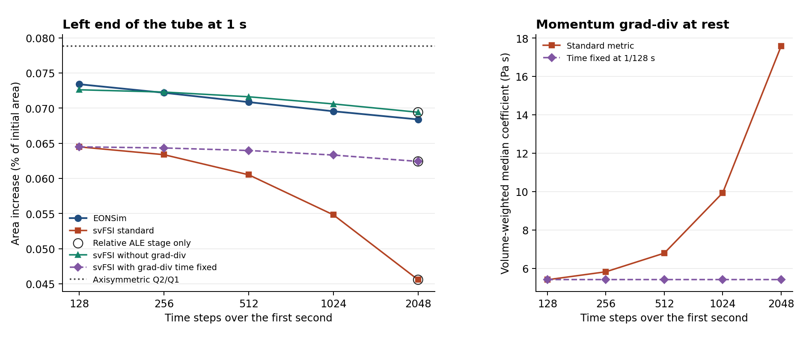

# Why reducing the time step changes the early elastic-tube expansion

A 2 m long, 1 m bore-radius tube fills from both ends under the same 0.02 Pa pressure ramp. At 1 s the computed left-end area increase on the 48/4/4/6 Tet4 grid is 0.0733993% of the initial area in EONSim and 0.0644891% in svFSI at 128 steps. The absolute separation is 0.0089102 percentage points of initial area. Dividing by the static Lamé expansion of 0.2174545% gives 4.0975%. Dividing by the instantaneous svFSI expansion gives 13.82%. The largest intercode difference for the other six measured sections can be reconstructed from the paired records. [Matched geometry and loading](../fsi-smooth-load-2026-11-24/README.md) · [Seven-section records](../fsi-smooth-load-2026-11-24/paired-space-time.json.xz)

## Momentum stabilization

In the pinned three-dimensional equal-order fluid, let $G=J^{-T}J^{-1}$ be the element metric from the affine reference Tet4 and let $u_r$ be the relative convective velocity. For constant density and viscosity the two coefficients are

$$
\tau_M=\frac{1}{\rho\sqrt{4/\Delta t^2+u_r^T G u_r+36\nu^2(G:G)}},
\qquad \tau_C=\frac{1}{\tau_M\,\operatorname{tr}G}.
$$

Here $\tau_M$ has units m³ s/kg and $\tau_C$ has units Pa s. The term $\tau_C(\nabla\cdot w,\nabla\cdot u)$ acts in momentum. P1/P1 continuity constrains the divergence weakly and allows a nonzero elementwise divergence. Increasing $\tau_C$ changes the cost of this component of the velocity field and thus the pressure-driven filling response. On a fixed mesh, where $4/\Delta t^2$ dominates the other terms, $\tau_C$ approaches $2\rho/(\Delta t\,\operatorname{tr}G)$. Both fluid pressure stabilization and time integration still change as the step decreases. [Fluid coefficients and stress, FLUID.f lines 376–422](https://github.com/SimVascular/svFSI/blob/94a2ff5cab2ad9e89e9bf12e0de36eaaa9b85571/Code/Source/svFSI/FLUID.f#L376-L422) · [Geometric metric, NN.f lines 1529–1544](https://github.com/SimVascular/svFSI/blob/94a2ff5cab2ad9e89e9bf12e0de36eaaa9b85571/Code/Source/svFSI/NN.f#L1529-L1544)

For the paired intervention all native decks, meshes, actual stage pressures, solver tolerances, and EONSim fields match. A modified external executable fixes *only* the time in $\tau_C$ at 1/128 s. A separate intervention removes the momentum grad-div contribution and keeps the pressure stabilization. Both changes retain the moving nonlinear three-dimensional problem. At 128 steps the fixed-time formula and native formula agree by construction. The independent equilibrium and dynamic references use the original circular meridian or the original tetrahedra, respectively. [Single-coefficient intervention](../fsi-smooth-load-2026-11-24/svfsi-grad-div-reference-step.patch) · [Separate zero-grad-div control](../fsi-smooth-load-2026-11-24/svfsi-zero-grad-div.patch)

| Steps over 1 s | Median native $\tau_C$ at rest (Pa s) | Fluid volume with dominant temporal term | EONSim left (%) | svFSI left (%) | Fixed grad-div time left (%) | Zero grad-div left (%) |
|---:|---:|---:|---:|---:|---:|---:|
| 128 | 5.402 | 0.00% | 0.073399 | 0.064489 | 0.064489 | 0.072608 |
| 256 | 5.817 | 16.67% | 0.072184 | 0.063377 | 0.064334 | 0.072289 |
| 512 | 6.789 | 37.50% | 0.070857 | 0.060518 | 0.063970 | 0.071616 |
| 1024 | 9.936 | 70.83% | 0.069553 | 0.054819 | 0.063325 | 0.070597 |

The area columns give percentages of the original lumen area. At 1024 steps, freezing only the temporal term of the native grad-div coefficient at its 128-step value recovers 0.008506 percentage points of left-end area. The maximum seven-section intercode discrepancy falls from 6.776% to 2.864% of static strain, a 57.7% reduction. Suppressing the whole grad-div term reduces the discrepancy to 0.480% while increasing the deformed-volume RMS divergence from 5.052 × 10⁻⁴ to 6.451 × 10⁻⁴ s⁻¹. The frozen-time case gives 5.651 × 10⁻⁴ s⁻¹. A separate vertex-order experiment and the independent circular reference measure two other contributions. [Three-way measurements](grad-div-time.csv) · [Spatial and temporal comparisons](../fsi-smooth-load-2026-11-24/space-errors.csv) · [Same coefficient in both nonlinear codes](tet-order.md)



## Independent operator and residuals

The at-rest linearization assembles both PSPG and momentum grad-div element by element on the actual tetrahedra. It matches the exported native lumen VTK file byte for byte. The DAE uses a separate SciPy sparse solver and two-stage Radau IIA integration with 128, 256 and 512 integration steps for every tested coefficient. These integration counts are independent of the 32 through 4096 source steps used in the coefficient formulas. Across the 24 such operators, the manufactured trajectory error is at most 4.92e−12 and the static residual is at most 8.54e−15. At 1024 source steps the left-end prediction of 0.054827% agrees with 0.054819% measured in the nonlinear program. The largest seven-section difference on this grid at that time is 0.01224% of the static strain. Finite-amplitude motion, convection and the two time integrators are present in the nonlinear-versus-linear comparison. The separate circular Q2/Q1 reference quantifies spatial error. [Assembly and solver](svfsi_linear.py) · [All independent operators](metric-dae.json.xz) · [Paired observations and time-refinement floor](metric-vs-3d.csv) · [Continuum reference](axisymmetric.md)

Upstream PIC can keep an equation's converged flag after a later correction increases its residual, and reaching the iteration cap also sets the flag. At 512 steps with standard coefficients, mesh equation step 125 had an earlier normalized residual of 1.84e−9 and ended at 3.23e−8 on correction 7. Tightening the internal tolerance to 1e−10 in a separate run led to a similar rebound on step 198. For the controlled series a source patch refreshes the current equation flag at each correction. Every final fluid/structure and mesh residual is still independently required to be at most 1e−8, with full contiguous time steps and no failed nonzero linear iteration. Rejected histories supply diagnostics only. The original constitutive and stabilization formulas apply to the series called standard. [Upstream stopping logic](https://github.com/SimVascular/svFSI/blob/94a2ff5cab2ad9e89e9bf12e0de36eaaa9b85571/Code/Source/svFSI/PIC.f#L255-L269) · [Controller patch](../fsi-smooth-load-2026-11-24/svfsi-current-coupled-residual.patch) · [Per-equation receipts](../fsi-smooth-load-2026-11-24/coupled-convergence.json.xz)

## Resolving the 2048-step mesh correction

In the original-coordinate native run with refreshed current residuals, step 1797 reached its 40-correction cap. Its final fluid/structure and mesh residuals were 1.79e−6 and 6.60e−6. The mesh calculation first forms a stage displacement and then subtracts the old displacement. A research variant evaluates this difference directly as $\alpha_f(D_n-D_o)$ before advancing the element reference coordinates. This algebraic rearrangement reduces cancellation for small increments. The run still uses the same constitutive laws, Tet4 mesh, time step, pressure samples, iteration budgets and independent 1e−8 threshold. [Native mesh-stage patch](../fsi-smooth-load-2026-11-24/svfsi-relative-mesh-stage.patch) · [Convergence histories](../fsi-smooth-load-2026-11-24/coupled-convergence.json.xz)

At 128 and 1024 steps, the two mesh-stage evaluations differ by less than 1e−9% of the static strain across seven sections at 0.5 and 1 s. At 2048 steps all final fluid/structure and mesh residuals with the relative displacement stage were at most 9.44e−9 and 9.89e−9, respectively, with zero failed linear corrections. At 1 s the measured left-end expansions are 0.06839244% in EONSim and 0.04558348% in the corrected-stage svFSI run. Across seven stations the largest intercode difference is 10.4891% of static expansion. The independent linear DAE gives 0.04559714% at the left end and a maximum difference from svFSI of 0.01002% of static expansion across the seven stations. The native median grad-div coefficient is 17.5854 Pa s at rest and the temporal term dominates 87.5% of the fluid volume. This result compares distinct stabilization operators on the same coarse Tet4 mesh. [Paired fields and denominators](../fsi-smooth-load-2026-11-24/space-errors.csv) · [DAE measurements](metric-vs-3d.csv)

Using relative displacement for the mesh stage also permitted the strict 2,048-step stabilized controls to finish. With both 3D solvers at the same physical time, 1 s, the seven-section maximum gap is 10.4891% of the static Lamé strain with native time-dependent grad-div, 2.8890% when only its time is fixed at 1/128 s, and 0.46957% with that momentum term disabled. The corresponding **left-end area increases** are 0.0455835%, 0.0624186% and 0.0694135% of the initial area, versus EONSim 0.0683924%. All use the same pressure data, meshes and endpoint. The PSPG time dependence still acts in each native control. [Matched independently converged 2,048-step rows](grad-div-time.csv)

## Converged field before failure at 4,096 steps

The 4,096-step native run with relative-displacement mesh staging has a validated snapshot at 0.5 s. At that time its left-end area increase is 0.00378953%, the independent native-metric DAE gives 0.00378998%, and EONSim with the volume model gives 0.00913301%. Across the seven sections the maximum DAE–native difference is 0.0002081% of the static equilibrium strain. Both end loads were verified through step 2,708. All terminal fluid/structure and mesh residuals over that prefix were at most 9.91e−9 and 9.97e−9.

At step 2,709 (0.661377 s), the native fluid/structure residual grew from a normalized 1 on its first correction to 88.62 on its second. The seventh correction exhausted 4,510 linear iterations. The run was stopped after this failure. Its 1 s response is excluded from the converged comparisons. The snapshot audit reads the native VTU and corresponding EONSim fields, checks every prefix residual and stage pressure, and retains the raw rows where the loss of convergence began. [Measured prefix and failure](../fsi-smooth-load-2026-11-24/n4096-converged-prefix.json) · [Prefix audit](../fsi-smooth-load-2026-11-24/audit_native_prefix.py)

## Reproduction

Build EONSim with the repository Release script. Use a separate checkout of the pinned external commit for each intervention. Apply the pressure observer and current-equation patch to each. Apply the fixed-time or zero-grad-div patch to its own copy and build through the archived external build script. Generate paired cases with the same 48 4 4 6 mesh, 0.02 Pa peak, 1e−25 linear absolute tolerance and nonlinear limit 40. [Build script](../fsi-pressure-faces-2026-11-24/build-svfsi.sh) · [3D driver](../fsi-smooth-load-2026-11-24/space_study.py)

```bash
export OPENBLAS_NUM_THREADS=1 OMP_NUM_THREADS=1
python svfsi_linear.py --case "$case_dir/reference" --native-mesh "$case_dir/matched/lumen.vtu" \
  --source-steps 32 64 128 256 512 1024 2048 4096 --integration-steps 128 256 512 --output /tmp/metric.json
python compare_metric.py --linear metric-dae.json.xz --pairs ../fsi-smooth-load-2026-11-24/paired-space-time.json.xz \
  --csv /tmp/metric-vs-3d.csv --controls-csv /tmp/grad-div-time.csv
python plot_metric.py --linear metric-dae.json.xz --pairs ../fsi-smooth-load-2026-11-24/paired-space-time.json.xz \
  --reference reference-corner.json --output /tmp/metric-end-expansion.png
```
