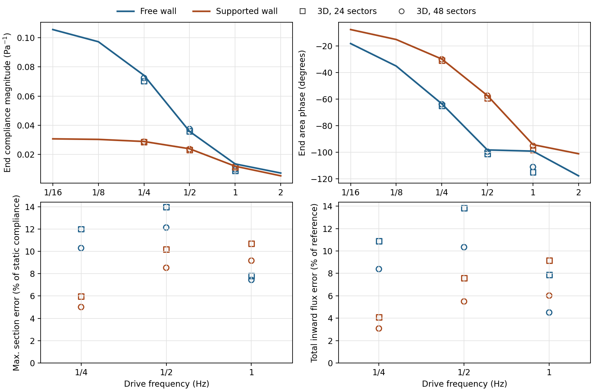

# Dynamic compliance of a tube filled through both ends

Both ends of the straight elastic tube have the same sinusoidal pressure. The fluid moves toward the midplane as the lumen expands. The small-amplitude reference uses incompressible unsteady Stokes flow, linear elasticity and a shared velocity at the wall. The 3D calculation uses the nonlinear ALE solver. Its drive amplitude is 0.0002 Pa. Length is 2 m, bore and outer radii are 1 and 1.2 m, and wall modulus is 100 Pa. One wall is freely expanding. The other has a reference-normal spring of 50 Pa/m and a dashpot of 5 Pa s/m.

For the convention $p(t)=\mathrm{Re}(\hat p e^{i\omega t})$, the area response is $H_A(x,\omega)=\widehat{\Delta A/A_0}/\hat p$. Its magnitude is in Pa⁻¹ and a negative phase denotes delayed expansion. The flow admittance $Y=\widehat{Q_{\rm in,left}+Q_{\rm in,right}}/\hat p$ uses the entire quarter-tube represented by the 3D mesh. The symmetric half-meridian admittance per radian is multiplied by π, and the full-length meridian by π/2. These conversions include both driven ends exactly once. [Frequency-domain solver](harmonic.py) · [Time-domain driver and flux reconstruction](harmonic_eon.py)

| Frequency (Hz) | Free end magnitude (Pa⁻¹) | Free phase (degrees) | Supported end magnitude (Pa⁻¹) | Supported phase (degrees) |
|---:|---:|---:|---:|---:|
| 0.001 | 0.10873 | −0.29 | 0.03080 | −0.12 |
| 0.25 | 0.07420 | −63.51 | 0.02886 | −29.77 |
| 0.5 | 0.03578 | −98.29 | 0.02387 | −57.28 |
| 1 | 0.01348 | −99.20 | 0.01192 | −94.28 |
| 2 | 0.00723 | −117.81 | 0.00533 | −101.17 |

At 0.5 Hz the free end reaches about a third of its static area compliance and peaks over a quarter period after maximum pressure. Supporting the wall reduces the absolute expansion and its phase lag. At 1 Hz the two support conditions have similar magnitudes, despite their very different static compliances. Both phase and amplitude therefore matter when comparing solvers.



The meridian solver evaluates $(K+i\omega M)y=f$ directly at seven frequencies. The finest half-domain grid has 99,875 unknowns and 97 axial observations. Comparing its 64- and 80-cell-per-half-length grids gives at most 0.05954% of static compliance in the complex area response and 0.00173% of reference flow. A distinct full-length mesh at the 24-cell resolution agrees with its half-domain counterpart to 9.67e−10% of static compliance and 5.49e−8% of flow. Across the 14 finest-grid frequency/support combinations, normalized complex power and mass closure defects are each below 1.14e−8. [All amplitudes, phases and balance defects](harmonic-meridian.csv)

The plotted 3D points have 32 steps per cycle and use 16 actual observations in each of the last two periods. Every plotted case passed the 0.1% intercycle criterion for each local area harmonic and for total inward flow. Section error is the largest complex difference among the coincident sections, divided by each wall's own static compliance. Flow error is the complex difference divided by the reference admittance magnitude. At 0.5 Hz, refining the free-wall grid from 24 to 48 sectors reduced section error from 13.97% to 12.13% and flow error from 13.83% to 10.34%. The supported values went from 10.19% to 8.53% and from 7.58% to 5.49%. Each 3D resolution changes circumferential and radial resolution together. The unsteady, two-ended loading and synthetic material properties define the scope of these errors. [Endpoint harmonics and intercycle errors](harmonic-eon.csv) · [Reference arrays, time samples, run hashes and controls](harmonic.json.xz)

At 0.5 Hz the 96-sector, 8-fluid-layer, 8-wall-layer, 12-axial-layer mesh reduced the free-wall section and inward-flow errors to 4.30% and 3.83%. With the spring/damper exterior they fell to 5.31% and 2.20%. This refinement changes the axial resolution as well as the cross-section. On the 24-sector free-wall mesh, 32, 64 and 128 time steps per cycle gave inlet-flow errors of 13.83%, 15.57% and 17.28% with the step-dependent default. Holding the coefficient time at 1/30 s gives 13.83%, 14.13% and 14.20% on those same runs. Separating time integration from the changing spatial operator materially changes the interpretation of the refinement. [Time and mesh controls](harmonic-eon.csv)

The same 0.5 Hz check on the 48-sector free-wall grid gives a 10.34% complex inward-flow error at 32 steps per cycle. At 64 steps the error becomes 11.37% with the step-dependent coefficient and 10.64% with its time scale fixed. At 128 steps with the same fixed coefficient the flow error is 10.72%, the flow phase differs by −0.386° and the maximum area difference over seven sections is 12.31% of static compliance. With exterior support on the 24-sector grid, 32 steps gives 7.58%, while 64 steps gives 8.67% and 7.76% for these two controls. The signed phase and amplitude components for each trajectory are recorded alongside the cycle-to-cycle drift. [Time-step controls on both walls](harmonic-eon.csv)

The archive can be replayed without running a solver. The comparison reconstructs both complex coefficients from signed pressure, area and flux samples. It checks the independent time stamps, the observed cap pressures, the two preceding periods and the source mesh before accepting a new run.

```bash
python compare_harmonic.py --archive harmonic.json.xz --meridian-csv /tmp/meridian.csv --eon-csv /tmp/eon.csv
python plot_harmonic.py --meridian-csv /tmp/meridian.csv --eon-csv /tmp/eon.csv --output /tmp/compliance.png
```
