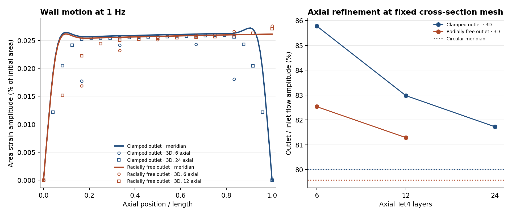

# Pulsatile inlet and RCR on a 20 mm elastic tube

This tube carries a prescribed flow at one end and supplies one three-element terminal at the other. The circular bore is 20 mm in diameter, the wall is 2 mm thick and the length is 120 mm. The fluid density and viscosity are 1060 kg/m³ and 0.004 Pa·s, and the wall density, Young modulus and Poisson ratio are 1100 kg/m³, 0.4 MPa and 0.45. The inlet wall ring is clamped. The outlet ring is either clamped or axially constrained with free radial expansion. The outer wall is traction free. The baseline inlet is parabolic in space with a signed sinusoidal flow, 0.2 mL/s peak and zero cycle mean. At 1 Hz the peak bulk Reynolds number is 3.37 and the Womersley number is 12.90.

For the full circle, the proximal and distal resistances are 2×10⁷ and 8×10⁷ Pa·s/m³. Compliance is 2.5×10⁻⁹ m³/Pa, giving a distal time constant of 0.2 s. A quarter model receives one quarter of the full flow, four times each resistance and one quarter of the capacitance. The physical driving pressure scale is the total resistance times the full inlet peak, 20 Pa. All reported flow amplitudes use the full circle. Area strain is the displacement-derived lumen area change divided by its own initial area, and phase is relative to the inlet flow.

## What controls the outlet flow

The table uses six 1 Hz cycles with 32 time steps per cycle and both rings clamped. The time-domain rows use the fundamental from the final period, with section fields, signed cap and wall fluxes, fluid pressures and both terminal pressures checked against the preceding period. The independent circular calculation solves the linearized fluid and wall on the complete axial meridian with a Q2/Q1 velocity/pressure pair and a separate terminal-pressure unknown.

| Solver / grid | Outlet / inlet amplitude (%) | Outlet phase (°) | Mean inlet pressure amplitude (Pa) | Midspan area amplitude (%) |
|---|---:|---:|---:|---:|
| EONSim, 24 sectors, 6 axial layers | 85.779 | −9.987 | 10.634 | 0.02557 |
| svFSI, same Tet4 mesh | 86.612 | −10.624 | 10.823 | 0.02597 |
| svFSI, stage-aligned RCR traction, same mesh | 85.808 | −9.998 | 10.645 | 0.02558 |
| EONSim, 24 sectors, 12 axial layers | 82.976 | −11.755 | 10.274 | 0.02603 |
| EONSim, 24 sectors, 24 axial layers | 81.720 | −12.531 | 10.115 | 0.02562 |
| EONSim, 24 sectors, 48 axial layers | 81.197 | −12.852 | 10.048 | 0.02547 |
| EONSim, 48 sectors, 6 axial layers | 85.482 | −10.161 | 10.616 | 0.02585 |
| Circular meridian, 128,044 unknowns | 79.999 | −13.569 | 9.966 | 0.02596 |

The finest two independent meridians give a complex outlet-flow difference of 0.000337% of the inlet peak. Rigid-wall controls give unit flow transfer and zero phase to numerical precision. The complex balance in the elastic tube is inlet flow minus outlet flow equals outward wall flux. Wall storage has a phase of its own, so subtracting the inlet and outlet amplitudes does not give the wall-flux amplitude. On the coarse mesh, changing 32 to 128 steps per cycle changes EONSim's outlet amplitude ratio from 85.779% to 85.815%. Axial refinement resolves the wall near the clamped rings and has a larger effect on this ratio. The sections plot retains the full axial profile. [Meridian fields, pressure and flux](perfused-meridian.csv) · [3D response and balance defects](perfused-solvers.csv)



## Time level of the RCR pressure

The native svFSI implementation advances its RCR from the endpoint flows and supplies the computed endpoint boundary pressure to the fluid residual. Its generalized-alpha fluid unknown is stage-interpolated. For a discrete harmonic with N steps per cycle and stage weight α=2/3, stage interpolation multiplies an endpoint phasor by H = α + (1−α) exp(−2πi/N). If the endpoint circuit pressure is imposed on the stage fluid traction, the fluid endpoint pressure can carry the factor 1/H. A recovered fluid cap-average pressure also contains a viscous normal-stress contribution and spatial discretization error. [svFSI terminal load](https://github.com/SimVascular/svFSI/blob/94a2ff5cab2ad9e89e9bf12e0de36eaaa9b85571/Code/Source/svFSI/SETBC.f#L925-L965) · [Fluid stage construction](https://github.com/SimVascular/svFSI/blob/94a2ff5cab2ad9e89e9bf12e0de36eaaa9b85571/Code/Source/svFSI/PIC.f#L132-L147) · [Assembly order](https://github.com/SimVascular/svFSI/blob/94a2ff5cab2ad9e89e9bf12e0de36eaaa9b85571/Code/Source/svFSI/MAIN.f#L115-L146)

In the rigid tube, the raw difference between the fluid outlet and circuit endpoint pressure phasors was 4.2141% of 20 Pa at 32 steps per cycle, and 2.1109% at 64. Applying H to the recovered fluid endpoint phasor gave 0.01739% and 0.01434% respectively. A separate compiled intervention changes only the applied RCR traction to its old/new stage average and scales its Newton derivative by α. It retains the upstream capacitor integrator and endpoint output and records the actual load applied in every correction. At 32 steps the solved rigid-tube difference then fell to 0.01747%. The unmodified and observer-only runs give identical measured modes. [External intervention](svfsi-rcr-stage-load.patch) · [Residual-side pressure observer](../fsi-smooth-load-2026-11-24/svfsi-pressure-observer.patch)

On the deformable coarse tube the same intervention reduced the EONSim–svFSI **complex** outlet-flow gap from 1.2700% to 0.0343% of the inlet peak. The inlet-pressure gap fell from 3.223% to 0.104% of 20 Pa. The remaining distance to the independent circular solution follows a different trend under spatial refinement. [Same-mesh pair differences](perfused-pairs.csv)

## Expanding outlet plane

Changing only the 3D outlet annulus from a clamp to an axial roller at 1 Hz and 32 steps changes EONSim's coarse flow gain from 85.779% to 82.531%. The outlet area then oscillates by 0.02756% of its initial area. Native svFSI gives 83.452% and 0.02800% on the same released mesh. The independent meridian predicts about 79.57% flow transmission for a radially free outlet. EONSim integrates the normal fluid velocity on the current fixed plane at each evaluation. For the native moving-mesh comparison the observer independently checks the circuit flow on the old geometry using the new velocity and measures the physical endpoint flow on the new geometry. [EONSim equations and MPI checks](../fsi-rcr-2026-11-24/planar-outlets.md) · [Native surface geometry](https://github.com/SimVascular/svFSI/blob/94a2ff5cab2ad9e89e9bf12e0de36eaaa9b85571/Code/Source/svFSI/NN.f#L1919-L1927)

At 32 steps, aligning the native traction on the moving outlet reduced the intercode complex flow difference from 1.4641% to 0.03978% of inlet amplitude. The unmodified native difference was 0.71761% at 64 steps. The raw audit repeats the capacitor integration from zero using the piecewise-linear measured flow. For an expanding port it reopens the velocity field at every accepted step, integrates that velocity over the previous and current cap, and compares the previous-geometry flux with the value printed by the native circuit. The native cap areas have a separate checksum covering the complete sequence of source VTUs. [Paired measurements](perfused-pairs.csv) · [Circuit recurrence and surface quadrature](compare_perfusion.py)

## Forward perfusion throughout the cycle

The same tube also receives a positive mean plus a sinusoid. Pressure and flow include a startup from the resting state. The table uses the last of eight cycles, 32 time steps per cycle and 16 saved field samples per cycle. Both ends of the wall are clamped. The mean distal pressure is zero. The steady prediction gives $\bar p_b=(R_p+R_d)\bar Q$ and $\bar p_c=R_d\bar Q$. The steady circular meridian independently solves the fluid and wall under the prescribed mean flow. Each pressure below is in pascals. An area of 0.09454% means an increase relative to the initial lumen area.

| Mean ± amplitude (mL/s) | Solver | Mean outlet/inlet flow | Mean terminal pressure | Mean inlet pressure | Mean midspan area increase |
|---|---|---:|---:|---:|---:|
| 0.4 ± 0.2 | EONSim | 1.000000007 | 40.0000004 | 40.05103 | 0.094537% |
| 0.4 ± 0.2 | svFSI | 1.000000000 | 40.0000003 | 40.05024 | 0.094537% |
| 0.4 ± 0.2 | Circular steady solution | 1 | 40 | 40.04857 | 0.102477% |
| 2 ± 1 | EONSim | 1.000000002 | 200.0000006 | 200.24989 | 0.473467% |
| 2 ± 1 | svFSI | 0.999999984 | 200.0000000 | 200.24675 | 0.473469% |
| 2 ± 1 | svFSI, stage-aligned traction | 0.999999973 | 200.0000063 | 200.24670 | 0.473468% |
| 2 ± 1 | Circular steady solution | 1 | 200 | 200.24283 | 0.512387% |

At 0.4 ± 0.2 mL/s the lowest sampled inlet flow is 0.2000 mL/s. The minimum endpoint outlet flows on the two 3D runs are 0.2285 and 0.2268 mL/s. Their complex outlet-flow difference is 1.2710% of the inlet sinusoidal amplitude. The zero-mean measurement on this mesh gave 1.2700%. This intercode difference persists with forward flow throughout the cycle. Cross-code agreement on mean area also leaves a 0.00794 percentage point difference from the steady circular midspan value. [Measured DC component, positive minima and circular reference](perfused-forward.csv)

Increasing both the mean and oscillatory inlet flows fivefold raises the mean terminal pressure to 200 Pa. On the same clamped mesh the unmodified native–EONSim outlet phasor difference is 1.2752% of the inlet oscillatory amplitude. Applying the native RCR traction at the fluid stage lowers that difference to 0.03479%. The EONSim and native midspan mean area increases agree within 0.000002 percentage points. Their difference from the circular steady response is about 0.039 percentage points. This comparison measures the mean and the oscillatory components independently. [Mean flows and areas](perfused-forward.csv) · [Complex amplitude and phase](perfused-pairs.csv)

## Reproduction

Build EONSim with the repository Release script and the pinned PETSc 3.23.7 environment. Build the external executable with the pressure-face build script at svFSI commit 94a2ff5. In separate worktrees build the observer-only executable and the observer plus the RCR stage patch. The 3D runners use the same pair of mesh files. The reference solver checks complex wall and fluid energy balance, terminal dissipation, capacitor storage, kinematic continuity and mass on every grid. Raw audit reopens the accepted histories, checks native fluid/structure and mesh convergence separately and reconstructs the observations from VTU files. The archived replay regenerates the frequency, solver, pair and forward-perfusion tables without a solver install. [Full measured periods and provenance](perfused-tube.json.xz) · [EONSim runner](perfused_eon.py) · [svFSI runner](perfused_svfsi.py) · [Independent meridian](perfused_tube.py)

```bash
export OPENBLAS_NUM_THREADS=1 OMP_NUM_THREADS=1
python perfused_tube.py --mesh 32 32 10 --corner-levels 3 --output "$work/circular.json"
python compare_perfusion.py --archive perfused-tube.json.xz \
  --meridian-csv "$work/meridian.csv" --solver-csv "$work/solvers.csv" --pairs-csv "$work/pairs.csv" --forward-csv "$work/forward.csv"
python plot_perfusion.py --archive perfused-tube.json.xz --output "$work/sections.png"
```
