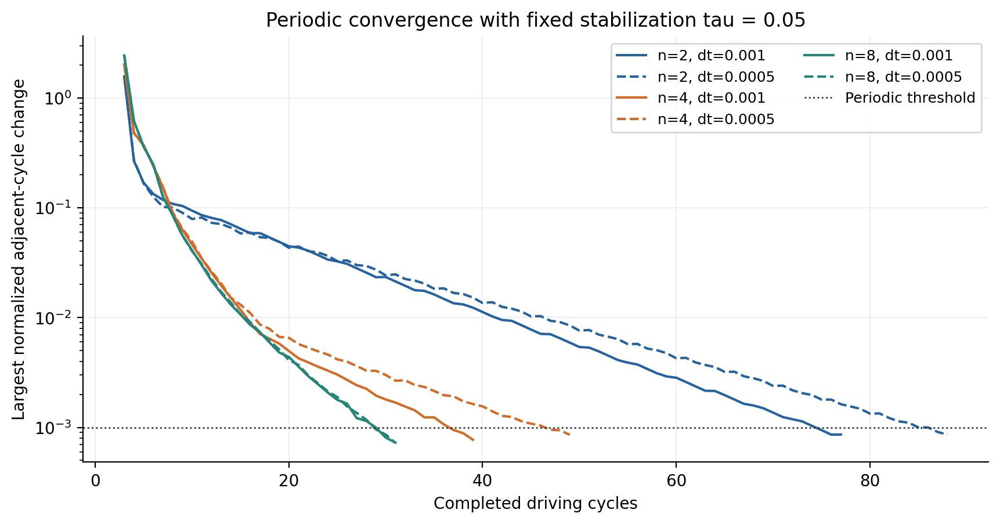
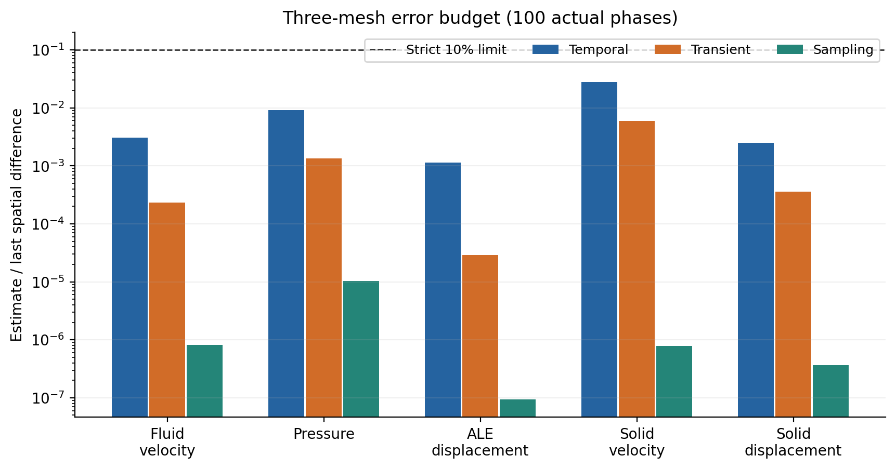
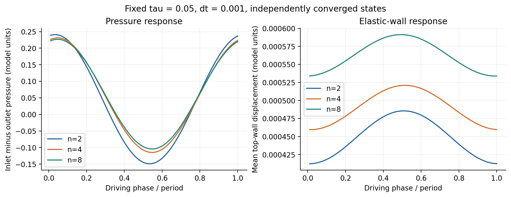

# FSI-NEXT-03 本地接续验收（2026-11-05）

从 `1b33db8c973b67d343d6376e3d8dee557f4af3de` 接续同一开发分支，
main基线为 `4f3a995de45dc1221a5303d7ed8a8a0104bd9f2e`，最终分析修正为 `e4bda862e9feebb63a09200f65bb7c4f4f842337`。
六状态、尾项、真实100相位与完整10%误差预算已经通过；迁移后从原始场重算预算完全一致。
本地验收与自审完成，后续在同一PR执行自动CI；没有合并main或发布文章。

固定τ=0.05，generalized-alpha（默认ρ∞=0.5），2 MPI rank，每rank单线程，周期0.1。
流体参考域[0,1]³，弹性顶壁y∈[1,1.25]；密度/黏度为1，固体密度1，线弹性E=100、ν=0.3。
入口Q(t)=s(t)[0.01+0.005sin(2πt/0.1)]，平滑启动0.02，按各网格P1积分归一化；刚壁无滑移、结构两端/两侧夹持、出口零自然压力。
非线性相对/绝对容差1e-10/1e-12，最多30次迭代；各包的原始JSON保存完整输入。

n=2、dt=.001由旧归档恢复并用本机构建重放完整周期，其余五状态均从初态求解。
所有六状态的尾项和密集采样均在本机实际求解；未修改原物理方程或放宽阈值。
三时间格式瞬态精度矩阵复用[历史通过证据](../time-accuracy-final/README.md)，本机未重跑。

## 实测结果（固定 τ=0.05）

六状态均达到完整场与标量连续三周期的1e-3判据，再各追加三个十周期区间和两周期100相位输出。
以下阶段与采样采用独立真实求解；不是把20相位结果插值为100点。

| n | dt | 达标周期数 | 三块尾项最大实测收缩率 |
|---:|---:|---:|---:|
| 2 | 0.001 | 77 | 0.504594 |
| 2 | 0.0005 | 88 | 0.557667 |
| 4 | 0.001 | 39 | 0.431478 |
| 4 | 0.0005 | 49 | 0.610879 |
| 8 | 0.001 | 31 | 0.287096 |
| 8 | 0.0005 | 31 | 0.322564 |

正式空间差采用100个真实相位；范数为参考体积归一化的lumped节点L2，再取相位RMS。各场保留本身量纲。
压力出口给定零自然压力，比较原始压力，不做任意均值平移。

| 场 | n=2→4差 | n=4→8差 | 观测阶 | 时间/空间差 | 瞬态/空间差 | 采样/空间差 |
|---|---:|---:|---:|---:|---:|---:|
| 流体速度 | 0.0061822716 | 0.00143099925 | 2.111114 | 0.304929% | 0.023141% | 0.000081% |
| 压力 | 0.132207181 | 0.0267037449 | 2.307687 | 0.906798% | 0.134863% | 0.001042% |
| ALE位移 | 0.000196488887 | 5.2648966e-05 | 1.899971 | 0.113386% | 0.002880% | 0.000009% |
| 固体速度 | 0.00315840895 | 0.00175183284 | 0.850333 | 2.765560% | 0.589428% | 0.000078% |
| 固体位移 | 0.000267541001 | 0.000122770467 | 1.123796 | 0.248835% | 0.035717% | 0.000037% |

三个预算分别严格小于10%。时间估计包含dt与dt/2差及两端状态的经验瞬态估计；
对末档空间差涉及的n=4/8不确定量取和，并与n=2估计取最大值。
采样项是50/100真实相位下所报告场差的变化；20相位波形重建误差另存原receipt，不冒充严格采样误差界。

全部周期状态共审计48300行接受历史，12组追加研究共28800行。
最大stage质量残差9.63638891e-16，表面/体散度差3.20923843e-17，
入口流量误差3.43475248e-16，最小几何Jacobian比0.997006645。
100相位无滑移/界面相容最大误差0。

18个归档迁移后逐一核对49305个文件；尾项实际场和完整预算重算与原结果一致，原receipt未改写。

## 构建与针对性验证

- WSL Ubuntu 24.04；仓库锁定 PETSc 3.23.7 Release。使用仓库入口：
  `bash scripts/cloud/run.sh 3.23.7 release explicit /home/tfblab633/EONSim/.cloud build/resume-20261105/tests.json`，
  tests.json 只选择 `fsi_periodic`。编译及1/2/4 rank周期、恢复、定义/截断历史拒绝检查1/1通过，见 `local-release-*`。
- 构建摘要保留其原始 `dirty=true`；随后逐字节核验74份生产源码/头文件/CMake输入与 Git 一致，
  见 `compiled-source-audit.json`。未把摘要改写为 clean。
- 本机构建 SHA-256 为 `2e12cb6ea905c2e600b427371c9aa33e586e7bf0dc91b4493ecbc28225104665`。
  旧粗网格归档878文件SHA及7700行接受历史核验通过；研究脚本指纹相同。
  完整末周期跨构建重放最大场差 `2.20406336764388e-15`，门槛 `2e-9`。
- 归档迁移修正 `e4bda862e9feebb63a09200f65bb7c4f4f842337`：
  `python tests/test_fsi_space_metrics.py` 6/6通过，见 `analysis-test.json`。
  新检查允许路径改变，拒绝检查点内容、网格、额外rank文件或研究定义改变。
- 既有 Debug/Release 其他检查未重跑；复用 `../cadence-debug/`、`../recovery-release/` 的历史通过证据。
  本轮未改变生产方程、时间格式、稳定化、收敛门槛或接口约束。

## 数据与恢复

`fixed-*.tar.gz` 由 `scripts/archive_fsi_periodic.py` 生成；保存全部接受CSV、日志、PVD索引，
最后四周期场，以及最后和前一完整周期的checkpoint。更早PVD中的场引用按原工具契约未归档。
伴随 `.manifest.json` 列出文件大小和SHA。

`tail-*.tar.gz` 和 `sampling-*.tar.gz` 由本目录 `archive-continuations.py` 生成。
密集采样包保存两周期全部真实VTU/PVTU片段；n=2/4尾项包保存三个追加区间的全部场，
n=8尾项包使用 `--tail-endpoints` 保存每个区间末周期的20个真实场相位（即尾项计算实际使用的全部场），
同时保存全部原始PVD索引、完整接受CSV/日志、配置、定义、结果及每个区间末checkpoint。
尾项中未用于估计的中间周期场未收入n=8交付包，完整本机原件仍保留；manifest明确列出保留周期。
核对所有收录PVTU的rank片段引用，并回读压缩包核对全部收录文件SHA。
迁移后还从实际场重新计算三个区间差和几何尾项，必须与原receipt相符。
这补齐了旧 `../fixed-operator/n2-dt001-continuations.tar.gz` 只含索引/日志而缺场片段的局限。
旧包未删除，所有本轮继续计算均为真实求解。

超过48 MiB的压缩包按原有 `scripts/split_fsi_archive.py` 分为4 MiB传输片，存入同名 `.parts/` 目录。
使用 `python scripts/split_fsi_archive.py join <archive>.parts/<archive>.parts.json --output <archive>` 重组，
再对照同名 `.manifest.json` 解压核验。`chunk-verification.json` 记录本轮已经实际重组并验证的整包SHA。

解压后，误差估计通过检查点generation、完整检查点文件SHA、网格SHA及研究定义与源状态绑定，
不要求恢复到原绝对路径。原始receipt的路径和哈希不改写。
不同可执行文件用于续算之前仍需完整周期重放；路径可迁移不等于任意构建或物理定义相容。

`matrix-status.json` 保存每个已完成阶段的实际命令、退出码、耗时和日志路径；
`continue-matrix.py` 是本轮顺序执行入口，`run-python.sh` 记录本地锁定环境。
MPI由同一个文件锁保护的队列串行执行。普通相位/归档分析不启动MPI。

## 失败及限定

首次完整仓库下载无有效进度，保留后改用按需取文件的副本；首次运行遇Windows CRLF，
恢复Git原有LF后重新构建成功。归档辅助脚本首轮在最终输出处误调用整数 `st_size`，
修正后重新归档并完成回读校验；该错误没有涉及求解或数值结果。

固定τ结果只解释本次固定离散算子的网格/时间差异；不能据此宣布默认随dt变化的稳定化设置通过，
也不能单凭两档网格差宣称连续模型渐近收敛。尾项是实测收缩下的经验外推，不是严格误差界。
本轮时间、尾项和采样估计均分别严格小于末档空间差10%。无大规模或性能结论。
