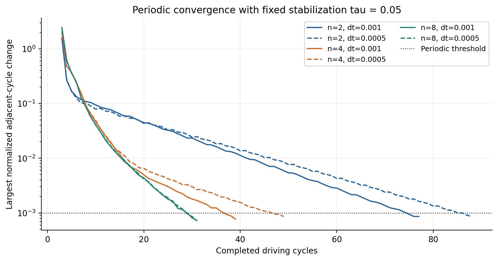
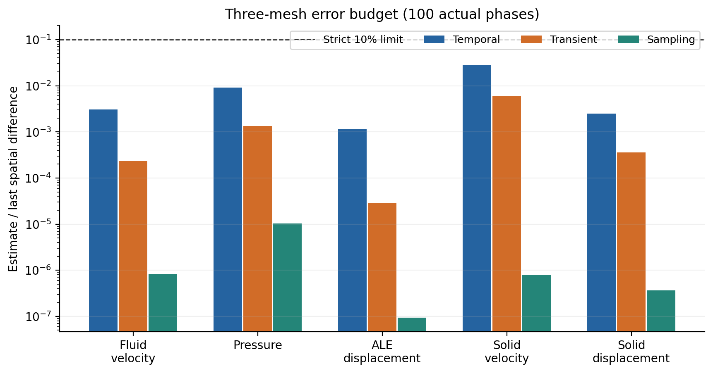
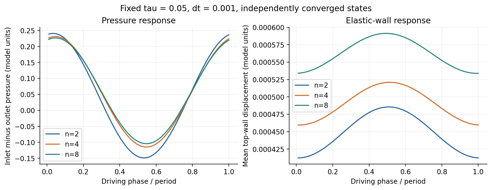

## 实测结果（固定 τ=0.05）

六状态均达到完整场与标量连续三周期的1e-3判据，再各追加三个十周期区间和两周期100相位输出。
以下阶段与采样采用独立真实求解；不是把20相位结果插值为100点。

| n | dt | 达标周期数 | 三块尾项最大实测收缩率 |
|---:|---:|---:|---:|
| 2 | 0.001 | 77 | 0.504594 |
| 2 | 0.0005 | 88 | 0.557667 |
| 4 | 0.001 | 39 | 0.431478 |
| 4 | 0.0005 | 49 | 0.610879 |
| 8 | 0.001 | 31 | 0.287096 |
| 8 | 0.0005 | 31 | 0.322564 |

正式空间差采用100个真实相位；范数为参考体积归一化的lumped节点L2，再取相位RMS。各场保留本身量纲。
压力出口给定零自然压力，比较原始压力，不做任意均值平移。

| 场 | n=2→4差 | n=4→8差 | 观测阶 | 时间/空间差 | 瞬态/空间差 | 采样/空间差 |
|---|---:|---:|---:|---:|---:|---:|
| 流体速度 | 0.0061822716 | 0.00143099925 | 2.111114 | 0.304929% | 0.023141% | 0.000081% |
| 压力 | 0.132207181 | 0.0267037449 | 2.307687 | 0.906798% | 0.134863% | 0.001042% |
| ALE位移 | 0.000196488887 | 5.2648966e-05 | 1.899971 | 0.113386% | 0.002880% | 0.000009% |
| 固体速度 | 0.00315840895 | 0.00175183284 | 0.850333 | 2.765560% | 0.589428% | 0.000078% |
| 固体位移 | 0.000267541001 | 0.000122770467 | 1.123796 | 0.248835% | 0.035717% | 0.000037% |

三个预算分别严格小于10%。时间估计包含dt与dt/2差及两端状态的经验瞬态估计；
对末档空间差涉及的n=4/8不确定量取和，并与n=2估计取最大值。
采样项是50/100真实相位下所报告场差的变化；20相位波形重建误差另存原receipt，不冒充严格采样误差界。

全部周期状态共审计48300行接受历史，12组追加研究共28800行。
最大stage质量残差9.63638891e-16，表面/体散度差3.20923843e-17，
入口流量误差3.43475248e-16，最小几何Jacobian比0.997006645。
100相位无滑移/界面相容最大误差0。

18个归档迁移后逐一核对49305个文件；尾项实际场和完整预算重算与原结果一致，原receipt未改写。

