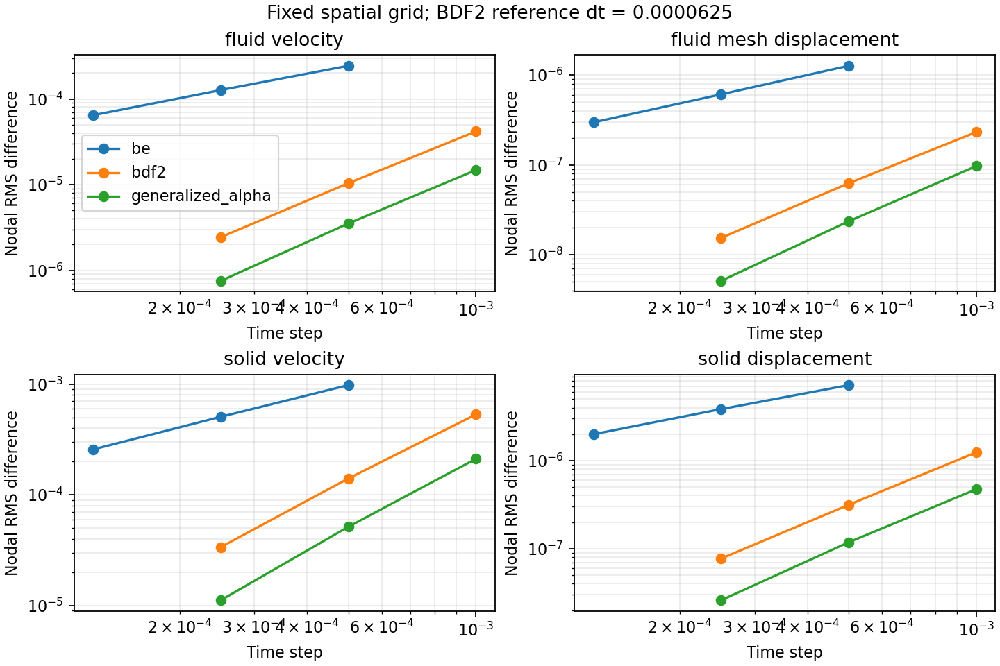
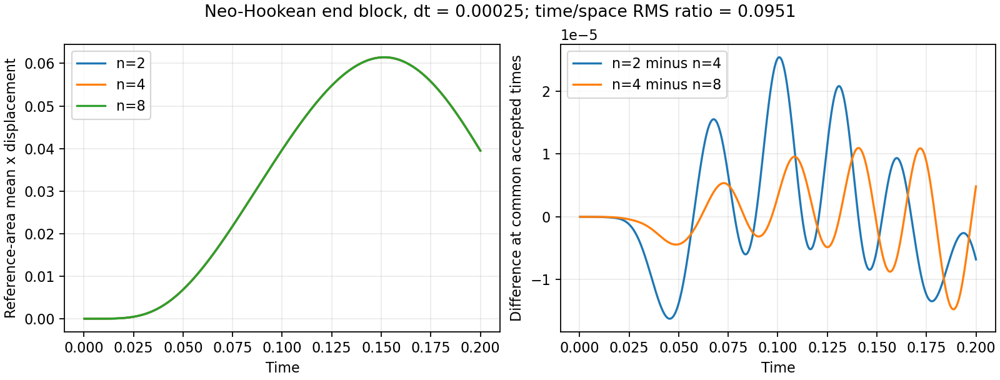
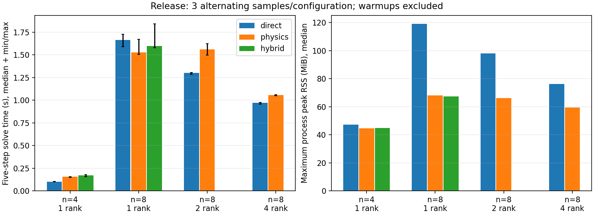

# FSI-NEXT-01：入口、几何可靠性与精度/性能证据

基线 main `06b05c4a6cfb6959e430a9c6042011cc0622510c`（PR #31 已合并）。
实现 `0d93d413f2a9c5ce97665f66925a52a786919937`，界面双域邻接补强与分场时间研究修订 `69692ee`；最终性能测量脚本 `32783a5`。
20 小时为原计划工程量估计，不是实际运行时长或验收指标。全部本地验收与记录完成后才创建 PR。

## 环境与复现

本地 WSL2、Intel i9-12900K、24 逻辑 CPU、约 31.2 GiB 内存；
PETSc 3.23.7、Open MPI 5.0.8、GCC 15.3.0，应用 Debug/Release。
依赖锁 `environments/petsc-3.23.7-linux-64.lock`，详见 [environment.json](environment.json)。
MPI/BLAS/OpenMP 设置如下，后文命令都在该环境内执行：

```bash
.cloud/micromamba run -p .cloud/petsc-3.23.7 env \
  LD_LIBRARY_PATH="$PWD/.cloud/petsc-3.23.7/lib" \
  OMPI_MCA_pml=ob1 OMPI_MCA_btl=self,sm,tcp \
  PRTE_MCA_rmaps_default_mapping_policy=:oversubscribe \
  OMP_NUM_THREADS=1 OPENBLAS_NUM_THREADS=1 MKL_NUM_THREADS=1 <command>
```

仅编译受影响的 `eonsim`、`verify_fsi_diagnostics` 目标并选测相关路径；没有本地全量或 PETSc 3.19.6 运行。
下面是各研究的复现命令；完整原始本地工作目录位于 `build/fsi-next-*`，其必要证据已归档于本目录。

```bash
ctest --test-dir build/cloud-3.23.7-debug --output-on-failure \
  -R '^(fsi_diagnostics|fsi_diagnostics_mpi|fsi_inlet|fsi_pressure_state)$'
ctest --test-dir build/cloud-3.23.7-release --output-on-failure \
  -R '^(fsi_diagnostics|fsi_diagnostics_mpi|fsi_inlet|fsi_pressure_state)$'
python scripts/study_fsi_next.py --executable build/cloud-3.23.7-release/eonsim \
  --mpiexec .cloud/petsc-3.23.7/bin/mpiexec --work build/fsi-next-time-fields --study inlet-time
python scripts/study_fsi_next.py --executable build/cloud-3.23.7-release/eonsim \
  --mpiexec .cloud/petsc-3.23.7/bin/mpiexec --work build/fsi-next-accuracy --study accuracy
python scripts/study_fsi_next.py --executable build/cloud-3.23.7-release/eonsim \
  --mpiexec .cloud/petsc-3.23.7/bin/mpiexec --work build/fsi-next-performance-final --study performance
```

## 状态、边界与 MPI

最终 Debug **4/4**（38.61 s）、Release **4/4**（19.57 s），零失败、跳过；
[Debug JUnit](debug.xml)、[Release JUnit](release.xml)、[状态摘要](state.json)。
这些是最终界面邻接实现的当前通过证据，不把早期失败的尝试合并成通过。
最终代码审查还识别出旧镜像弹性体的独立参考几何分支，追加 `-R '^elastic_fsi_verification$'`：
Debug/Release 各 **1/1**，见 [Debug 补验](debug-legacy.xml)、[Release 补验](release-legacy.xml)。
因此本地两模式各累计 **5 项独立检查通过**；CI 选测映射同步补上这条实际受影响路径。

- 新顶壁算例 BE/变步 BDF2/generalized-alpha：每个接受步的终点入口、1/2 rank 场一致、非零横向壁响应、正几何比、参考面积 1、自由界面平衡及功率平衡。
- 2 rank 在启动中及启动后恢复；入口参数改变拒绝旧 checkpoint；Neo-Hookean BDF2/alpha 各实际触发 16 次拒绝缩步，并与相同实际步长重放比较，场差阈值 `2e-9`。
- 全装配差分 Jacobian 最大相对误差：线弹性 `1.54187e-8`、Neo-Hookean `1.54813e-8`，阈值 `1e-6`。
- 真实刚体 alpha（rho=1、dt=.5、压力均值 -10/幅值 20/周期 2）第四步阶段收敛但终点网格反转。失败时 checkpoint 全部文件 SHA256 不变，失败 CSV 无接受行且无 PVD；实际缩步 1 次后恢复，位置/速度与重放差小于 `2e-9`。
- 原生 1/2 rank oracle：已知体积比 24、解析三角面积积分、阶段正而终点负、跨 rank 内部面消去、只有一个流体和一个固体邻接单元的面被计入。
- `fsi_pressure_state` 是无入口旧路径的受影响回归。本任务没有重新执行全部历史基准；其它模块历史结论仍以其原始提交及证据为准。

## 时间与空间研究

[inlet-time.json](inlet-time.json)：新线弹性顶壁，n=2、T=.04、固定稳定化 tau=.05，
所有方案相同非线性容差 rtol=`1e-11`/atol=`1e-13`；BDF2 参考 dt=`6.25e-5`。
比较真正属于各域单元的节点，分别计算流体速度、网格位移、固体速度/位移的有量纲 RMS 误差，禁止不同物理量混合范数。
BE 步长 `.0005/.00025/.000125`，观察阶 **0.905–1.056**；
BDF2 步长 `.001/.0005/.00025`，阶 **1.892–2.091**；同样步长的 alpha 阶 **2.000–2.223**。
这些是相对于细网格时间参考解的观察阶，不是解析解误差或所有配置的精度保证。

[accuracy.json](accuracy.json)：独立共形端块 Neo-Hookean，n=2/4/8，压力均值 20、幅值 2、周期 .1、启动 .05，T=.2、BDF2。
流体密度/黏度均为 1，固体密度 1、Young=100、Poisson=.3、厚度 .25；单位为内部一致单位，非量纲标定实验。
压力/网格残量 scale=.01、速度/结构为 1；[实际研究输入](study-inputs.json) 保留完整配置。
使用默认随 dt 变化的稳定化；时间细化差异包含该离散项的变化，不能解释成固定半离散方程的纯时间阶。
rtol=`1e-11`、atol=`1e-13`；最终各空间网格统一 dt=`.00025`，n=8 参考 dt=`.000125`。

| 整条面积平均轴向位移轨迹的 RMS 差异 | 实测值 |
|---|---:|
| n=2 与 n=4 | 1.02029935e-5 |
| n=4 与 n=8 | 5.60977069e-6 |
| n=8 时间步减半 | 5.33435685e-7 |
| 时间差 / 最后空间差 | **0.09509 < 0.25** |

轨迹差随空间加密减小；只有三档且没有精确解，不宣称已达到预定空间阶。最终时刻的单点位移不单调，不能只选该时刻推断收敛。
实际接受时间插值到较粗轨迹进行比较；完整接受步 CSV 保留面积、几何与平衡信息。
文件 `space-n2.csv`/`space-n4.csv`/`space-n8.csv` 和 `time-reference.csv` 对应最终数据。

原 accuracy 进程载入旧 600 s 子进程超时设置，完成 dt=.00025 后主动终止（退出 143），没有把被取消的细参考样本计为成功。
最终用 [finish_accuracy.py](finish_accuracy.py) 继续：复用已成功的 n=8/.00025 轨迹，重算 n=2/4，再以 2400 s 超时完成 n=8/.000125。
该续跑脚本的实际命令为 `python build/finalize_fsi_accuracy.py`；公共研究脚本已具备相同超时和统一空间步长逻辑。
这些空间轨迹来自 `0d93d41` 方程实现；后续 `69692ee` 仅收紧界面面片的双域邻接选择及错误消息，没有改变这些平面共形算例的面集合或方程。
复用已有完整轨迹，本次不因文档或未影响路径的提交而重算。

## 配对性能测量

[performance.json](performance.json) 保留 **10 个预热 + 30 个正式样本**；
[performance-summary.json](performance-summary.json) 给出中位数、范围与场误差，
[原始报告/输入](performance-raw.txt.gz) 保留每次求解器树及配置。
新 Neo-Hookean 顶壁、n=4/8（双域分别 768/6144 个 Tet4，总独立 DoF 625/5057），
alpha rho=.5、dt=.004、5 步至 T=.02。每个配置预热一次，三次交替正反序测量；
默认直接法与 physics/hybrid 先在 1 rank 筛选，再对 n=8 的 physics 与直接法测 2/4 rank。
预热不参与统计，研究之间不并行抢占 CPU；全进程测量包含 FSI 几何与界面诊断，求解器内部计时不包含接受步后处理。

各配置使用相同 rtol=`1e-12`/atol=`1e-14`，外层 KSP rtol=`1e-12`/atol=`1e-16`。
逐域比较最终物理场、算法加速度和坐标，同 rank 直接法及 1 rank 直接法的最大差 **6.16e-11 < 2e-9**。
`solve_seconds` 为五步求解器报告之和，再对三次求解取中位数；它不包含程序启动、网格读入和输出等开销，
全进程时间另存 `wall_seconds`。assembly/ghost 是 solve 内的分项，不能重复相加。
RSS 是进程高水位最大值，另有所有 rank 高水位之和；不是分配器精确活跃内存。

| n / rank | recipe | solve 中位数 s（范围） | assembly s | 总线性迭代 | 最大进程 RSS MiB |
|---|---|---:|---:|---:|---:|
| 4 / 1 | direct | .1024 (.1019–.1042) | .0654 | 10 | 47.3 |
| 4 / 1 | physics | .1568 (.1501–.1579) | .0979 | 177 | 44.6 |
| 4 / 1 | hybrid | .1722 (.1572–.1786) | .0994 | 145 | 44.7 |
| 8 / 1 | direct | 1.6666 (1.5924–1.7288) | .6409 | 11 | 119.1 |
| 8 / 1 | physics | 1.5273 (1.5045–1.6712) | .8709 | 259 | 68.1 |
| 8 / 1 | hybrid | 1.5978 (1.5799–1.8432) | .9078 | 195 | 67.3 |
| 8 / 2 | direct | 1.3000 (1.2870–1.3068) | .5275 | 11 | 98.0 |
| 8 / 2 | physics | 1.5620 (1.4973–1.6238) | .7472 | 253 | 66.2 |
| 8 / 4 | direct | .9724 (.9562–.9758) | .3302 | 11 | 76.1 |
| 8 / 4 | physics | 1.0567 (1.0491–1.0624) | .4696 | 253 | 59.3 |

在这些小问题上，n=4 直接法更快；n=8 单 rank 分块中位数稍低，但范围重叠，不能宣称稳健加速。
n=8 的 2/4 rank 直接法更快，physics 最大进程 RSS 较低。physics 的 2 rank 时间未改善，
该结果不支持生产规模扩展承诺，也没有据此引入新的缓存、后端或改变默认求解器。
局部使用建议仍以直接法为小规模基线；内存受限时可在同容差下对照分块方案。

## 已处理的失败与限制

1. 测试从 alpha 配置复制到 BE/BDF2 时遗留 rho 参数，解析器正确拒绝；修正测试配置，保留原校验。
2. 负例与成功恢复复用输出前缀，重复运行时旧 PVD 造成假失败；改为独立 failed/recovered 前缀。
3. 初始 BE 粗步的固体位移观察阶 .844，未达 .85 门槛；进一步细化步长，未放宽门槛。
4. 初始空间研究的时间差是空间差约 6.98 倍；逐级细化时间并重算空间网格后降至 9.5%。
5. 仅以界面节点筛选流体外表面不足以确认实体邻接；加入固体面记录与双域计数 oracle。
6. 常压压缩的探索先触发 Newton/试探几何失败，不能用作阶段成功而终点失败的证据；最终采用变号周期压力得到真实负例。
7. 首轮性能使用 rtol=1e-10/atol=1e-12，n=8 physics 的网格位移差仅 2.20e-14，但网格算法加速度差 1.027e-8 超过原场阈值；dt^-2 放大了位移求解误差。未删去加速度，也未放宽场门槛。
8. 仅收紧非线性容差后，默认外层 KSP atol=1e-13 大于新非线性目标，physics 在第一步 SNES reason=-6 失败；同时统一收紧线性容差后，重新预热并完成全部矩阵。
   [失败尝试日志](performance-failed-attempts.txt.gz) 单独归档，不进入最终性能统计。没有修改生产默认容差。

能力边界：固定单入口、共形 Tet4、同分区恢复；无非匹配界面、重网格、多速率或生产规模验证。
面积与最小 det F 是诊断，不是完整网格质量判据。知识文章仍在 `website/drafts/`，未经人工审核，不发布。

## 图与静态检查

`MPLCONFIGDIR=/tmp/eonsim-matplotlib python3 docs/research/data/fsi-next-2026-11-03/plot_results.py`
使用 matplotlib 3.6.3 从归档数据生成下图；性能图已实际检查。





`python3 tests/test_ci_selection.py`：26/26，通过；离线选测执行的 `tests/test_cloud_evidence.py`：6/6，通过。
`git diff --check` 和新文档相对链接检查通过；预计 PR 选取 28 个相关 CTest，最终以云端 inventory 为准。
数值 PR CI 结果在创建 PR 后另行记录，不能用本地结果替代云端结果。
