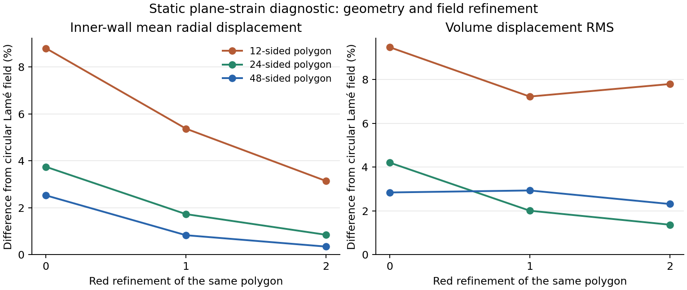

> **轻量进度快照 / 2026-11-09**：此分支只含当前代码、进度、报告和清单。本轮新增的1114个原始压缩包（约22GB）未上传，完整历史与数据保留在本地`codex/fsi-production-48h-20261107`、提交`407c655`。下文“已归档/已提交”的历史记录指该完整本地历史，不表示原始包存在于本快照。后台计算和定时任务已停止，项目验收尚未完成。

# Static quarter-annulus diagnostic

Source checkpoint `6093f01`, frozen EONSim `b072cc8`, PETSc3.23.7 Release,
one process on CPU22. [archives.json](archives.json) records108 files read
back and SHA256 checked; [manifest.json](manifest.json) identifies every raw
input, command, log, field and analysis file. The executable is identified
by its hash and is not included. No coupled physical qualification follows.

R=1, outer radius1.2, L=12, E=1000, nu=.3, constant inner pressure.02 and
zero outer pressure. Quarter-domain symmetry fixes only the corresponding
normal displacement. Both ends fix only axial displacement, leaving radial
motion free. This differs from the fully clamped ends of the coupled study.
Seeds use12/24/48 circumferential sectors, two radial layers and12 axial
layers, followed by0/1/2 red refinements of each unchanged polygon.

The circular plane-strain Lamé solution is evaluated as an analytical
extension on the polygon, not as that polygon's exact boundary-value solution.
Its inner displacement is1.0872727272727274e-4. See [summary.json](summary.json).

| Sectors | Mean radial error, levels0/1/2 (%) | Volume displacement RMS, levels0/1/2 (%) |
|---|---|---|
|12|8.80054 /5.36954 /3.13666|9.47973 /7.22344 /7.79624|
|24|3.74230 /1.72288 /.841732|4.20234 /2.00386 /1.36346|
|48|2.52320 /.823358 /.338404|2.83780 /2.92906 /2.30983|

The field errors are not all monotone. No asymptotic rate or pure geometry
error is inferred by subtracting norms. [Same-polygon differences](static-nested-differences.json)
use the exact fine-grid P1 mass norm after verifying nested interpolation;
the S12 second difference is larger than its first. The figure preserves this
behavior and was visually checked for labels and clipping.

The original4/6 quadrature comparison failed its predeclared1e-9 check.
That attempt, successful numerical solution and failed analysis are retained.
The recovery reused the hash-identical first solve and used6/8 quadrature;
all nine analyses pass1e-9 (largest change1.364e-10). Eight further numerical
solves were performed. Strain energy agrees with half the pressure boundary
work within4.45e-14 relative. Positive geometry, node mapping and component
constraints are checked explicitly. These checks do not make the circular
extension an exact polygon solution.

Reproduction helpers and their exact source dependencies are stored in the
archives. `study-lame-quarter.py` generated/solved the nine cases;
`finish-static-and-time-analysis.py` read the completed fields, produced the
PNG/SVG and checked five manufactured sinusoidal phase-sampling identities.
Only those manufactured interpolation checks were run; no C++ changes,
rebuild, unrelated regression rerun, performance or MPI claim was made.
