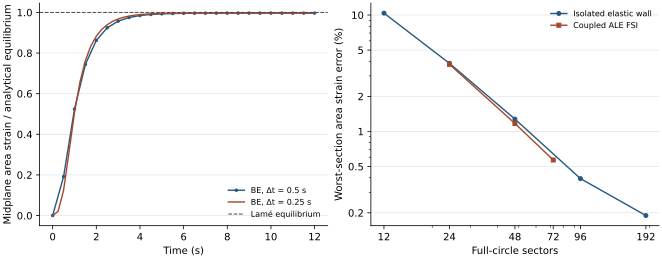

# Thick-wall pressure–area benchmark · 2026-11-20

Internal pressure of 0.02 Pa in a synthetic, linearly elastic thick tube gives an analytical bore expansion of **0.001087272727 m** and a first-order **0.2174545455%** area increase. The 192-sector isolated wall reproduces the area increase to 0.1894%. In the monolithic fluid–wall case, the 72-sector backward Euler solution gives a 0.5684% area error at 12 s. All area errors below are relative to the analytical expansion. A reported 1% error therefore means 1% of the expansion. [Equations, boundary conditions and run commands](../../../development/PRESSURIZED_ELASTIC_TUBE.md)

The curves on the left use the same 48-sector mesh and a one-second pressure ramp. The lines on the right connect sampled meshes with simultaneous refinements in several directions. The coarsest coupled point is at 8 s, the other two at 12 s. The file archive includes a separate set of single-direction refinements. [Plot source](plot_response.py)

## Isolated elastic wall

| Full sectors / wall layers / axial cells | Tet4 cells | Worst bore radius and area error | Displacement vector L² error |
|---|---:|---:|---:|
| 12 / 1 / 2 | 36 | 10.3854% | 9.7554% |
| 24 / 2 / 3 | 216 | 3.8451% | 2.8390% |
| 48 / 4 / 6 | 1,728 | 1.2770% | 0.7993% |
| 96 / 8 / 12 | 13,824 | 0.3933% | 0.2131% |
| 192 / 12 / 16 | 55,296 | 0.1894% | 0.0800% |

The largest change in normalized sectional compliance between the two finest meshes is 0.20393%. At fixed 48 sectors and six axial cells, increasing the number of wall layers from 1 to 2, 4 and 8 reduces the area error from 5.560% through 2.496%, 1.277% to 0.768%. At fixed four layers and six axial cells, the 24/48/96-sector errors are 2.203%, 1.277% and 1.057%. The first two jointly refined meshes miss the predeclared 2% radius/area criterion. Radial and linear area errors coincide here because reference vertices lie on a regular polygon and its area derivative gives the same edge-weighted radial average.

On 96/8/12, doubling the pressure doubled every stored displacement component exactly at the reported precision. Against the serial solve the maximum displacement differences were 2.36e−16 m on two ranks and 2.16e−15 m on four. At 192/12/16 the relative difference between external pressure work and twice the computed strain energy was 1.56e−13. The affine equal-pressure patch gave maximum displacement errors of 6.58e−18 m and 1.70e−17 m in the one- and two-rank tests.

## Monolithic hydrostatic FSI

| Sectors / wall / fluid radial / axial | Δt (s) | End time (s) | Worst area error | Final maximum fluid speed (m/s) |
|---|---:|---:|---:|---:|
| 24 / 2 / 3 / 3 | 0.5 | 8 | 3.7725% | 1.50e−6 |
| 48 / 4 / 4 / 6 | 0.5 | 12 | 1.17035% | 1.07e−7 |
| 48 / 4 / 4 / 6 | 0.25 | 12 | 1.17024% | 9.96e−8 |
| 72 / 6 / 5 / 8 | 0.5 | 12 | 0.56838% | 8.01e−8 |

The 24-sector mesh misses both the 3% area and 1e−6 m/s settling targets. At 48 sectors halving the time step changes normalized sectional area by at most 0.000113%. The final fluid pressure RMS at Δt = 0.5 s is 3.25e−6 times the imposed pressure. The final interface displacement and velocity coincide. The largest one-to-two-rank difference across the five recorded fluid and solid fields is 3.47e−18 in their respective SI units. Halving the pressure changes normalized sectional compliance by 0.05446%. At the same 48-sector resolution the coupled and isolated sectional responses differ by up to 0.10876% of the analytical expansion. The static linear wall loads its reference surface. The fluid pressure acts on a moving bore in the coupled problem.

### Fluid volume during expansion

The audit recomputes tetrahedral volumes, oriented facet velocity fluxes and the BE wall velocity at every step. The Euler boundary flux sums both ends, both symmetry planes and the moving wall. The integral over both open ends should also equal the final volume gain. The latter comparison uses a finite volume increment and an end-of-step velocity quadrature.

| Δt (s) | Volume gain (m³) | Integrated end inflow (m³) | Signed imbalance / gain | Maximum absolute Euler net flux (m³/s) |
|---:|---:|---:|---:|---:|
| 0.5 | 0.003395840 | 0.003396216 | −0.011076% | 5.03e−14 |
| 0.25 | 0.003395843 | 0.003396061 | −0.006444% | 2.24e−14 |

Both symmetry fluxes sum to zero. The largest fluid wall velocity discrepancy from the displacement difference over Δt is 4.34e−19 m/s. The stored history includes the instantaneous ALE volume balance, center-section area and all boundary terms.

## Independent svFSI comparison

The two programs start from rest under a constant common end pressure, with identical reference meshes, geometry, material coefficients, pressure and rollers. They use generalized-alpha at spectral radius 0.5 and output at 0.5 s intervals to 12 s. On 48 sectors at 0.02 Pa the worst-section area errors are 1.170215% in EONSim and 1.170217% in svFSI. The largest inter-code difference on any section is **0.00002265% of the analytical area expansion**. At 24 sectors both miss the circular reference by about 3.74%. Cross-code agreement and convergence toward the circular solution test different aspects of the calculation.

Each archived svFSI input is regenerated from the corresponding EONSim case during replay. Both equation histories must cover every step and meet the unchanged 1e−8 nonlinear criterion. On 48 sectors their maximum final normalized residuals were 7.07e−9 (fluid/structure) and 8.76e−9 (mesh). The external VTU data contain separate mechanical and mesh displacements. The comparison checks the domains, original tetrahedra, interface fields, pressure and the positivity of endpoint fluid volumes before evaluating area.

| Full sectors | Pressure (Pa) | EONSim worst area error | svFSI worst area error | Maximum inter-code difference / analytical expansion | Analytical gate |
|---:|---:|---:|---:|---:|---|
| 24 | 0.02 | 3.7427% | 3.7429% | 0.00023293% | Miss |
| 48 | 0.02 | 1.170215% | 1.170217% | 0.00002265% | Pass |
| 48 | 0.01 | 1.2236% | 1.2236% | 0.00002259% | Pass |
| 72 | 0.02 | 0.568274% | 0.568259% | 0.00001939% | Pass |

On 72 sectors, a GMRES subspace of 450 gave a complete external history.
Its maximum final normalized residuals were 9.21e−9 and 9.15e−9 for the
coupled fluid/structure and mesh equations. The minimum endpoint fluid
Jacobian ratio was 1.0004393. The archived field and histories permit an
independent check of all these numbers.

Two failed attempts are archived. Spectral radius zero gave nonfinite arithmetic in the native coupled predictor where the factor `γ−1` vanishes. The floating-point-trap backtrace and original input are in `failed/`. An initial 72-sector external solve exhausted the GMRES subspace at 150 while the residual still exceeded tolerance. The alternative subspace setting preserves the linear and nonlinear convergence tolerances. [Pinned predictor](https://github.com/SimVascular/svFSI/blob/94a2ff5cab2ad9e89e9bf12e0de36eaaa9b85571/Code/Source/svFSI/PIC.f#L96) · [Upstream coupled input](https://github.com/SimVascular/svFSI-Tests/blob/c38514ff7d7128583ec530971080dd0fac8026bf/07-fsi/ale/03-pipe_3D/svFSI.inp)

## Reproduction and provenance

The study used the unchanged Release solver from main `89a1a3d823396df02fa9e8acb5ded36b70938e9c`, executable SHA-256 `4cbc4dccc584da8cab684b5721226feadf262323ca92a0e1a0c6ae0196c3546f`, locked PETSc 3.23.7. Case generation, comparison and replay are in `d08958e1e968640a35315b0571a849fc234ef36a`. The wall branch was also built and its `lame_wall` and existing `fsi_tube` CTests ran in Release. Default one-layer output from the generator was compared byte-for-byte with the main version. The receipts, mesh hashes, exact case files, runtime preflight and full iteration logs accompany the raw fields.

The external executable was built from unmodified SimVascular/svFSI release 2022.09.26, commit `94a2ff5cab2ad9e89e9bf12e0de36eaaa9b85571`, with SHA-256 `76fa8bccbe419b4c8cf95d40c74b64290d2b55079750e7f44ef270f7c8760c06`. Read its compressed binary VTUs with Python VTK 9.3.1. All EONSim replay calculations use the Python standard library. Run from the repository root. [Upstream source](https://github.com/SimVascular/svFSI/tree/94a2ff5cab2ad9e89e9bf12e0de36eaaa9b85571)

~~~bash
data=docs/research/data/lame-wall-2026-11-20
mkdir -p build/lame-replay
tar -xJf "$data/raw.tar.xz" -C build/lame-replay
python3 "$data/replay.py" build/lame-replay --verify --external --output build/lame-checked.json
~~~

`--verify` checks all 381 files in the manifest and all measured values against the recorded output. The archive contains 13 isolated EONSim wall solves, 12 coupled EONSim solves, four cross-code pairs and both rejected upstream inputs. Its SHA-256 is `57a3e188cee7f9bae30ed5c54ccc5b311dbb28786474610440b243e19d843092`. Omit `--external` for the EONSim-only replay. The analytical and cross-code evidence covers the equilibrium of a straight, small-strain tube at two pressures. Dynamic pressure–area phase, pulse-wave speed, curved vessels, tissue support and scaling to multiple nodes require additional measurements. [Manifest](manifest.json) · [Measured values](results.json) · [Raw fields and logs](raw.tar.xz)

In a disposable local merge, the rigid-tube implementation at `f8d30f1` and
the wall implementation at `7800abe` merged cleanly. Both Python suites
(11 and 6 cases) and both numerical smoke drivers passed against the
combined scripts and the rigid-flow Release binary. The latter contains
the complete combined C++ source changes. In this mixed-branch run the
maximum serial-to-MPI rigid-flow field difference was 7.32e−19 and the
same-partition restart difference was zero.
