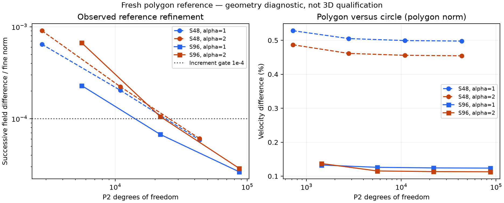

# Fresh independent polygon reference

Recomputed from the repository tube generator: S48/S96 radial4 seeds, straight-facet red refinement levels0..3; complex scalar P2 problem (-Delta+i alpha²)U=.01 with zero wall. All16solves completed. S48 final43393nodes, S96 final86785nodes. Original successive-field1e-4, quadrature6/8 change1e-9, manufactured error1e-11, true algebraic residual1e-11 gates unchanged.

S48 alpha1/2 velocity differences from circular analytic reference are0.4978303%/0.4544775%; S96 are0.1238034%/0.1129775%. Final field increments5.89228e-5/6.10213e-5 and2.64777e-5/2.89011e-5 pass. Velocity norms integrate over polygon; flow compares full polygon flux with circle flux.

macOS longdouble has the same epsilon as float64. Double-double residual/state corrections therefore replace platform-dependent extended arrays. S96 final initial residuals2.37782e-11/2.05734e-11 exceed original gate, one correction gives1.60085e-23/2.75618e-23 for the assembled binary64 matrix. Independent80-digit Decimal checks selected actual CSR rows. This is not a continuum error claim. Square P2 mass/stiffness/three nonzero quadratic manufactured checks and exact nested quadratic transfer on skewed triangles pass.

All raw NPZ mesh/hi-lo states and outputs remain local; complete archive decoded and each member SHA verified. Source helpers, reports and manifest captured here. These observed field increments are not rigorous a-posteriori bounds. This geometry diagnostic does not replace3D time/space/tail/FSI qualification or permit subtraction of scalar error norms.

Figure33803 completed0 and PNG visually inspected; input/output hashes recorded in figure-provenance.json. Fontconfig emitted cache-location warnings, but the output is rendered and readable.
