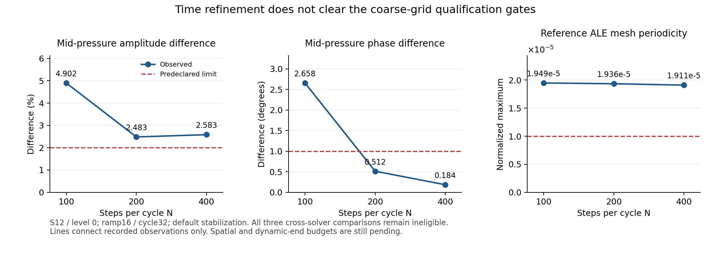

> **轻量进度快照 / 2026-11-09**：此分支只含当前代码、进度、报告和清单。本轮新增的1114个原始压缩包（约22GB）未上传，完整历史与数据保留在本地`codex/fsi-production-48h-20261107`、提交`407c655`。下文“已归档/已提交”的历史记录指该完整本地历史，不表示原始包存在于本快照。后台计算和定时任务已停止，项目验收尚未完成。

# Coarse pressure tube: N400 and actual time/sampling differences

Completed S12/level0, default stabilization, ramp16/cycle32: both programs
reached12800 steps. EONSim remains the frozen b072cc8 Release executable
`2692b6480cddebec96bd4f74479963d732aa483dc5b2be5a7635ac57e041eb12`.
Reference source is unchanged svFSI7bdb74c; General pressure is evaluated at
the alpha_f stage, with explicit linear absolute floor1e-26 and unchanged
nonlinear1e-10. The controller originated at6093f01; exact frozen analysis
sources and commands are archived at capture checkpoint054b64a.

[Manifest](manifest.json) lists8289 original files, independently read back
from16 archives totaling179991408 bytes. [Archive hashes](archives.json)
also retain the omitted executable's exact hash. Original fields were neither
replaced nor deleted. `work/` and `host-d/` archive prefixes name the declared
storage roots; this capture uses `work/`. Each archive contains at most64MiB
uncompressed input and is below the repository's single-file limit.

The recorded commands include `run-pressure-n400.py` and the copied analysis
controller `analyze-pressure-time400.py`. Analysis uses the same audited
implementation as N200, SHA256
`9083406301d953607c8c71f95f2425094b4f3e21aeb273ed2a539ec1d622ef0a`.
No unrelated C++ rebuild or numerical regression was run for this read-only analysis.

## Qualification remains incomplete

EON's final-cycle maximum five-field change is1.94694e-6 and its last-two-cycle
periodicity passes1e-5. Reference equation logs all pass strict relative
convergence, and both programs pass positive geometry and physical quality
checks. Reference ALE displacement still fails periodicity: final-cycle
maximum1.91055e-5, RMS1.90900e-5. Taking both required cycle differences gives
maximum1.91125e-5. The pressure phase improves with time refinement, while
the amplitude and mesh periodic gates remain failed.

The [plot inputs](time-trend-observations.json), plotting source and
[four verified derived files](time-trend-files.json) are separate from the
raw archive. PNG layout was visually inspected. Lines only join observations;
there is no fitted convergence rate or extrapolated limit.

[Cross-code observables](comparison.json): radial and projected-area amplitude
differences2.43248% pass5%; mid-pressure amplitude2.58266% fails2%, while
phase.183517degrees passes1degree. Left/right flow amplitudes1.21391%/1.12812%
and phases.535093/.509128degrees pass their individual limits. The mid-wall
mean remains8.31523% from the infinite circular Lamé value; geometry and
dynamic end effects are still separate unresolved budgets. Because reference
periodicity fails, these observable passes do not confer comparison eligibility.

## Independent field differences

[Summary](summary.json) separates time, final-cycle tail and actual200→400
phase sampling for all five fields. N200→N400 uses200 exact common phases;
tail31→32 and sampling use the actual400 phases. Sampling linearly reconstructs
every-other stored state and includes the real preceding endpoint. Norms are
exact consistent P1 mass norms on the same reference domains, normalized by
the unchanged physical scales. These are pairwise differences, not an
additive error decomposition or a continuous-time quadrature claim.

| Field | EON N200→N400 RMS | svFSI N200→N400 RMS |
|---|---:|---:|
| Fluid velocity | .00687472 | .00425648 |
| Fluid pressure | .0126438 | .0111299 |
| Fluid mesh displacement | .00760961 | .00599650 |
| Solid velocity | .0102740 | .00873196 |
| Solid displacement | .0102523 | .00871400 |

EON tail RMS is at most1.37828e-6 and actual sampling RMS at most4.55494e-5.
Reference tail includes the failed mesh RMS1.90900e-5; its sampling RMS is at
most4.48662e-5. Reference periodic prerequisites remain explicitly false in
each comparison. The final same-time-step spatial denominator is pending,
so none of these numbers constitutes a10% error-budget pass. The earlier
[N100/N200 study and independent mesh replay](../pressure-tube-time-2026-11-08/README.md)
remain distinct preserved evidence.
