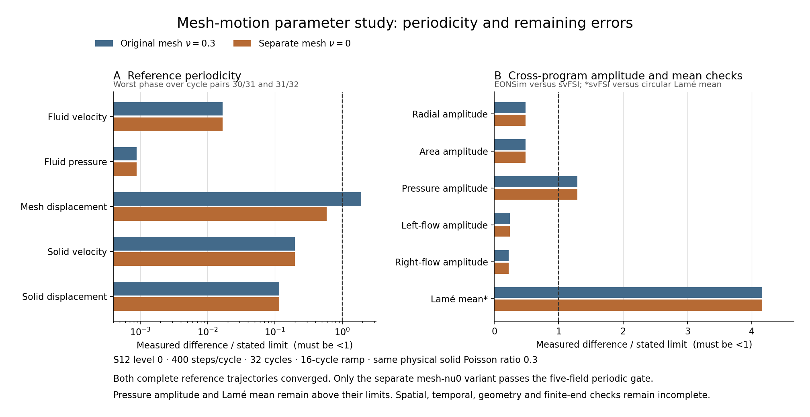

> **轻量进度快照 / 2026-11-09**：此分支只含当前代码、进度、报告和清单。本轮新增的1114个原始压缩包（约22GB）未上传，完整历史与数据保留在本地`codex/fsi-production-48h-20261107`、提交`407c655`。下文“已归档/已提交”的历史记录指该完整本地历史，不表示原始包存在于本快照。后台计算和定时任务已停止，项目验收尚未完成。

# Completed coarse reference: mesh-motion parameter comparison

These plots use two completed, strictly converged S12 level0/N400 reference
trajectories: the original mesh Poisson ratio0.3 and a separate mesh ratio0
variant. Both use32 cycles and a16-cycle ramp. The physical solid Poisson
ratio stays0.3, and the same original EONSim trajectory is used in both
observable comparisons. This is an analysis at source `30828c5`.



The worst mesh-displacement periodic difference across cycle pairs30/31
and31/32 decreases from1.9112481e-5 to5.8952298e-6, crossing the unchanged
1e-5 gate. The separate variant passes all five periodic fields and the
quality checks. Original nu.3 remains failed.

The middle-pressure amplitude discrepancy changes only from2.5826566%
to2.5824666%, still above2%. The reference Lamé mean discrepancy stays
about8.31525%, above its2% diagnostic target. Radial/area and flow
amplitude checks remain below their individual5% limits. The figure uses
the actual per-metric limits, with a dashed ratio1 line; its left axis is
logarithmic and its right axis linear. Phase checks are not plotted.
The Lamé comparison remains a diagnostic pending geometry and finite-end
bounds. This experiment does not qualify the unfinished space/time budgets
or establish complete production acceptance.

[Extracted numbers](plot-data.json) retain source audit/comparison hashes.
[File hashes](files.json) verify the copied data, script and PNG/SVG. Raw
trajectory evidence is archived separately; the plot does not replace it.
Both final panels were visually checked for labels, scales and clipping.
The [SVG](reference-nu0-gates.svg) preserves editable text.

Replot the archived numbers with Python, NumPy and Matplotlib3.6.3:

```text
python3 plot-reference-nu0-gates.py --data plot-data.json --output new-plot-directory
```

No numerical solver or previous acceptance test was rerun for this figure.
