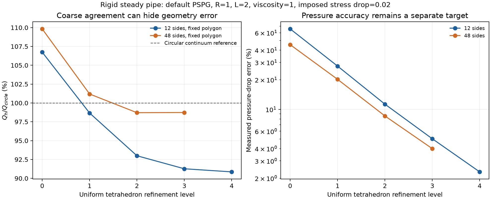

# FSI-PROD-02A: steady rigid-tube flow evidence

Local acceptance passed on 2026-11-06. Source:
`a0d228764850fa838229acb6a6e613933070490f`, based on merged main
`dc378529538259567a78cea9820a202a6187809c`. Branch:
`codex/fsi-tube-qualification`. This is a steady flow-quantity qualification,
not completion of the full PROD-02 production stage.

[PR #38](https://github.com/saitoasukakawaii/EONSim-new/pull/38) is open, unmerged.
[Cloud numerical CI](https://github.com/saitoasukakawaii/EONSim-new/actions/runs/42236840428)
passed 26/26 selected tests in both Debug and Release, zero failed/skipped tests;
35 Python checks and the incremental receipt passed.
[Website/draft isolation](https://github.com/saitoasukakawaii/EONSim-new/actions/runs/42236840526)
passed. [cloud-ci.json](cloud-ci.json) records exact head/base, tested merge commit,
matching Git trees, resource data and counts. CI runs the small tube regression,
not the complete eleven-state study. The manual 3.19.6 job was not requested.

## Results

R=1, L=2, rho=mu=1, imposed normal-stress drop=.02, Q_circle=pi/800,
Re=.0025, alpha=0. Default steady PSPG tau=h²/(4mu), h=(6V)^(1/3).
PETSc 3.23.7, application Release, SuperLU_DIST direct solve, relative/absolute
tolerances 1e-11/1e-13, maximum 30 iterations. Synthetic consistent units.
Boundary conditions and reference derivation:
[interface and study](../../../development/RIGID_TUBE_QUALIFICATION.md).

| Sides | Red-refinement level | Nodes | Tetrahedra | Circular flow error % | Measured pressure-drop error % |
|---:|---:|---:|---:|---:|---:|
| 12 | 0 | 75 | 216 | 6.738548 | 65.725177 |
| 12 | 1 | 425 | 1,728 | 1.334702 | 27.546764 |
| 12 | 2 | 2,817 | 13,824 | 7.005628 | 11.302486 |
| 12 | 3 | 20,417 | 110,592 | 8.731503 | 5.031515 |
| 12 | 4 | 155,265 | 884,736 | 9.142316 | 2.319132 |
| 24 | 2 | 5,625 | 27,648 | 1.424476 | 9.592091 |
| 24 | 3 | 40,817 | 221,184 | 2.236785 | 4.105803 |
| 48 | 0 | 291 | 864 | 9.827077 | 45.462461 |
| 48 | 1 | 1,685 | 6,912 | 1.190114 | 20.215611 |
| 48 | 2 | 11,241 | 55,296 | 1.289445 | 8.577903 |
| 48 | 3 | 81,617 | 442,368 | 1.264676 | 3.993089 |

The original thresholds were preserved: finest 48-side flow error <2%; decreasing
fixed-polygon successive flow changes with final change <1% of Q_circle; 1/2-rank
maximum field difference <2e-9; global net flux <1e-10. Final changes are
0.410813% (12 sides) and 0.024769% (48 sides). MPI max difference is
2.77555756156289e-17 on the 12-side level-1 mesh; maximum net outward flux over
the eleven serial states is 4.119968255444917e-17.

The initial level-2 stop failed: last changes 5.670926% and 2.479559% exceeded
1%. [The rejection](initial-level2-rejection.json) is retained. Additional
states were run without repeating the original seven serial solves or the MPI
comparison. There were no numerical solver failures in this study.

The continuum geometry intervals Q_polygon/Q_circle are [cos(pi/s)^4,1]. These
are independent analytical bounds, not FE acceptance constraints. The 12-side
coarse agreement is cancellation, not proof of circular geometry accuracy.
The 48-side level-3 mean-to-end flow difference is 0.394695% of Q_circle, while
measured end pressure still differs by 3.993089% from the imposed normal-stress
drop. Global flux cancellation is not pointwise incompressibility. Pressure,
local divergence, temporal behavior, elastic walls and asymptotic orders are
not qualified by the flow gate.



## Actual verification

The repository's `scripts/cloud/run.sh` was used under Ubuntu 24.04/WSL2 with the
existing locked PETSc 3.23.7 prefix. Each rank used one OMP/OpenBLAS/MKL thread,
OpenMPI ob1 with self/sm/tcp, and a unique TMPDIR. No native Windows solver or
PETSc 3.19.6 claim. The host exposed about 31 GiB to WSL; the largest direct
solve was observed near 28 GiB RSS, but no controlled performance samples were
taken and no scaling or memory-efficiency conclusion is made.

- Release initial: `tagged_fluid_verification`, `regions_verification`, 2/2 pass.
- Release final: `tagged_fluid_verification` after additional gauge/restart checks,
  and new `rigid_tube_verification`, 2/2 pass. The unchanged regions result is reused.
- Debug final: the three tests above, 3/3 pass, zero failures/skips.
- Mixed affine traction/velocity and pressure/velocity patches on 1/2 ranks:
  maximum analytic error 3.2862601528904634e-14 in final Release.
- Mixed-boundary continuation on 1/2 ranks, reordered-entry signature invariance,
  changed-component/value rejection, overlap rejection, pressure-component input
  validation, and closed-normal/tangential-traction gauge case passed.
- `python tests/test_rigid_tube.py`: 3 tests passed; exact boundary incidence,
  positive volume, fixed polygon area/volume and replay-parameter rejection.
- `python tests/test_ci_selection.py`: 26 tests passed. An earlier Windows run
  hit Git ownership protection (25 passed, one error); rerun with process-local
  safe.directory for this checkout passed. No global Git configuration changed.
- Python syntax and source/documentation whitespace checks passed. Raw CTest,
  inventory and dependency logs retain their original trailing whitespace;
  they were not reformatted to satisfy a whole-archive whitespace check.

For each build, the exact tests JSON was supplied to:

```sh
bash scripts/cloud/run.sh 3.23.7 release explicit /home/tfblab633/EONSim/.cloud /path/to/release-tests.json
bash scripts/cloud/run.sh 3.23.7 debug explicit /home/tfblab633/EONSim/.cloud /path/to/debug-tests.json
```

See [initial Release](release-initial/summary.json), [final Release](release/summary.json),
[Debug](debug/summary.json), and their `ctest.log`/`junit.xml` files. Initial
build receipts retain their original pre-commit SHA/dirty fields; they were not
rewritten to pretend a clean build. Numerical source hashes are tied to the
implementation commit in [identity.json](identity.json); the final Release build
had no numerical source changes from the study executable.

## Reproduce and relocate

[summary.json](summary.json) contains all numerical values. Eleven compressed
state archives in `raw/` contain 110 original files: relative configurations,
base/refined meshes, VTU fields, MPI partition files and solver logs. Total
compressed size is 76,209,782 bytes. [manifest.json](manifest.json) gives SHA-256
and size for every archive and extracted file. No executable is bundled.

Release executable SHA-256:
`f7e694748f37dbaaed15096f7b140c96eddaadac66d5bc78eac38e2677c82613`.

```sh
# From the repository root, with its locked runtime activated:
python scripts/study_rigid_tube.py --executable /path/to/eonsim --work /tmp/tube --study
# Or extract raw/*.tar.gz into a new directory and only recompute diagnostics:
python scripts/study_rigid_tube.py --work /tmp/relocated-tube --study --analyze-only
```

The actual run started with levels 0–2; it then used `--case 12 3 --case 48 3
--case 24 3 --case 12 4` and recomputed with `--study --analyze-only`.
The current `--study` reproduces this final eleven-state set from scratch.
Use the manifest to verify extracted files before reanalysis. Actual relocation
verification is recorded in [replay.json](replay.json) and [replay.log](replay.log).
All eleven archives and 110 extracted files matched their SHA-256 values, and
every recomputed summary field matched exactly in the new location.

Unaffected historical FSI, time-integration and multi-rank studies were not
rerun locally. The current task makes no Womersley, default transient-tau,
elastic-tube, svFSI or multi-node performance claim.
