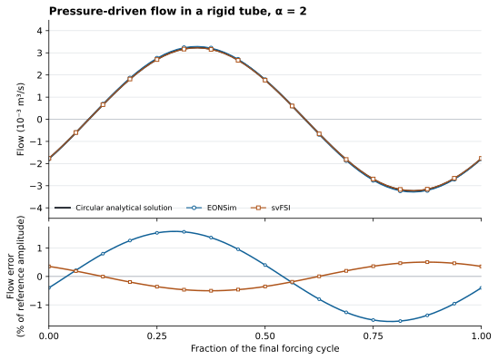
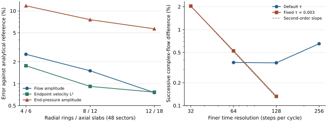

# Pressure-to-flow verification in an oscillating rigid tube

The reference BDF2 run on 48 sectors, 8 radial rings and 12 axial slabs had
1.5047% amplitude error, 0.2858° phase error and 1.5864% relative waveform
RMS error. On the same 25,920 tetrahedra, a separate generalized-alpha run
and upstream svFSI differed by 2.0395% of the analytical flow amplitude.
On the finer 59,616-cell mesh the EONSim flow amplitude error fell to
0.7554% and the matched cross-code complex difference fell to 1.3046%.
These results apply to the synthetic rigid circular-tube problem at α=2.
[Boundary model, reference solution and commands](../../../development/WOMERSLEY_FLOW.md)



## Quantities and acceptance

All flow signs refer to positive x except the explicitly outward boundary
integrals. Fit the last complete cycle of `(Qout−Qin)/2` to sine and cosine
at every accepted endpoint. Normalize the complex comparison and intercycle
maximum change by the circular reference amplitude 0.00323951534417 m³/s.
Normalize the waveform RMS by the RMS of the analytical waveform on those
same phases. Pressure averages use the discrete P1 trace with the absolute
level fixed by boundary stress.

| Quantity | Predeclared limit | 48/8/12, 64 steps/cycle, 3 cycles |
|---|---:|---:|
| Flow amplitude error | <2% | 1.504734% |
| Flow phase error | <2° | 0.285763° |
| Waveform relative RMS error | <3% | 1.586417% |
| Maximum cycle 3 vs. 2 difference | <0.1% | 0.004873% |
| Maximum absolute net outward flux | <1e−10 m³/s | 1.995e−17 m³/s |

The 24/4/4 configuration at 48 samples and the 32/6/6 configuration at 64
samples missed the amplitude gate with 2.65% and 2.33% error. A 48/7/8
grid at 64 samples also missed at 2.12%. The checks use the original limits.
The much smaller CTest checks loading stages, accepted diagnostics, MPI and
restart. Its coarse flow target serves as a regression check.

## Pressure, velocity and conservation

At step 144 (positive pressure peak), the quarter-cycle field had velocity
relative L² error 1.1855% over the polygonal fluid domain. The velocity
integral uses 27 positive Gauss points per tetrahedron. Increasing this to
64 points gave 1.1888%. The P1 pressure square integrates exactly and yielded
RMS pressure error 1.0523% of the imposed drop amplitude. At step 176 the
respective errors were 1.1855% and 1.0522%. At the final zero-pressure phase
they were 0.9179% and 0.3376%. The no-slip wall velocity was zero in the VTUs.

The fitted computed end-pressure difference had amplitude 0.0184844 Pa,
7.58% below the applied 0.02 Pa. The slice integrals localize part of this
effect. At the positive load peak the means at x=0, 1 and 2 m were 0.0192128,
0.0100203 and 0.0007367 Pa against 0.02, 0.01 and 0 Pa. Axial flux at the
two ends was 0.00275852 m³/s and at midspan 0.00267533 m³/s. The RMS element
divergence at this phase was 6.6994e−5 s⁻¹. The fitted end-flux target and
the local velocity, pressure and divergence diagnostics address different
quantities. The pressure trace has no acceptance claim.

The 5,005-node, 192-step reference also ran on two and four MPI processes.
The largest velocity-component difference from serial was 2.17e−19 m/s
on both decompositions. Pressure differed by up to 1.02e−18 and 1.11e−18 Pa.
Across all steps and tags the maximum differences were 1.96e−17 m³/s in
flow and 2.85e−16 Pa in mean pressure. Separate one- and two-process
checkpoints generated with the original main executable reproduced the
uninterrupted endpoint fields with zero difference after restoration.

## Mesh and time sensitivity



Each point on the right compares two successive time resolutions. The dashed
line decreases as the inverse square of the number of steps per cycle and is anchored at the first
uniform-τ difference. [Plot source](plot_refinement.py)

At a fixed polygon with 48 sectors, increasing radial and axial resolution
reduces both the flow amplitude error and the discrepancy in the computed
pressure trace. All three runs use BDF2, 64 steps per cycle, three cycles,
the default stabilization and the same pressure waveform.

| Sectors / radial / axial | Tet4 cells | Flow amplitude error | Flow phase error | Waveform RMS error | End-pressure amplitude deficit |
|---|---:|---:|---:|---:|---:|
| 48 / 4 / 6 | 6,048 | 2.5372% | 0.3083° | 2.5951% | 11.7610% |
| 48 / 8 / 12 | 25,920 | 1.5047% | 0.2858° | 1.5864% | 7.5780% |
| 48 / 12 / 18 | 59,616 | 0.7554% | 0.2097° | 0.8400% | 5.6792% |

At the final zero-pressure phase, the 59,616-cell mesh gives velocity
L² error 0.7657%, volume RMS pressure error 0.2210% of the imposed amplitude
and element-divergence RMS 1.8993e−5 s⁻¹. At fixed eight radial rings and
12 axial slabs the 24-sector mesh has a smaller end-flow amplitude error
(0.6781%) than the 48-sector mesh. Its velocity L² error is substantially
larger (3.1233% versus 0.9179%) and its phase error is 0.7022°. Agreement
of a single end-flow quantity can conceal error in the interior profile.

| Full sectors at fixed 8 radial / 12 axial | Flow amplitude error | Phase error | Endpoint velocity L² error | Endpoint pressure RMS / imposed amplitude |
|---:|---:|---:|---:|---:|
| 24 | 0.6781% | 0.7022° | 3.1233% | 0.4209% |
| 48 | 1.5047% | 0.2858° | 0.9179% | 0.3376% |
| 96 | 1.1680% | 0.1171° | 0.4257% | 0.2652% |

The temporal study uses the complex flow coefficient, including phase. Each
reported difference is the change between successive step sizes divided by
the analytical amplitude. In the default formula the effective integration
step enters the stabilization coefficient. With 32, 64, 128 and 256 steps
per cycle the successive differences are 0.3694%, 0.3659% and 0.6522%.
Their ratio orders are 0.014 and −0.834. The maximum last-cycle change
over this family is 0.00563% of the analytical amplitude. To hold the
spatial operator fixed a separate four-cycle control
uses the same uniform coefficient 0.003 at all resolutions. With 16, 32,
64 and 128 steps per cycle the differences are 2.0445%, 0.5254% and 0.1322%,
giving observed orders 1.960 and 1.991. The maximum last-cycle change in
this four-cycle control is 5.76e−9 of the analytical amplitude. Its measured order applies to this mesh,
stabilization choice and first-harmonic observable.

Evaluating the solver's coefficient formula cell by cell at the same final
phase quantifies the change. The coefficient below is for an additional
equal BDF2 step from each saved endpoint. At every listed resolution the
advective term contributes at most 3.02e−9 of the squared default inverse
coefficient on any cell. The time and viscous terms dominate in this regime.

| Steps per cycle | Minimum default τ | Volume-weighted mean τ | Maximum default τ |
|---:|---:|---:|---:|
| 32 | 0.0012143 | 0.0035692 | 0.0046681 |
| 64 | 0.0012044 | 0.0033069 | 0.0041851 |
| 128 | 0.0011670 | 0.0026624 | 0.0031324 |
| 256 | 0.0010463 | 0.0017437 | 0.0018858 |

## Independent solver

Both solvers used the identical Tet4 connectivity, coordinates, zero initial
velocity, unit density and viscosity, zero backflow term, fixed no-slip wall
and the same mixed end constraints. The pressure sine acts on the normal
component. The generalized-alpha spectral radius is zero so both load stages
are at the endpoint. Spatial stabilization, algebraic tolerances and startup
implementations are specific to the two codes. Files were exported with VTK
scalar connectivity, one-based parent IDs and outward-oriented boundary
triangles. The upstream Fourier convention is `r cos − i sin`, including the
zeroth coefficient. Its original linear and nonlinear solvers were used.
[svFSI source revision](https://github.com/SimVascular/svFSI/tree/94a2ff5cab2ad9e89e9bf12e0de36eaaa9b85571)
· [Fourier evaluation](https://github.com/SimVascular/svFSI/blob/94a2ff5cab2ad9e89e9bf12e0de36eaaa9b85571/Code/Source/svFSI/FFT.f#L133)
· [Nonlinear stopping rules](https://github.com/SimVascular/svFSI/blob/94a2ff5cab2ad9e89e9bf12e0de36eaaa9b85571/Code/Source/svFSI/PIC.f#L257)

| Mesh, samples per cycle | Complex flow difference / analytical amplitude | 5% criterion | Endpoint velocity L² difference / EONSim norm | Endpoint pressure RMS difference / 0.02 Pa |
|---|---:|---|---:|---:|
| 12/2/3, 16 | 8.7814% | Miss | 4.1432% | 0.3306% |
| 48/8/12, 64 | 2.0395% | Pass | 0.3160% | 0.1400% |
| 48/12/18, 64 | 1.3046% | Pass | 0.1622% | 0.0834% |

For the 48/8/12 case, svFSI's error against the circular reference was
0.4947% in amplitude and 0.0565° in phase. Its maximum last-cycle change
was 0.00556%. The final nonlinear residual satisfied one of svFSI's two
normalizations at every step, with maximum 4.85e−9 versus tolerance 1e−8.
There were 50 zero-iteration GMRES returns when the nonlinear target had
already been reached. The parser rejects a failed positive-iteration
linear solve, missing step or unconverged final normalization. The final
binary VTU independently reproduced the external end-flow and mean-pressure
tables to their printed precision.

On 48/12/18 the native svFSI result had 0.5196% amplitude error and
0.0517° phase error against the circular solution. Its maximum final
normalized residual across 192 steps was 9.9e−9. The history includes
142 zero-iteration corrections already beneath the nonlinear target.
An early cross-code postprocessing attempt encountered the still-running
EONSim job and correctly rejected its incomplete endpoint. The successful
comparison uses both completed solves and their final fields.

For EONSim's first-order generalized-alpha method, spectral radius zero gives
`α_m = 3/2`, `α_f = 1` and `γ = 1`. Substituting the preceding accepted rate gives
`(3uₙ₊₁ − 4uₙ + uₙ₋₁)/(2Δt)` after the common BE startup on a uniform
time grid. Thus the EONSim BDF2 and generalized-alpha runs in these two
pairs are algebraically equivalent. On 48/8/12 and 48/12/18 their maximum
final velocity differences were 2.17e−19 m/s. Pressure differed by at most
8.55e−19 Pa and the largest per-tag flow history difference was 1.74e−18 m³/s.
The independent implementation in this comparison is the upstream svFSI run.

## Reproduce and inspect

The EONSim C++ solver used commit `62c0b2fc0b59d5377e1a085a8f4e94ac4b5eb209`.
The initial field and cross-code tools used `bef75bda4c6674452757cee3629a38854f34807e`.
Endpoint stabilization reconstruction and the shared flux check are in `f802fa3`.
The baseline checkpoint binary came from `89a1a3d823396df02fa9e8acb5ded36b70938e9c`.
PETSc 3.23.7 was real/double with 32-bit indices, Open MPI 5.0.8 and GCC
15.3.0. The shared machine had four CPU cores of quota and 16 GiB of memory.
The EONSim binary SHA-256 was
`9ad78529a9ab73aa9cb814bcf72aa549c36d9ba9a32de70cdebdd8e2ccaffef5`.
The svFSI 2022.09.26 binary SHA-256 was
`76fa8bccbe419b4c8cf95d40c74b64290d2b55079750e7f44ef270f7c8760c06`.

```sh
# From the EONSim repository root. The destination can be anywhere.
d=docs/research/data/womersley-2026-11-20
mkdir -p /tmp/eonsim-womersley-raw
tar -xJf "$d/raw.tar.xz" -C /tmp/eonsim-womersley-raw
python "$d/replay.py" /tmp/eonsim-womersley-raw --verify --output /tmp/wom-integrals.json
# The additional external VTU audit used vtk 9.3.1.
python "$d/replay.py" /tmp/eonsim-womersley-raw --verify --fields --output /tmp/wom-fields.json
python "$d/plot_waveform.py" /tmp/eonsim-womersley-raw /tmp/wom-waveform.svg
python "$d/plot_refinement.py" /tmp/wom-fields.json /tmp/wom-refinement.svg
```

The raw archive contains the Gmsh volume meshes, case inputs, every accepted
boundary row, the audited VTU fields, the matched external inputs and
histories, the baseline checkpoint generations and both legacy endpoints.
The archive contains 200 authenticated files covering 20 EONSim runs and
three matched external runs. Its SHA-256 is
`bf6035d02ae0cbb4881c69e9adda3c0662d01aa22cfb743e42fe5b86a3f0824b`.
The JSON results include
the coarse misses as well as the gated cases.
[Inputs and raw outputs](raw.tar.xz) · [File digests](manifest.json) · [Recomputed metrics](results.json)

Use a separate compiler environment for the external Fortran solver. The
unmodified Fortran/C/C++ sources were built on Linux with GNU 15.3,
Open MPI 5.0.8, CMake 3.x, Ninja, BLAS, LAPACK and zlib. Set `svprefix` to
that environment and issue the following commands from a checkout of svFSI.

```sh
git checkout 94a2ff5cab2ad9e89e9bf12e0de36eaaa9b85571
cmake -S Code -B build-wom -G Ninja -DCMAKE_BUILD_TYPE=Release \
  -DCMAKE_C_COMPILER="$svprefix/bin/gcc" -DCMAKE_CXX_COMPILER="$svprefix/bin/g++" \
  -DCMAKE_Fortran_COMPILER="$svprefix/bin/gfortran" -DMPI_C_COMPILER="$svprefix/bin/mpicc" \
  -DMPI_CXX_COMPILER="$svprefix/bin/mpicxx" -DMPI_Fortran_COMPILER="$svprefix/bin/mpifort" \
  -DCMAKE_PREFIX_PATH="$svprefix" -DSV_USE_TRILINOS=OFF
cmake --build build-wom --parallel 2
```

Two initial interoperability attempts are archived. The upstream ASCII
reader inferred one index per tetrahedron. A trial vector-connectivity
workaround was rejected by the standard VTK reader and the trial NS solver
reported a singular projected system. The accepted comparisons use standard
appended binary arrays, GMRES and explicit convergence checks. Two local
regression harness faults (a non-string argument and an incorrect mesh lookup)
are also retained with the corrected test receipts.

The current study measures flow, pressure and velocity for a stationary
rigid wall. A companion benchmark covers hydrostatic elastic-wall
pressure–area response. Dynamic compliance and multi-node scaling remain
open. [Elastic-wall PR #42](https://github.com/saitoasukakawaii/EONSim-new/pull/42)
· [Production FSI roadmap](../../../development/FSI_PRODUCTION_ROADMAP.md)
