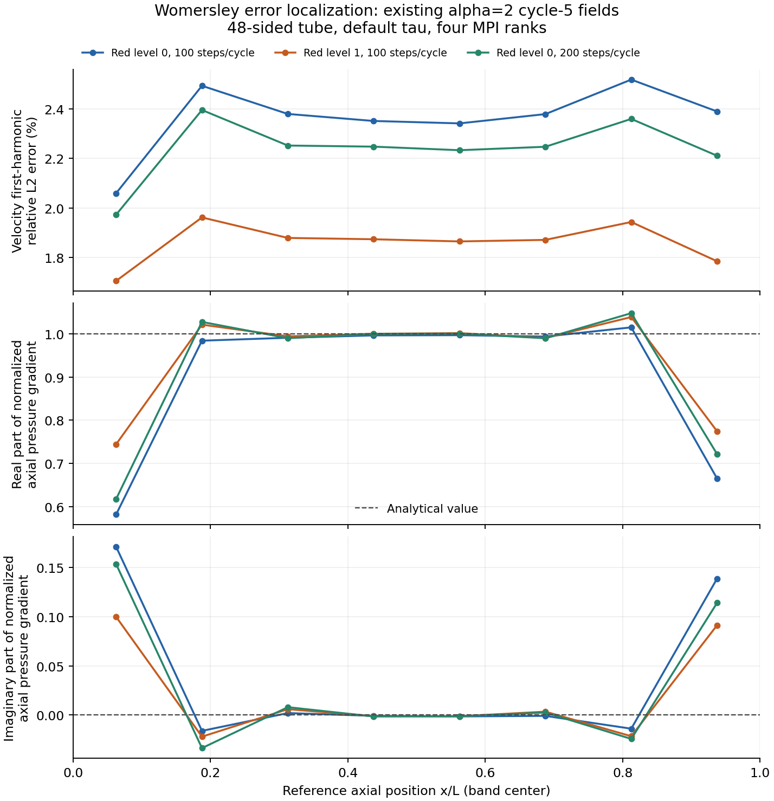

> **轻量进度快照 / 2026-11-09**：此分支只含当前代码、进度、报告和清单。本轮新增的1114个原始压缩包（约22GB）未上传，完整历史与数据保留在本地`codex/fsi-production-48h-20261107`、提交`407c655`。下文“已归档/已提交”的历史记录指该完整本地历史，不表示原始包存在于本快照。后台计算和定时任务已停止，项目验收尚未完成。

# Initial Womersley studies: incomplete qualification

Solver source `b072cc81e29160488e5c08044d8aee3b0245078f`, frozen Release binary
SHA256 `2692b6480cddebec96bd4f74479963d732aa483dc5b2be5a7635ac57e041eb12`.
Research scripts were checkpointed in `d280e7fdd84a8bf3c2e63185623afb2907faba7c`.
These runs all use the **default** tau; the new diagnostic time-scale option
was not used. The later C++ diagnostic change is not covered by these solves.

The problem has R=1, L=2, rho=mu=1, pressure drop `.02*sin(4*t)` (alpha=2),
zero transverse end velocity and no-slip side wall. The seed is 48 sectors,
4 radial and 8 axial subdivisions. Red refinement preserves that polygon.
BDF2, two warmup cycles followed by three sampled cycles, 100 phases/cycle,
four MPI ranks, existing Schur/GAMG with restart 120 and maximum 2000 iterations.
The nonlinear tolerances remain rtol `1e-11`, atol `1e-13`, maximum 30 iterations.

## Actual results

Percent errors; velocity below uses quadrature order 4. Source files also retain
order-6 analyses of the N100 states. The latter changes the coarse/level-1
velocity errors by only `1.662e-7` / `1.914e-8` in relative units.

| Red level / steps per cycle | Nodes | Velocity L2 | Pressure RMS/amplitude | Flow amplitude | Flow phase (degrees) |
|---|---:|---:|---:|---:|---:|
| 0 / 100 | 1737 | 2.36670% | 1.15345% | 1.47233% | .227143 |
| 1 / 100 | 12257 | 1.86191% | .588616% | .010704% | .112050 |
| 0 / 200 | 1737 | 2.24222% | .874747% | .287850% | .111975 |

All three are periodic under the prescribed last-two-differences criterion;
the largest preceding-cycle velocity difference is `7.81e-9` times analytical
cycle RMS (limit `1e-6`). Net flux is below `1.40e-13` (limit `1e-10`).
All three fail the 1% velocity gate. The first also fails pressure and flow
amplitude. Solver convergence and period convergence do not establish accuracy.

The 100→200-step coarse field difference is `.00412730` / `.00822612` times
the analytical velocity/pressure RMS. The level-0→1 spatial difference at N100
is `.00735754` / `.01524492`. Thus the time/parameter changes are about 56.10% /
53.96% of that first spatial difference, above the prespecified 10% limit.
Because default tau depends on effective dt, this is not a pure derivative
error measurement. See the [diagnostic definition](../../../development/FLUID_STABILIZATION_TIME_SCALE.md).

The coarse N100 study was actually continued through cycle six. Cycle 6−5
field RMS differences are `3.405e-15` / `4.402e-15` in the same normalization.
This confirms that coarse case's tail, not a finer grid's tail. Alpha=1,
geometry sensitivity, finer spatial/time/sampling budgets and full
qualification remain pending. The steady cos^4 flow bound is not a bound on
the complex Womersley flow response.

## Analysis checks and failures

The analytical reference's three standard-library tests passed: wall/zero
frequency, differential momentum equation and cross-sectional flow integral.
Independent SciPy Bessel values differ by at most `1.2183e-18`. Tetrahedral
monomials through degree five have maximum order-4 quadrature error `4.45e-16`.
An independent direct space-time integral, including a transverse second
harmonic, differs from the mass/harmonic formula by `3.2e-15` in relative L2.
`original-metric-check.py` preserves the actual helper used; its original
workspace locations are literal and must be redirected when replayed elsewhere.

The first analysis failed while serializing a NumPy boolean to JSON. Converting
the flow-amplitude scalar to a Python float fixed serialization; only analysis
was repeated, with unchanged solver fields and gates. The component diagnostic
shows that most remaining velocity error is axial, but does not establish its
cause or an asymptotic order.

## Reproduce

Solve in the repository PETSc 3.23.7 lock, in a fresh directory:

```sh
python scripts/study_womersley.py --executable /path/to/eonsim-b072cc8 \
  --work /new/womersley --seed 48 4 8 --level 1 --alpha 2 \
  --steps-per-cycle 100 --phases 100 --warmup 2 --cycles 5 --ranks 4 --schur
```

Change level/N for the other two states. For the coarse tail, repeat the same
definition with `--resume --cycles 6`. The executable and mesh are hashed and
continuation rejects changes in the study definition. Each attempted solve has
an immutable case, command and log; complete checkpoint generations retain all
accepted phase samples. Historical warmup attempts predating per-attempt
receipts still have their original logs/manifests and final root receipt.

Postprocessing used an independent, already installed system Python 3.12 with
NumPy 1.26.4, SciPy 1.17.1 and h5py 3.14.0; it is not the locked solver Python.
After extracting the archives into a fresh directory, no solver is needed:

```sh
python scripts/analyze_womersley.py --work /extracted/womersley-a2-s48-l1-n100 \
  --quadrature 6 --output /new/analysis.json
python scripts/compare_womersley.py \
  --coarse /extracted/womersley-a2-s48-l0-n100 \
  --fine /extracted/womersley-a2-s48-l1-n100 \
  --coarse-cycle 5 --fine-cycle 5 --output /new/space.json
```

`manifest.json` records all 5169 raw files. Every file was read back from the
three archives and SHA256-verified. Partitions, meshes, snapshots, checkpoint
fields and original receipts are retained; the executable and redundant base
generator meshes are omitted. `archives.json` records archive hashes and sizes.
No public upload or PR has occurred at this checkpoint.

## Subsequent offline localization

At source checkpoint `2189a8c`, `original-localization.py` re-read the existing
cycle5 fields with order-6 quadrature. No additional solve was performed.
The exact helper and `localization.json` were copied with SHA256 verification,
recorded in `localization-files.json`; these are supplemental to the original
5169-file archive, not silently added to its manifest.

| Level/N | First harmonic velocity L2 | Analytical nodal interpolant L2 | Numerical minus nodal interpolant L2 |
|---|---:|---:|---:|
| 0/100 | 2.366721% | 2.557792% | 1.659411% |
| 1/100 | 1.861909% | .858339% | 1.352365% |
| 0/200 | 2.242242% | 2.557792% | 1.521081% |

These are separate norms; they cannot be added or subtracted as scalar error
budgets. The analytical nodal interpolant is not the best P1 approximation
and is not a lower bound. Non-first-harmonic relative norms are at most
`2.546e-7`, including mean and higher harmonics.

The eight axial bands align exactly with mesh planes. For level1/N100,
first-harmonic velocity errors range approximately1.71–1.96%; interior bands
remain near1.87%. The discrepancy is therefore not confined to the ends.
Mean axial pressure gradients, normalized by the exact complex gradient,
are about `.74459+.09998i` and `.77451+.09143i` in the end bands, while the
central bands are close to1. These observations locate discrepancies but
do not establish their cause or identify a formula defect.

Actual command: `/usr/bin/python3 build/prod48-20261107/localize-womersley-error.py`.
The retained helper uses the original workspace locations; redirect its
repository, study and output paths to replay on the extracted studies.
See also the separate [a-priori mesh screen](../tube-mesh-screen-2026-11-08/README.md).



The figure uses the exact supplemental JSON values, not a new solve. Band
centers are shown; lines only connect observations. The first panel is the
first-harmonic velocity error, while the other panels normalize the complex
pressure gradient by the exact negative axial gradient. `plot-files.json`
records input/output hashes and Matplotlib3.6.3. `original-plot-localization.py`
reproduces PNG/SVG outputs when placed in the original repository helper
directory. The initial preview's legend overlapped a curve; it was moved
above the axes and the final figure visually inspected. Numerical data did
not change.

## Actual lagged tau coefficient terms

`tau-terms-summary.json` reconstructs the default coefficient from each
cycle5 checkpoint's actual BDF2 `time_previous`, using the source formula's
cell-mean accepted velocity and `h=cbrt(6V)`. It is not a new PDE solve.

| Level/N | Mean squared time-term fraction | Maximum squared advection-term fraction | Mean same-state tau ratio if dt is halved |
|---|---:|---:|---:|
| 0/100 | .6624922 | 1.058e-8 | .5829312 |
| 1/100 | .1246602 | 5.020e-9 | .8571094 |
| 0/200 | .8776559 | 4.963e-9 | .5254217 |

The mean quantities use element-volume weights and then average the100 stored
phases. The last column changes only the explicit temporal coefficient at
the **same accepted state**; it is not the coefficient in a newly solved field
or a bound on its error. Small advection fractions likewise do not establish
a bound on physical solution sensitivity. Controlled periodic solves remain
required to separate the observed time/parameter differences.

For both N100 histories, all100 saved previous fields match the independently
saved preceding accepted state exactly (200 checks total). N200 stores every
second state, so there are zero such direct preceding-file comparisons there;
its recorded zero maximum is an empty accumulator, not an independent check.
All three histories check previous-field shapes, finiteness, owned/ghost
agreement and the BDF2 previous step size.

Actual command: `/usr/bin/python3 build/prod48-20261107/audit-womersley-tau-terms.py`.
`tau-terms.tar.xz` contains the exact helper and full422297-byte report, with
phase rows and primary checkpoint hashes. Both files were read back and
SHA256-verified; `tau-terms-files.json` records the61000-byte archive.
The helper retains its original repository/work path assumptions. Source
checkpoint was `f7a32f6`; the default formula and b072 fields were unchanged.

## Pressure trace versus reconstructed normal stress

A subsequent existing-field diagnostic reconstructs the first harmonic of
the area-mean cap pressure and `-sigma_nn = p - 2*mu*du_x/dx` on each planar
end. Pressure is integrated exactly on each P1 triangle; the axial derivative
comes from its unique parent tetrahedron. Complex-amplitude drop errors,
normalized by the prescribed .02 load amplitude, are:

| Level/N | Pressure trace drop | Equivalent normal-pressure drop |
|---|---:|---:|
| 0/100 | 10.3331% | 7.30344% |
| 1/100 | 5.80515% | 3.42207% |
| 0/200 | 8.07237% | 6.10938% |

These diagnostics do not replace the volume pressure RMS, add a new gate or
establish an implementation defect. Reconstructed strong P1 stress need not
exactly satisfy the weak natural traction at finite resolution. They show why
a pressure trace and a prescribed normal stress must be reported distinctly.
The independent affine oracle `p=3+2x, u_x=x` has maximum integral error
1.164e-13 across the three analyses. This is an integration check, not a PDE solve.

Actual command: `/usr/bin/python3 build/prod48-20261107/audit-womersley-end-stress.py`,
repository checkpoint5cd0c2b. `end-stress.json` and `original-end-stress.py`
were copied with SHA256 verification in `end-stress-files.json`. The helper
retains its original paths; source checkpoints remain the existing archived
cycle5 fields. More refined physical conclusions are still pending.

## Same-history phase reconstruction check

`phase-sampling.json` compares the existing100 saved phases with a linear
reconstruction from their own50-phase subset, including the real preceding
cycle endpoint. There is no new solve, changed time step, fitted phase or
interpolation between different studies. Exact P1 spatial mass gives relative
velocity cycle-RMS differences about.001385–.001386 and pressure differences
.001387–.001396. These do **not** establish the100→200-phase budget; actual
denser saved states are still required for that comparison.

An independent sinusoid oracle gives dimensional RMS
`(1-cos(pi/50))/2 = .00098663578586422`, reproduced to1.6e-17. A linear time
signal reproduces within8.89e-16; an unaligned phase grid is rejected.
Actual command: `/usr/bin/python3 build/prod48-20261107/check-womersley-phase-sampling.py`,
source checkpoint0eb4544. The report and two exact helpers are retained in
`phase-sampling.tar.xz`; all3 files were read back and verified against
`phase-sampling-files.json`. Helpers retain their original repository/work
locations. The same analysis can later use actual200-phase fields and a100
phase subset without changing the solver or claiming an extrapolated bound.
