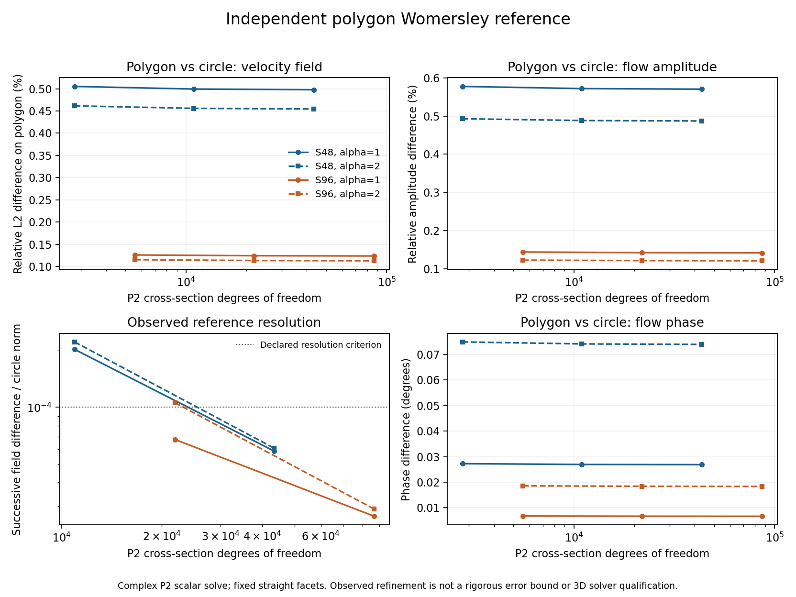

> **轻量进度快照 / 2026-11-09**：此分支只含当前代码、进度、报告和清单。本轮新增的1114个原始压缩包（约22GB）未上传，完整历史与数据保留在本地`codex/fsi-production-48h-20261107`、提交`407c655`。下文“已归档/已提交”的历史记录指该完整本地历史，不表示原始包存在于本快照。后台计算和定时任务已停止，项目验收尚未完成。

# Independent polygon Womersley reference

Source `fa9646d`; NumPy1.26.4/SciPy1.17.1 on WSL x86-64, one thread/CPU23.
[106 files](manifest.json), including all four attempts, were individually
read back from a10281876-byte archive. [Archive and source hashes](archives.json),
[definition](provenance.json), [attempt history](attempt-history.json) and
[final results](summary.json) bind the claims to the actual calculations.

The complex scalar P2 solve is `(-Delta + i*alpha^2) U = .01`, with zero wall
data, R=rho=mu=1, and physical velocity `Im(U exp(i*alpha^2*t))`.
Cross-section triangles come from the same straight-facet tube generator.
All refinement keeps S48 or S96 geometry fixed. Velocity norms compare both
fields on the polygon; the flow comparison includes the polygon/circle
domain-area difference. No EONSim production solver is used in this reference.

| Sectors | alpha | Velocity L2 difference (%) | Flow amplitude difference (%) | Flow phase difference (degrees) | Last relative field increment |
|---|---|---|---|---|---|
|48|1|0.497830|0.570435|0.0268634|5.86717e-5|
|48|2|0.454478|0.487123|0.0738633|6.08126e-5|
|96|1|0.123803|0.141938|0.00667305|2.64497e-5|
|96|2|0.112978|0.121148|0.0183340|2.88765e-5|

Both geometries meet the predeclared successive-field criterion1e-4 at
level3:43393/86785 P2 degrees of freedom. This is observed reference
resolution, not a rigorous a-posteriori bound. Three nonzero complex
quadratic manufactured solutions have maximum nodal error2.630e-13<1e-11.
Constant stiffness patches, exact P2 mass integrals, exact polygon areas,
nested-cell mapping and independent6/8 quadrature changes all pass their
declared checks. All accepted true linear residuals are below1e-11.

The first attempt stopped at S96/level3. The second explicitly reproduced
a2.84e-11 initial double residual and a1.68e-11 floor after corrections.
The third attempted extended accumulation but compared it with a double
oracle at an extended-precision bound; that verification bug also failed
and is preserved. The fourth uses extended state/residuals and independently
checks selected CSR sums with80-digit decimal accumulation. One correction
reduces the S96/level3 residuals to9.081e-15/7.788e-15. The1e-11 residual
and manufactured-solution gates were never relaxed. Stored extended arrays
require a platform with the recorded NumPy long-double representation.

Actual helpers, in order, were `reference-womersley-polygon.py`,
`reference-womersley-polygon-refined.py`, `reference-womersley-polygon-extended.py`
and `reference-womersley-polygon-checked.py`, each launched with
`/usr/bin/python3 -u build/prod48-20261107/<helper>`.
All original helper/source snapshots and available failure traces are archived.

The [figure inputs/outputs](figure-provenance.json) are hashed. PNG was
visually checked; SVG trailing whitespace was normalized before hashing.
This diagnostic separates a geometry contribution, without subtracting
error norms additively or replacing3D temporal, spatial or periodic gates.
