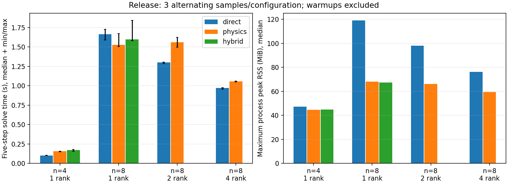

# 单体 FSI：非零入口与终点有效性

本文面向维护 ALE 有限元求解器的开发者。内容为小算例的代码验证与解验证，
不是实验验证；性能测量仅适用于记录的单机、配置与网格。

## 理论与项目离散约定

规定速度是本质边界。对于阶段关系
`u_stage=(1-alpha_f)*u_n+alpha_f*u_next`，相容边界应使用相邻终点规定值的同样插值。
若直接使用非线性时间函数在阶段时刻的值，再通过线性阶段关系重建，终点一般不会等于规定值。
这与自然压力载荷直接在评价时刻取值的职责不同。
本项目的具体时间映射见 [时间契约](../../docs/development/TIME_INTEGRATION.md)。

阶段构形有效并不保证终点有效。例如 `alpha_f=.5`，某仿射单元初始伸长为 1、
阶段伸长 .25，则外推终点伸长为 -.5。阶段 Newton 可以收敛，但终点必须拒绝，
否则保存的历史已不再是可接受的物理状态。

线性三角面场的积分为参考面积乘三个节点值的算术平均；整个界面再用总参考面积归一化。
该结果与不考虑面积的全界面节点平均不同。移动后的面积另行计算，不混入参考面积权重。

## 实现证据

源码 `0d93d41`（邻接补强 `69692ee`，研究脚本 `32783a5`）的 `src/physics/fsi.cpp` 将非零入口写入固定物理槽的提升值，
在共同 Newton 内使用该值；相应行列已经从独立未知量中消去。
阶段和终点几何均在历史提交前检查；失败时进入原有限缩步路径。

`src/physics/fsi_diagnostics.cpp` 按稳定节点 ID 分布式路由候选面，
只保留恰有一个流体与一个固体邻接单元的面，剔除内部流体面和只有共享顶点的外表面。不能仅凭“三个节点都是界面节点”判断面属于界面。
面拓扑仅建立一次，每步执行局部积分与小规模归约，不收集完整全局场。

夹持界面节点上的结构反力不等于未收敛残量。
自由测试行的平衡与全界面流体反力保留不同含义，输出必须明确二者的区别。

## 验证证据

本地 PETSc 3.23.7 Debug/Release 已验证非零入口、三时间格式、逐接受步终点值、
1/2 rank 一致、启动中和启动后恢复、完整装配差分 Jacobian、Neo-Hookean 缩步重放。
实际刚体 alpha 负例在第四步出现终点反转：checkpoint 内容未改变，失败步无历史发布；
缩步恢复后与相同步长重放相符。解析仿射几何与跨 rank 内部面消去另有原生测试。
Debug/Release 最终各 4/4 主检查与 1/1 旧弹性体补验通过，装配切线最大相对差小于 1.55e-8。
完整实验命令、原始数据、失败尝试及源码沿革见 [验收记录](../../docs/research/data/fsi-next-2026-11-03/README.md)。

## 解验证：先消除时间污染，再解释空间差异

新算例采用单位流体立方体与 y=1..1.25 的弹性顶壁，入口速度 `.1*(1-y)`，
两端夹持、侧面滑移、出口压力零。线弹性时间研究固定 tau=.05，参考为细步 BDF2。
用每个物理场独立的节点 RMS 误差比较：BE 的观察阶 .905–1.056，BDF2 1.892–2.091，alpha 2.000–2.223。
粗步 BE 曾出现 .844 的位移观察阶；进一步细化后才满足预先设定门槛，没有降低门槛。

空间研究选择周期压力端块 Neo-Hookean 算例，比较整段参考面积平均轴向位移轨迹，避免只选某一最终时刻。
最初时间差比 n=4/8 空间差大约 6.98 倍，此时不能解释空间阶。
统一细化到 dt=.00025，并以 dt=.000125 为时间参考后，n=2/4 的轨迹 RMS 差为 1.0203e-5，
n=4/8 为 5.6098e-6，时间差仅为最后空间差的 9.51%，低于预设 25% 门槛。
空间差减小，但只有三档且没有解析解，不能宣称已经得到普适空间阶。
该研究保留默认随 dt 变化的稳定化，时间差也包含该项变化；不能将它当作固定半离散系统的纯时间阶试验。

## 性能：统一误差要求后再比较

算法加速度包含位移差除以 dt² 的运算，位移上很小的求解误差也可能在加速度中变得可见。
首轮 n=8 physics 的网格位移差约 2.20e-14，加速度差却达 1.027e-8，超过原 2e-9 场比较门槛。
仅收紧非线性目标还不够：旧 KSP 绝对容差会让线性修正过早停止。
最终所有 recipe 同时采用非线性 rtol=1e-12/atol=1e-14 和外层 KSP rtol=1e-12/atol=1e-16，
重新预热测量，最大场差 6.16e-11。此处调整仅用于研究脚本，没有改变生产默认值。

本地 WSL2/i9-12900K、PETSc 3.23.7 Release、每 rank 单线程、最多 4 rank；
新 Neo-Hookean 顶壁 n=4/8 对应 625/5057 个独立 DoF，alpha 连续五步。
每组一次预热、三次交替次序测量，共 10 预热和 30 正式样本。
n=4 直接法更快；n=8 单 rank physics 中位数略低但范围重叠，2/4 rank 则直接法更快。
physics 在 n=8 的最大进程高水位内存更低。这支持按算例比较时间和内存，不支持大规模加速结论。

## 参考与复现

- [入口契约与生成器使用](../../docs/development/FSI_INLET_AND_RELIABILITY.md)。
- [时间积分实现契约](../../docs/development/TIME_INTEGRATION.md)。
- [实际命令、配置、原始证据与局限](../../docs/research/data/fsi-next-2026-11-03/README.md)，含时间/空间图和逐样本性能数据。
- 理论段是上述线性阶段关系与三角面线性插值的直接推导；未引用外部实验基准，也不将代码验证写成物理实验验证。

## 限制与审查问题

固定入口、共形 Tet4、同分区恢复；没有非匹配插值、重网格或多速率耦合。
`min(det F)` 只是几何体积指标，不能识别所有长细或劣形单元。
审查应检查规定值与齐次约束交线的相容性、面积是否重复计入，以及状态提交是否晚于所有有效性检查。
练习：将入口启动时间缩短，观察粗时间步上的误差是否掩盖空间加密趋势。
