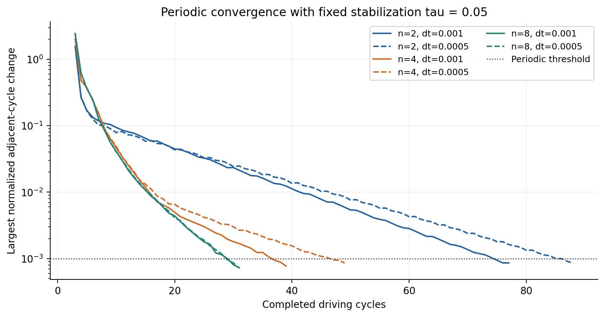
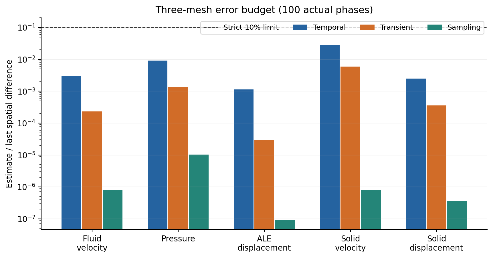
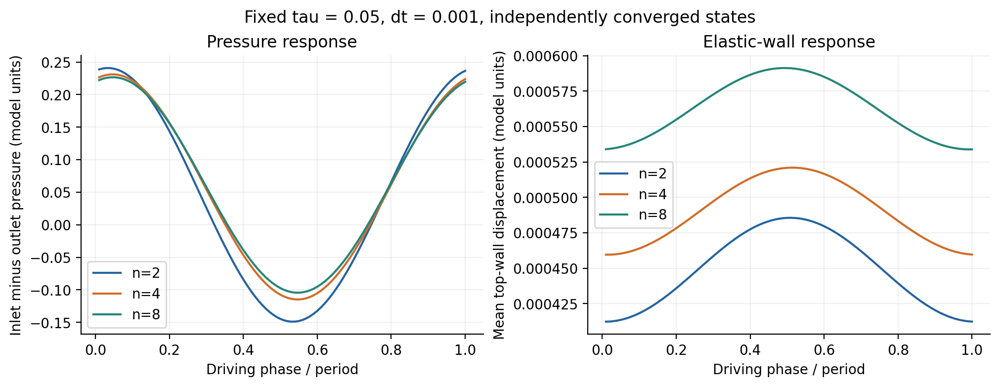

# 周期流固耦合的判据与误差分离

## 实现补记：异常质量历史不能参与归约（2026-11-06）

实现依据：`scripts/fsi_cycle_metrics.py`，提交 `80571b102e31dd2e7664a64a39a92efc8402045c`。初始体积为NaN时，旧实现可返回NaN末端缺陷，同时因 `max(0., abs(NaN))` 保留0而报告零最大缺陷。修复在积分前检查初始状态有限、体积为正；接受步长与体积严格为正，时间差及累积积分/缺陷必须有限。时间戳一致性容差不能替代步长符号约束。该检查只证明数据适合参与诊断，不证明守恒或周期收敛。

验证：`python tests/test_fsi_cycle_metrics.py` 10项通过，涵盖异常初态、非正步长/体积、溢出与有效非零时间续算；相关归档/场/空间检查另16项通过。9组归档时间研究22400条接受步重算，36个预算值与原收据精确一致，命令见[会话日志](../../docs/development/CODEX_SESSION_LOG.md)。未重新求解PETSc/MPI算例，无性能结论；本补记仍待人工审查。

本文面向实现低阶ALE/FSI的开发者，记录合成弹性壁通道的数值验证。
周期载荷重复、全局质量残差很小和空间误差得到控制，是三个需要分别验证的结论。
这里没有实验数据对照，也不是文献标准基准或性能评估。文章保留为待人工审核草稿。

## 参考问题与实现范围

流体参考域为单位立方体，顶壁是厚度0.25的独立共形弹性域。
流体密度、黏度及固体密度取1；线弹性模量100、泊松比0.3。
这些是合成模型参数，不能解释为具体生理材料。
入口为离散总流量 `Q(t)=s(t)[0.01+0.005 sin(2πt/0.1)]`，`s`在0.02时间内平滑启动。
刚性底壁与侧壁无滑移，弹性顶壁满足流固速度/位移相容；结构两端和两侧夹持，出口为零自然压力。
入口形状在各自网格上按实际P1积分归一化，保证相同离散总流量。

采用Tet4/P1场、单体流固与ALE共同求解；n=2/4/8表示每个参考方向的网格细分数。
周期状态研究使用generalized-alpha、默认ρ∞=0.5，dt=0.001及0.0005，固定稳定化τ=0.05。
非线性相对/绝对容差为1e-10/1e-12，最多30次迭代；每组2 MPI rank、每rank单线程。
输入、网格、求解器输出及实际运行命令见[原始证据](../../docs/research/data/fsi-next-03/local-recovery-2026-11-05/README.md)。

## 理论与实现：同相位的完整场判据

自由响应可能持续很久；只检查平均壁位移会漏掉固体振动或局部压力变化。
对参考网格上的场差采用

$$
\|e\|_{h}=\sqrt{\frac{\sum_i w_i|e_i|^2}{\sum_i w_i}},
\qquad w_i=\sum_{K\ni i}\frac{|K_0|}{4}.
$$

它是参考体积归一化的lumped节点L2范数，不是精确连续L2积分。
周期检测在各物理相位比较相邻周期并取最大值，再除以固定尺度：速度0.01、压力0.1、位移1e-4。
流体速度、压力、ALE位移、固体速度、固体位移，以及壁位移、体积、流量、压降观测均需连续三个周期通过1e-3门槛；标量均值漂移另检。
固定尺度避免用较大的平均值掩盖振荡漂移。

实现位于 `scripts/fsi_field_cycles.py` 和 `scripts/study_fsi_periodic.py`。
相位依据物理时间，不能拿不同步长的步编号直接配对。
检测器允许受限的非均匀时间线性插值，禁止外推与大间隙；本研究驱动仍使用整数步周期及20个准确对齐的场相位。
场数据按全局节点号去重，仅用于离线分析，没有改变生产求解器的分布式存储。

## 验证：时间格式与质量预算

时间格式研究使用固定n=2、固定τ，比较第二个完整驱动周期，不把该周期当作稳态。
BE最终使用每周期1280/2560/5120步，BDF2和alpha使用160/320/640步；更细BDF2参考为10240步，并与5120步参考比较。
速度/位移最小受检观测阶分别为0.864、1.882、1.981；参考再加密差占最小候选误差3.17%–3.21%，通过既定门槛。
压力阶单独列于原始摘要，不能由速度阶推断。
粗步长矩阵曾失败，随后实际加密，没有放宽门槛或删除失败记录。
[时间精度、完整CSV/日志和实际第二周期场](../../docs/research/data/fsi-next-03/time-accuracy-final/README.md)来自本分支先前成功检查点，本机接续没有重复运行该矩阵。

质量验证还采用三轴伸缩并平移的四面体，体积为 `(1+t)(1+2t)(1+3t)/6`。
`fsi_tet_mass_observation` 分别积分体散度与四个外向面通量；它们与解析体积导数相符，纯平移的总通量为零。
通道的端点净流量再按真实接受时间做梯形积分，与端点体积变化独立比较。
最终时间矩阵的累计预算最大误差约按BE一阶、BDF2/alpha二阶下降。
后处理积分阶不能冒充时间推进阶；stage通量也不能无条件等同有限步体积secant。

## 理论与验证：空间差之前的误差预算

跨网格比较在参考构形中做真实粗网格Tet4插值，相同节点编号不代表相同位置。
设相邻网格的周期场差为D₂₄和D₄₈，报告 `p=log₂(D₂₄/D₄₈)`；只有两档差值时，p是观测量，不能证明已经进入统一渐近区。

每个周期状态再追加三个十周期区间。若区间末周期的场差为D₁、D₂、D₃，取

$$
q=\max(D_2/D_1,D_3/D_2),\qquad
E_{tr}=D_1+D_2+D_3+\frac{D_3q}{1-q}.
$$

只在实测q<0.8时采用这个尾项。它依赖后续收缩继续，是条件性的经验估计，不是严格数学误差上界。
时间项采用每张网格的dt与dt/2实际周期解差，并计入两端瞬态估计；涉及末档空间差的n=4/8不确定量取和，避免抵消。

另从每个状态真实续算两周期，每周期输出100相位。正式场差取100相位的相位RMS，50/100统计变化作为采样检查。
20相位线性重建与100个实际场的差另列，二者衡量不同的量。
时间、瞬态和采样项均必须逐字段严格小于末档空间差10%；缺字段或非有限值直接拒绝。

## 实测结果（固定 τ=0.05）

六状态均达到完整场与标量连续三周期的1e-3判据，再各追加三个十周期区间和两周期100相位输出。
以下阶段与采样采用独立真实求解；不是把20相位结果插值为100点。

| n | dt | 达标周期数 | 三块尾项最大实测收缩率 |
|---:|---:|---:|---:|
| 2 | 0.001 | 77 | 0.504594 |
| 2 | 0.0005 | 88 | 0.557667 |
| 4 | 0.001 | 39 | 0.431478 |
| 4 | 0.0005 | 49 | 0.610879 |
| 8 | 0.001 | 31 | 0.287096 |
| 8 | 0.0005 | 31 | 0.322564 |

正式空间差采用100个真实相位；范数为参考体积归一化的lumped节点L2，再取相位RMS。各场保留本身量纲。
压力出口给定零自然压力，比较原始压力，不做任意均值平移。

| 场 | n=2→4差 | n=4→8差 | 观测阶 | 时间/空间差 | 瞬态/空间差 | 采样/空间差 |
|---|---:|---:|---:|---:|---:|---:|
| 流体速度 | 0.0061822716 | 0.00143099925 | 2.111114 | 0.304929% | 0.023141% | 0.000081% |
| 压力 | 0.132207181 | 0.0267037449 | 2.307687 | 0.906798% | 0.134863% | 0.001042% |
| ALE位移 | 0.000196488887 | 5.2648966e-05 | 1.899971 | 0.113386% | 0.002880% | 0.000009% |
| 固体速度 | 0.00315840895 | 0.00175183284 | 0.850333 | 2.765560% | 0.589428% | 0.000078% |
| 固体位移 | 0.000267541001 | 0.000122770467 | 1.123796 | 0.248835% | 0.035717% | 0.000037% |

三个预算分别严格小于10%。时间估计包含dt与dt/2差及两端状态的经验瞬态估计；
对末档空间差涉及的n=4/8不确定量取和，并与n=2估计取最大值。
采样项是50/100真实相位下所报告场差的变化；20相位波形重建误差另存原receipt，不冒充严格采样误差界。

全部周期状态共审计48300行接受历史，12组追加研究共28800行。
最大stage质量残差9.63638891e-16，表面/体散度差3.20923843e-17，
入口流量误差3.43475248e-16，最小几何Jacobian比0.997006645。
100相位无滑移/界面相容最大误差0。

18个归档迁移后逐一核对49305个文件；尾项实际场和完整预算重算与原结果一致，原receipt未改写。

默认τ含有integration_dt，因此改变步长同时改变稳定化算子。
先前默认τ候选的n=2压力时间差约0.08908，已超过末档空间差约0.03899的10%，被拒绝。
这一筛查不能把全部差异解释为时间积分误差，也不等于发现求解器错误。
当前固定τ研究隔离了这个变化，但不能据此宣布默认τ通过，更不能推出连续模型空间误差已得到严格界定。

## 实现与复核：证据身份不能等同目录名

恢复到另一机器后，原绝对路径不再存在；相同目录名也不能证明保存的是同一状态。
修正 `e4bda86` 用checkpoint generation、完整checkpoint文件SHA、网格SHA及研究定义绑定误差估计。
原receipt保留原文。6项空间/预算/迁移检查通过，包括篡改状态、网格、定义和增加rank文件的拒绝例。
不同构建仍须另做完整周期重放；本机与原粗网格重放的最大场差2.21e-15，小于2e-9门槛。

归档保存完整接受历史、可恢复checkpoint，以及计算场差实际需要的VTU/PVTU片段。
n=8尾项包保留三个区间各自末周期的全部20个场相位，中间未用于估计的场仍保留在本机原件；保留策略明确写入manifest。
大采样包按4 MiB分片，先重组验证整包SHA，再解压核对文件清单、逐文件SHA，并从实际场重新计算尾项和预算。
只保存PVD索引、日志或摘要，不能构成可重算的场证据。

`fsi.checkpoint_interval`默认仍为1；指定周期保存可减少中间检查点写入，成功停止点和最终接受步无论是否在间隔上都会保存。
恢复同时核对研究定义、完整接受时间历史和声明终点。截断末尾、未收敛周期或定义变化均不能作为成功缓存复用。

## 复现、限制与审查重点

生产实现及最终分析修正源码见frontmatter提交；本机使用仓库 `scripts/cloud/run.sh`、锁定PETSc 3.23.7 Release构建。
针对性 `fsi_periodic` 1/1通过，覆盖1/2/4 rank及恢复/拒绝路径；未受影响的Debug/Release检查复用已归档历史证据。
[能力契约](../../docs/development/FSI_PERIODIC_CONVERGENCE.md)列出入口和阈值，[本轮证据](../../docs/research/data/fsi-next-03/local-recovery-2026-11-05/README.md)列出实际命令、图表、源码指纹与可恢复包。

本文支持本次固定算子、合成参数及小网格范围内的数值观察。经验尾项和两次网格差不能证明严格误差界或全场二阶；全局质量平衡不能证明逐单元强守恒。
没有大规模MPI、性能提升、高Re稳定性或实验验证结论。
人工审查重点为固定τ的解释、尾项收缩假设、采样检查的含义及非均匀观测阶。本文未发布。

练习：为周期信号加入缓慢均值漂移，比较用平均值与固定尺度归一化的结果；再对照20/50/100实际相位的场差，检查停止判据是否受采样影响。
