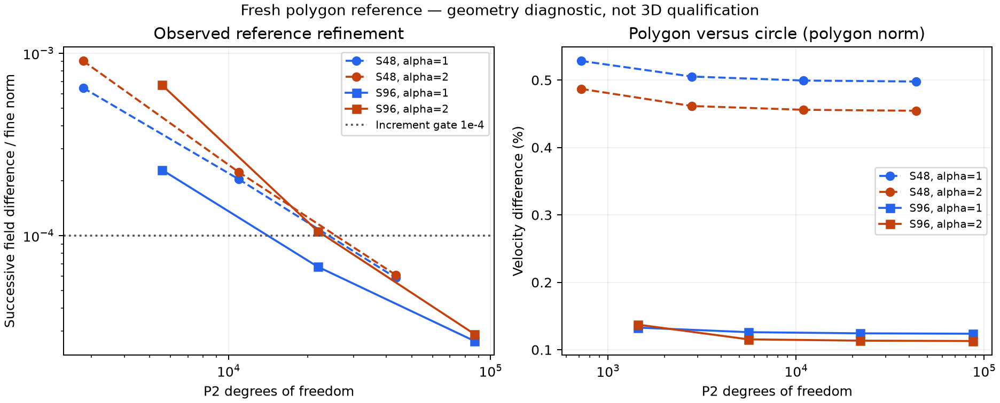

# 用双字长残量复核多边形管流参考解

本文面向需要复核小型参考计算的数值开发者。实现和验证证据见[本次重算记录](../../docs/research/data/macos-polygon-reference-2026-11-09/README.md)；本文不是通用高精度线性求解器的证明。

## 问题与离散

在直边多边形截面上求解复数标量问题
\( (-\Delta+i\alpha^2)U=0.01 \)，壁面零值。
采用二次三角形，组装刚度矩阵与质量矩阵，形成
\(A=K+i\alpha^2M\)。四阶一维 Gauss 规则经 Duffy 映射用于单元积分。
边界自由度先消元；非零边界制造解通过右端提升验证。

同一管网格生成器产生48或96边形，随后只加密三角形，不改变直边几何。不同层场在子三角形积分点上比较，粗场通过父单元坐标求值。该差值是观察到的加密变化，不是严格误差上界。

## 残量修正的实现范围

本机 `longdouble` 与 `float64` 的 epsilon 相同，直接改数组类型不能增加精度。
新辅助程序把状态表示为两个 binary64 数的和，使用拆分乘积与误差补偿加法计算复数 CSR 残量。
SciPy LU 给出初值及修正方向；状态更新保留高、低两部分。
每次修正后重新计算原组装矩阵的残量，要求相对值小于原定 \(10^{-11}\)，最多五次修正，失败则终止。
该实现仅针对本次有限、适中量级的系数；未验证溢出、下溢或任意病态矩阵。

## 实际验证

400个标量加法/乘法检查与含消去的复数 CSR 行由80位十进制运算复核。
P2常量刚度、精确多项式质量积分和三个非零复数二次制造解通过，最大节点误差约 \(3.06\times10^{-14}\)。
实际父子单元比较函数在倾斜三角形上的二次场误差为 \(2.47\times10^{-16}\)。

96边形最细层86785自由度，两个频率的初始残量约 \(2.38\times10^{-11}\) 和 \(2.06\times10^{-11}\)，超过门槛。
一次双字长修正后降至约 \(1.60\times10^{-23}\) 和 \(2.76\times10^{-23}\)。实际矩阵的选定行也由80位十进制独立核验。
这些数值是 binary64 组装矩阵的代数残量，不表示 PDE 解有23位精度。

## 结果边界与进一步检查

96边形的速度场与圆管解析场差异约为0.124%和0.113%；流量比较还包含积分域面积变化。
没有把几何差异与三维离散误差的范数直接相减。三维时间、空间、周期性和FSI验证仍须独立完成。

源码与全部实际命令在上述证据目录，原始网格和高/低状态数组归档逐成员校验通过。
进一步检查可以改变三角形质量或频率，观察修正是否仍收敛；超出本次范围时必须新增证据。

