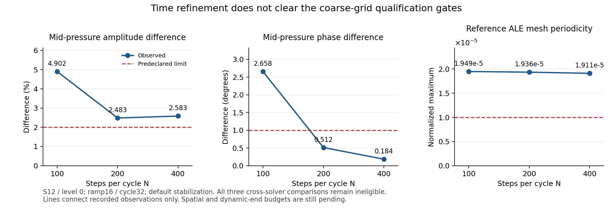
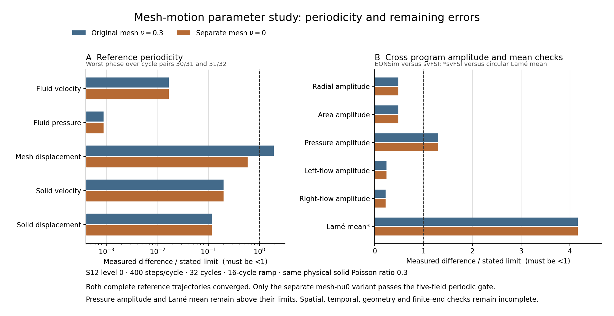

# 参考求解器对照前，先核对压力的离散时刻

2026-11-09北京时间09:00补充：[新的四组只读前缀](../../docs/research/data/reference-full-load-prefix-20261109t005527z/README.md)
把载荷阶段纳入结果说明。ν.3细N400、ν0细N400和ν.3细N200的已封存区间分别包含
400、1900和400个满幅步；ν0细N200的900个已核查续算步仍全部处于ramp。
四组每个FS/MS最终方程行均严格满足1e-10，最差4.2e-11、最多3次迭代。
这些事实证明所列区间的方程收敛，不能推出未完成尾部、周期场或跨程序响应已经通过。
封存时保留原日志前缀、实际native、全部冻结export输入及独立原生解析器，排除正在写的
最高checkpoint与其后续日志；不能把主动截取的前缀伪装成无中断全程记录。未发布。

2026-11-09北京时间06:59补充：前一段仍为未采用的局部证明；实际600交接现已有独立收据。
原生STOP让数值程序自然结束600，完整1200条最终方程行通过且全部旧进程身份退出后，
才以同一原生seed开始新的ILUT续算。原控制器仍预期6400，因而留下真实缺失文件失败；
该失败不能改成完成，也不能解释成数值发散。完整旧前缀和新不可变输入已封存，增长中的
新结果仍待最终6400链、全场和预算审计。[183文件实际交接证据](../../docs/research/data/reference-nu0-n200-native600-handoff-2026-11-09/README.md)
将“局部数值相符”“交接已执行”“长期资格通过”保持为三个不同事实。

运行中参考也可只读检查，但必须先选取完整区间并冻结原始字节，排除最高可能在写的步。
[三个明确区间的收敛证据](../../docs/research/data/reference-live-prefix-20261108t224736z/README.md)
分别覆盖1900、2100和1600步；所有最终方程行通过只证明这些前缀，不代替完整重启链、
周期性或物理精度。没有因前缀收敛而提高任何资格结论。此段继续保留为未发布草稿。

2026-11-09北京时间06:38补充：后端证明需要绑定具体离散家族。新的mesh-nu0细N200对照
从真实100检查点重现原200，再比较候选100态和候选190→200重放10态。原生每rank当前/
历史、方程范数与时间均显式比较；原恢复和候选自重放的算法字节完全一致，只排除elapsed
与非状态padding，后端之间则在数值阈值内一致。[561文件完整证据](../../docs/research/data/reference-nu0-n200-ilut-backend-proof-2026-11-09/README.md)
记录902.45/1501.60秒的局部成本比和独立raw复核。它仍是早期ramp，不外推满载或长期
稳定性。准备检查最初漏去checkpoint_interval差异而在数值启动前失败；修正仅明确N200/
N400的三项缩放关系，实际输入和容差未变。新的600边界接续另须核实自然停止、完整前缀、
旧进程全部退出与新输入绑定，不能把证明通过直接写成已执行交接。此段未发布。

2026-11-09北京时间06:30补充：上文精简报告对应的完整细网格采样轨迹现已封存。
[4995文件、143包完整证据](../../docs/research/data/elastic-s24-fine-eonsim-complete-sample-2026-11-09/README.md)
保存11601–12800全部current/history、实际11600边界、冻结输入源码和完整有界审计，
并保留原2GiB内存耗尽及失败消费者。归档完成没有增加新的物理通过项；既有1.237613%
Lamé均值及五场周期通过仍需与参考轨迹、各自空间/时间/尾项/采样预算共同判断。
全部包以普通Git内容逐字回读后保存，不能用本地存储路径代替仓库证据。此段仍未发布。

2026-11-09北京时间05:01补充（完整粗网格结果）：独立参考mesh-nu0的12800步、末三个
周期1200态已完整审计；固体泊松比仍为0.3。最后两周期ALE最大差6.6115e-6通过，质量
守恒、正Jacobian和逐步方程收敛也通过。相同400个存储相位比较后，位移/面积幅值差
3.02604%、两端流量1.83838%/1.85491%在门槛内，但中部压力3.11277%仍高于2%；两程序
Lamé均值误差均约3.19504%，亦未通过2%。因此，改善网格场周期性不等于消除跨程序
压力差或几何/端部误差。[完整参考与比较证据](../../docs/research/data/elastic-s24-coarse-n400-nu0-reference-pair-2026-11-09/README.md)
保存400相位P1全场差异，尚不能把其中ALE差异归因为单一因素，更不能代替各程序自己的
空间、时间、周期尾项和采样预算。原mesh-nu.3失败仍保留。

L24另有明确的后处理依赖迁移：原数值子进程继续自然完成6400，仅等待父被有意暂停，
通过身份检查和临时父子fixture后，计划在数值齐全时退休旧父并使用已验证的低内存
读取器，随后等待真正的L12续算结果。这是预先规划的后处理交接，区别于前述只有实际
OOM后才可触发的参考恢复预案；不伪造原失败或重跑PDE。
[准备档](../../docs/research/data/length24-postprocessing-preparation-2026-11-09/README.md)
尚不证明真实交接、L24场审计或长度比较完成。原长度比较算术逐字保留；长度同时改变
流体惯性，不能把全动态差异叫作纯端部误差。此段仍为未发布草稿。

2026-11-09北京时间04:38补充（后处理证据）：同一份数值结果，直接比较内存字典与
旧JSON也可能产生假差异。周期编号在内存中是整数，JSON对象键是字符串。本次参考
1200态读取已写出完整报告，随后比较失败；保留该exit1及零内存事件/空scope收据，
另立报告复核，以相同序列化形式逐值比较并重核全部raw SHA。全部物理/质量指标和
旧收敛量完全一致，ALE周期失败仍保持，既不重算数值，也不放宽浮点阈值。
[完整失败与复核](../../docs/research/data/reference-bounded-reader-and-preparation-retry2-2026-11-09/README.md)
将“读取已完成”“比较代码失败”“独立复核通过”分别记录。对尚在运行的旧分析器，
只准备严格受限的未来恢复条件；没有实际后处理失败，就不能触发恢复或改写旧状态。

2026-11-09北京时间04:10补充（实现/控制验证）：把未启动的参考对照提前到空闲CPU，
需要绑定输出所有权和最终预算消费者。独立nu0粗N400/细N200仍使用原f3求解器、双rank、
逐字export与相同物理输入，只改变运行时机和CPU。当前细N400没有收到信号。
两个原规划目录在独立审查后显式接管；原冻结循环的存在性guard在实际fixture中于
任何export或数值调用前拒绝重复任务。未来原fine审计结束后的预期guard失败必须保留，
并逐项核对完整fine资源和报告后才能组装新完整家族，不能改写旧状态为成功。
新预算读取相同fine续算链及实际coarse/time日志，核心算术逐字不变；仅替换无锁无子
任务的旧等待器。[69文件不可变交接证明](../../docs/research/data/reference-nu0-early-companion-ownership-2026-11-09/README.md)
只证明已执行的控制与输入绑定，尚不包含新对照结果，也不声称未来旧队列已退出。

2026-11-09北京时间03:27补充：有界内存修正已在细网格的全部1200存储态上完成实际
审计，峰值90243072B、3313.361秒，零内存事件。五场末两周期最大差2.47298e-7，
阶段守恒/运动学/正Jacobian通过；径向位移均值相对无限圆管平面应变值误差1.237613%，
低于2%。[完整审计报告证据](../../docs/research/data/elastic-s24-fine-bounded-audit-report-2026-11-09/README.md)保留输入不变哈希。
这些结果只解决这一网格和采样窗口的指标；参考程序及各自空间/时间/尾项/采样预算
未完成，原粗网格和原分析OOM失败均不能删除或改判。完整数值轨迹另在封存中。

2026-11-09北京时间02:35补充：独立nu0的三个研究并不把日志放在同一个位置。
细网格已原生续算，需显式restart-chain；尚未执行的原始coarse/time日志将由家族
控制器写到自己的目录。新消费者逐一绑定这三条路径，并保持预算kernel逐字不变。
独立检查涵盖4种实际函数命令路径、物理报告不变及旧等待器无子任务/无锁，随后先
启动新消费者再仅取消旧等待器。全部数值生产者继续，完整预算仍未产生；
[86文件证据](../../docs/research/data/reference-nu0-bounded-budget-consumer-2026-11-09/README.md)
保存实际交接和范围限制，不能把分析依赖修正当成物理验收。

2026-11-09北京时间02:22补充（分析内存，代码基线6bce127）：数值计算完成并不保证
全场审计能在同一资源预算内完成。S24细N400的12800步和1200个存储态已经齐全，但
分析器把400相位的整份节点字典留在内存，触及2GiB而被终止。这个失败属于后处理，
不需要重算PDE，也不能直接把缺少审计的轨迹标为合格。

修正只保存每个相位的文件路径，比较时重读上一周期的同相位场，保持原积分和累加
顺序。新增测试跟踪活着的读取结果，并使用非零逐周期压力漂移检查最大相位差、RMS
与均值；旧代码确实失败，新版Windows/WSL各9项通过。完整粗网格1200态重分析除源码
SHA外所有值逐项相同，峰值36995072B、566.535979秒，2GiB/swap0下没有内存事件。
这以额外读取换取与相位数量无关的场内存；细网格补审计仍需实际完成，不能从粗结果
推断其物理资格。[完整证据](../../docs/research/data/pressure-audit-bounded-memory-validation-2026-11-09/README.md)
同时保存旧OOM收据和失败源，原数值输出前后哈希不变。

新的分析器身份还会触发预算消费者重审旧报告。若参考轨迹由多个原生续算段组成，
必须传入显式restart-chain，不能退回只检查最后一个svfsi.log。三种命令路径已验证，
原误差预算kernel逐字不变。真实1600边界再次完整对照后才
[采用MUMPS/chord](../../docs/research/data/elastic-n200-native1600-handoff-2026-11-09/README.md)；
原1647之前的后续尾段仍保留，选定1600为接续边界。局部约63%–65%的成本减少只属于
此次共享CPU、中段载荷对照，不延伸为全程性能或物理验收结论。

2026-11-09北京时间01:51补充（直接后端事件与接续范围）：EONSim的真实N200
1400检查点对照使用同一旧binary，默认SuperLU_DIST8步在前后两次测量耗170.780s与
161.065s，MUMPS/chord8步耗50.510s；全部24对状态的当前量、历史量和五场P1比较通过，
4+4重放及legacy v3时钟也通过。第一次独立复核却失败了：它误以为两个后端都必须
记录MatLUFactorNum。原始profile显示旧路径使用MatLUFactor（16次），新路径使用
MatLUFactorNum（8次）；记录事件种类并按实际路径检查后，独立回读通过。这里没有
改变收敛或误差门槛，也没有为了修复读取器重算数值。完整原始profile、首次失败和
通过结果见[356文件证据](../../docs/research/data/elastic-n200-mumps-chord-option-proof-2026-11-09/README.md)。
这只是在共享CPU上的中段载荷局部比较；后续1600边界验证、长程物理与误差预算仍必需。
参考程序的另一路N200已自然到达1100并通过完整前段收敛后接续ILUT；原审计失败和
[实际交接](../../docs/research/data/reference-n200-native1100-handoff-2026-11-09/README.md)均保留，
缺少的convergence-svfsi文件名族以[单独补档](../../docs/research/data/reference-n200-native1100-audit-tail-2026-11-09/README.md)保存，未改运行中的冻结捕获器。

2026-11-09北京时间01:29补充（有界N200执行证据）：真实600→700检查点对照中，
原FSILS的100步耗3004.393521s，ILUT耗1590.483061s，约减少47.1%。独立回读全部
100态与690→700重放10态后，五场节点、P1质量范数和原生历史最大差分别约
1.843e-17、4.483e-15、2.956e-15，保存方程范数相同、物理时间精确相同。候选重放
的算法字节完全一致，仅诊断计时和非状态padding不纳入算法比较。基线并未重跑：
已数值成功但被旧午夜审计拒绝的完整文件逐字复用，原失败仍可追溯。这个中段载荷
结果只支持受审查的后端接续准备，不能替代满载、末周期与空间/时间预算验收。
原始字段、完整native记录、成本收据及独立审查见[556文件证据](../../docs/research/data/reference-n200-midnight-backend-proof-2026-11-09/README.md)。

2026-11-09北京时间01:08补充（实际交接证据，代码基线fce909d）：原S24细N400参考
自然完成第4000步，完整前段8000条最终方程行均严格收敛，检查点与原物理时间精确
绑定。原完整12800审计失败、旧交接的诊断字段拒绝和下游失败全部保留。新独立审查
通过后才从该边界采用已对照的ILUT后端继续4001..12800，并让预算明确连接新轨迹。
这使执行失败、前段数值证据和后段待验结果各自可追溯。归档只含封存的原轨迹及
不可变交接，不包含增长中的新结果；[218文件完整证据](../../docs/research/data/reference-fine-native4000-handoff-2026-11-09/README.md)
已逐包回读Git实际字节。完整周期、误差预算和物理资格仍待验收，文章仍未发布。

2026-11-09北京时间00:40补充（实现和验证证据，基线a0a4675）：诊断耗时也需要与
算法时间分开。固定版本`Code/Source/svFSI/UTIL.f`的`CPUT()`使用当天时、分、秒和
毫秒，不包括日期；`OUTPUT.f`把它与启动计时之差打印为`T`，也写入原生重启文件。
跨午夜时这个诊断差可以为负，不能因此推断物理时间倒退或非线性迭代失效。

实际N200原生600→700的100步数值成功后，旧解析器因负诊断值拒绝完整日志。新审计
仅允许有限的带符号elapsed；物理时间、保存方程范数、各残差比仍须非负且有限，
历史场必须有限，输入/种子/完整链的SHA绑定保持原样。700终态与原连续轨迹的算法
字节完全一致，只有诊断elapsed不同。双rank4400中master为负而另一rank仍为正，
说明不能再额外要求所有rank的诊断计时相同；步号、物理时间与保存范数仍要求相同。

Windows相关6+16项、WSL28项参考和8项压力测试、26项CI选测均通过；真实100步全部
严格相对收敛与单/双rank原生记录已回读。成本仍采用外部单调计时收据的3004.393521s，
不用这类当天秒数诊断计算加速比。原失败与首轮错误计时假设保留，新对照复用已成功
基线的完整字节，尚未完成的候选计算仍独立验收。这不是物理资格或全项目通过声明。
原始100步、验证命令/日志、固定上游源码和失败记录见[344文件完整证据](../../docs/research/data/reference-midnight-diagnostic-audit-2026-11-09/README.md)。

2026-11-08 15:00补充（基线abec003，验证与实现证据）：原生停止也需要实际证明。
固定参考的`MAIN.f`在耦合时间步结束后读取`stopTrigName`，达到目标步时写出完整
checkpoint，再输出结果并正常退出。`READFILES.f`将`appPath`加到这个文件名之前，
而当前输入把`appPath`指定为`results/`。首次独立小试把`STOP_SIM`放在输入cwd，
程序因而继续超过目标步；这是执行路径错误，不能写成停止机制已验证。该小试已受控
取消，部分输出、失败和资源清理收据全部保留，正式计算不受影响。

新目录中使用`results/STOP_SIM`后，原单rank2800→2810及原双rank2600→2610各10态
正常退出。输入仍声明原100步目标，五场和完整原生Yn/An/Dn、保存范数、时间与此前
不中断oracle完全一致；算法字节比较仅排除elapsed和直接记录padding。该试验没有
比较性能，也没有切换任何长期生产者。后续交接还须绑定完整来源、真实边界状态与
后续预算消费者，不能把一次正常退出当作全程物理资格。

预算消费者保留原P1误差预算函数和时间/尾项/采样门槛，只调整后端接续
后的输入路径及匹配分析器。旧报告保留，重算报告的全部物理量和原有严格收敛指标
必须不变。停止证明与已完成粗配对的实际重算已由另一执行过程复核，所有物理报告值
完全一致；这里的“独立”指同一agent重新执行原始数据审查，不表示外部人工审查。
[257份完整停止和准备证据](../../docs/research/data/reference-native-stop-and-handoff-preparation-2026-11-08/README.md)
包含首次失败、两组10态、同版审查和最初未执行的交接定义。

2026-11-08 15:43补充：调度失败也应与数值失败分开。S24细网格EONSim已成功完成
11600步预热，但旧控制器要求逻辑CPU22/23都空闲，另一已授权参考程序使用CPU23，
因而在采样开始前被拒绝；依赖它的旧预算等待器也随之退出。完整检查点没有损坏，
不需要把预热重跑，也不能把失败状态改成成功。

独立目录保留同一2692二进制、物理输入、时间步和MUMPS/chord选项，将实际11600状态
分别推进两步与分成两段重放。11601/11602共22个HDF数据集、全部算法历史、五场节点
与P1质量范数、旧v3clock的差都是0，经单独回读才开始剩余1200步采样。执行记录明确
逻辑CPU22与guest sibling23共享，不据此声称宿主物理核独占或扩展性。

恢复还必须连接下游消费者。新的预算任务显式指向新EON采样路径，保留原预算算术；
参考侧的4000正常停点请求经修订审查后发出。到本记录时原参考仍在计算，尚未到边界
或采用新后端。原生短程证明、调度恢复和完整物理资格仍是三个分别需要核实的结论。
[283份恢复与交接证据](../../docs/research/data/elastic-s24-sample-recovery-handoff-2026-11-08/README.md)
保存原失败、全部可用预热输出、两态重放和不可变接续记录，排除正在增长的采样数据。

2026-11-08 14:17补充（基线27f5c82）：同版分析器重算已经完成，S12其它所有报告值
保持一致；完整6400链、800态及200相位比较可复核，但Lamé约4.80%和参考ALE约2.625e-5
仍不合格。S24粗网格完整12800步比较也已结束，Lamé约3.20%、中p幅值差3.11%仍失败。
这些是完成的数据集，不是通过资格的数据集。

串行细网格和双rank的实际100态提速对照及10态重放均经过独立原始数据检查，成本比
分别0.729680/0.765242。把它们用于后续续算，还需要显式记录执行身份：v2链绑定两个
二进制、相同物理输入/输出格点、实际rank布局、完整原生seed、独立proof的源码和raw
哈希；只允许已测FSI-ILUT变化。旧v1默认仍拒绝隐式后端变化，每个长期方程步和物理
误差预算仍须单独通过。[契约验证](../../docs/research/data/reference-backend-transition-contract-validation-2026-11-08/README.md)
通过Linux23参考+8压力、Windows4项以及两真实proof绑定，未执行后端交接。

Windows临时目录还暴露了同一文件的短/长路径别名：TFBLAB~1与tfblab633字符串不同，
却指向相同数据。来源哈希不应因路径拼写而误判；读取证据时规范化路径，同时拒绝
重复别名，以免同一数据被重复计作独立证据。保留首次失败，验证修复后再封存。

2026-11-08 12:06补充（基线243c9d0）：完成参考800态审计后，S12交叉比较因新旧
分析器SHA不同而拒绝继续。来源检查不应被删去；当前以参考的同一冻结版本重新
生成EON审计，要求除脚本SHA外所有报告值完全相同，再比较字段。数值轨迹不重跑。
参考ALE末两周期2.625e-5未过1e-5，不能因其它四场、守恒和收敛通过而省略ALE。

双rank实际2600→2700的100态原程序/候选对照以及10态候选重放已完成；原程序
复现真实2700算法字节，候选五场/历史差约机器精度，重放除elapsed/padding逐字
一致。耗时1839.649→1407.777秒仅支持当前共享CPU10/16位置的有限成本判断，
独立审查与正式全链后端交接尚待。另一方面，保持FSI-ILUT后再改mesh预条件为IC，
虽全部数值检查通过，却使20步105.186→149.428秒，因此淘汰。
[完整失败/淘汰记录](../../docs/research/data/reference-rejected-mesh-ic-and-placement-2026-11-08/README.md)
保留原输入、50态输出和资源收据；不能仅凭预条件器名称推断加速收益。

2026-11-08执行收尾补充：S12恢复达到6400后，数值进程返回0，但资源组仍有一个MPI
辅助进程；原控制器清理后仍记failed。完整801场文件和最终native状态经过独立核对，
随后另启后处理，不重跑或改写原失败。完整6400步的12800条最终方程记录通过，800态
物理审计仍进行中。这说明执行收尾、输出完整性、方程收敛和物理资格应分别记录：
不能用某一层的成功或失败直接替代其他层的判断。后续记录见项目会话日志。

2026-11-08原生记录与后端补充（基线1374b625，未发表）：固定双rank直接记录采用
共同RECL709864B，但两个rank有效payload分别709864/604864B。尾部105000B是padding，
不能纳入有限数值或算法历史比较；各rank自己的elapsed也不是时间积分状态。新解析器
核对rank布局、完整有限Yn/An/Dn和一致step/time/保存范数，原serial契约保持。
[19参考+8压力测试及五份真实文件解码](../../docs/research/data/native-two-rank-record-audit-2026-11-08/README.md)
通过只证明格式与来源检查，不证明相同分区恢复后的轨迹；后者仍须实际运行。

[固定原码Trilinos串行证明](../../docs/research/data/reference-trilinos-serial-proof-2026-11-08/README.md)
覆盖20态启动、实际满载S12第6000步后20态和候选10态重放，均经独立原始数据回读。
满载候选节点/P1质量/全部native历史差分别1.839e-16、4.546e-14、3.186e-14；保存范数
差0、原生时间exact，重放除elapsed逐字一致。原程序与候选20步分别265.064/127.284秒，
仅是同一共享WSL逻辑CPU上的有限成本证据。物理、网格CG和容差没有变化，FSI预条件
改用固定源码内置ILUT且禁用Trilinos装配；源码含零对角替换，因而必须实际核验。
本证据不授权去掉完整重启链的后端身份检查，也不代表双rank/长周期或误差预算通过。

后续执行筛查（2026-11-08）：[162份原始记录](../../docs/research/data/reference-allocation-screens-2026-11-08/README.md)
显示四rank原GMRES100在首步长时间迭代；空间200变体虽写出5个时间步，但第5步网格
方程到30次迭代仍2.51e-9，高于1e-10，不能当作收敛。回到双rank原100后，20态五场
最大节点差1.6653e-16、质量范数差2.4558e-14通过；实际236.232秒相对此前261.554秒
仅节约9.68%，未达预设10%，仍不采用。参考源码和全部容差未改；这不是长期资格通过。

资源标注校准（2026-11-08）：下文CPU编号及核分组来自WSL虚拟机，不能当作宿主机物理核绑定的证明。
[Windows/WSL实测记录](../../docs/research/data/execution-topology-2026-11-08/README.md)分别报告16核/24逻辑处理器与12个双线程核组。
原始档案、数值结果和门槛保留；本地耗时不支持宿主机扩展性结论。

## 一个没有空间误差的检查问题

刚性直管两端施加相同压力，侧壁固定。连续解为 \(u=0\)、\(p=P(t)\)，
即使网格很粗，空间常数压力也可精确表示。这个问题能检查导入和载荷时刻，
不会把空间离散误差混入时间约定。它不能代替弹性管验证。

固定参考版本为 svFSI `7bdb74cdd517310d6bf32c0bb7d42072aeac8658`，从只读
仓库导出、独立编译，没有修改参考源码。`MAIN.f` 在步开始把全局时间推进至
终点，随后 `SETBCNEUL`/`IFFT` 使用该时间读压力；`PIC.f:PICI` 同时把压力
插值到 alpha_f 阶段。这意味着输出的终点变量满足

\[
\alpha_f p_{n+1}+(1-\alpha_f)p_n=P(t_{n+1}),\quad p_0=0.
\]

当 rho_infinity=.5 时 alpha_f=2/3。若直接将输出压力与 \(P(t_{n+1})\) 比较，
会把变量的离散表示误判成输入错误或物理误差。对阶段载荷的一致输入，应明确
提供 \(P(t_{n+1}-(1-\alpha_f)\Delta t)\)。本实现以显式选项设置 Fourier 初始
时间，偏移来自格式公式；没有从待比较的结果中拟合相位。

## 实际验证

`d280e7f` 的导出与审计工具完成了原生终点时间输入的100步检查：325节点、
1296四面体、\(P=.02+.01\sin t\)。最大速度2.51e-15，压力递推误差4.61e-13，
空间压力极差4.53e-13，均小于审计使用的1e-9门槛。所有实际输出步均读取并核验。
显式阶段转换的真实运行和弹性管对照在这一检查点仍待执行。

网格也需要独立验证。旧 ASCII 读取器要求逐行标签并对连接表作额外尺寸假设；
尝试多分量连接表又被标准 VTK 读取器拒绝。未压缩 raw 格式虽通过标准读取器，
仍被旧 svFSI 报块尺寸不符，增加填充也未解决。最终采用参考程序原生的 zlib
压缩格式，标准 VTK 与 svFSI 均通过，才进入上述物理检查。所有失败输入均保留。
这些失败的 svFSI 进程返回值为0，因而退出值不是可靠的成功证据。

## 对照的边界

后续静态阅读还发现一个与方程无关、却会破坏对照的数据问题：FSI 与 mesh 方程都
默认输出名为 `Displacement` 的数组，但前者在固体上表示结构位移，后者在流体上
表示 ALE 位移。导出器使用固定源码支持的 `Output: Alias` 分别命名，审计再依据
`Mesh_ID`、参考坐标和实际单元拓扑确定每个字段的物理域。未被该域单元使用的输出点
没有物理场解释，不能参与范数。五项独立后处理检查已通过，真实耦合输出仍待验证。
独立VTK9.6.1实测中，旧同名数组确实被忽略一份；新命名的制造场物理值全部读回，
参考坐标差1.11e-16。制造的48快照历史也恢复了已知谐波和阶段时刻，见
[原始核验](../../docs/research/data/pressure-tube-audit-2026-11-07/README.md)；这些不是实际弹性求解结果。

质量残差也必须保留时间语义。alpha 格式在阶段几何和阶段速度上满足离散连续性；
输出终点上的通量与体积差另有时间离散误差，不能混称为阶段残量。完整审计显式重建
阶段场，同时单独记录终点梯形积分预算。材料中环的投影面积、径向平均和参考面积
加权压力是明确观测，不宣称为当前空间固定平面上的切片。定义与事前尺度见
[压力管审计说明](../../docs/development/PRESSURE_TUBE_FIELD_AUDIT.md)。

相关[原始日志、输入、场和复现命令](../../docs/research/data/svfsi-import-2026-11-07/README.md)
提供213文件的回读哈希验证。三项几何/Fourier测试独立检查外法向、父单元、
散度定理及流固界面的相反三角片。

后续弹性比较使用两边均可表达的参考构形小应变线弹性材料；不能仅因
Neo-Hookean 名称相同，就假定两种能量和体积项一致。两套 alpha 的其他权重、
启动方式、稳定化和内部 ALE 网格运动仍可能不同，需要实际时间/空间预算。
本稿只说明理论、实现与已执行的输入检查，无性能或生产级 FSI 结论，未发布。

后续源码核对明确了内部 ALE 的实际差异：EONSim 在固定参考网格上做向量 Laplace
扩展；固定 svFSI 的 `CONSTRUCT_MESH` 在上一步网格上求位移增量的伪弹性扩展。
因此，即使两边物理材料、界面和载荷匹配，参考节点对应的当前内部空间位置仍可能不同。
跨程序的参考坐标场差不能直接称为同一当前位置的物理误差；壁面响应、压力和通量
仍按事前门槛比较，两个程序各自完成空间、时间、尾项和采样预算。

新增比较辅助工具用五项已知信号/拒绝检查及三项嵌套场/双读取器检查验证了这一
分析链。零振幅的相位不计为通过，制造场标记不能转成物理通过；拓扑不嵌套时
拒绝套用精确细网格质量范数。见[比较证据](../../docs/research/data/pressure-tube-comparison-2026-11-08/README.md)。
这仍是分析工具证据，真实弹性结果尚待计算。

## 真实输出暴露的第二个读取契约

首次600步耦合运行完成后，旧审计拒绝了参考坐标。固定版本的
`vtkXMLParser.f90:putVTK_pointCoords`显式将坐标写为Float32，物理场仍是Float64。
此前制造文件使用双精度坐标，因此没有覆盖这个实际存储差异。

修正后的读取器把输入节点精确舍入为binary32，再用实际输出坐标匹配；出现碰撞、
一个ULP的错误坐标、缺失节点或不同拓扑都拒绝。匹配成功后使用原输入几何积分，
不改变物理场。六项单位检查和独立VTK生成的两种坐标类型均通过；这并非放宽距离
或物理验收容差。原始失败和场文件保持完整。

两边重审通过界面约束、阶段质量及正几何；最后两周期全场差仍过大，尚未达到周期态。
中部压力振幅差4.9021%、相位差2.6578度，超出预定门槛。平均径向位移对无限圆管
Lamé值的偏差约8.3153%，几何与有限端部影响仍需分别量化。因此，成功输出600个时间步
不代表弹性管通过。显式阶段压力100步精确输入检查则已独立通过，最大阶段误差1.45e-13。

## 预热后的窗口仍需要真实初态

长暂态可以只保存后期周期，但不能把窗口起点当成零位移、零速度。审计要求前一个
真实终点，以它重建阶段场并初始化体积/净通量积分；仍须至少三个完整周期和原门槛。
已知1%静态膨胀的制造历史验证了窗口与完整历史逐行一致。若错误地用初始参考体积，
会留下大于1的体积缺口。这个制造场故意违反端部约束，也被正确判为不合格。
[11项窗口检查](../../docs/research/data/pressure-tube-window-2026-11-08/README.md)仅验证分析链，
真实延长预热研究尚在运行。首轮两套实际600步及其失败/修复证据共3423文件已核验，
见[首次弹性结果](../../docs/research/data/pressure-tube-first-2026-11-08/README.md)。

## 平滑启动不能只检查输入曲线

固定参考的General输入在每个面节点给出时序值；`IGBC`线性插值并对表末时间取模。
输入适配把所需压力精确放在每个实际固定步长读取时刻，并增加一个运行终点后的结点，
避免末步回到启动值。`SETBCNEUL`对General标量直接使用，对Fourier路径则自动取压力
负号，因此表中需写负压力。阶段偏移仍由alpha_f推导。默认Fourier路径不近似ramp，
调用者必须显式选择General输入。

在0b9e980之后的归档实现上，普通正弦和半周期五次平滑启动各运行100步，最大终点
递推误差分别4.188e-13和4.050e-13，均低于原1e-9门槛。导出5项、审计7项、制造启动
比较6项也通过；[输入与全部输出](../../docs/research/data/pressure-general-input-2026-11-08/README.md)共288文件核验。
这证明固定步长载荷的输入约定，不能外推到任意变步长或弹性周期收敛。

真实EONSim长预热到132周期后通过周期场门槛；两周期ramp、总12周期的候选仍未通过。
所以“启动更光滑”不是“周期态已到达”的证据。不同启动必须明确记录，在各自ramp结束后
比较同一求解器的完整场；材料、其他边界和物理门槛不能随之改变。长预热的参考对照及
更长ramp候选仍在运行，完整弹性资格尚未完成。

运行环境也必须分开。清理参考程序的库路径后，遗留的OpenMPI5 `sm`通信选项仍会使
系统OpenMPI4在初始化时失败。此类失败没有数值结果；保留日志、输入哈希并仅重试参考
部分。调度器还需区分“锁已释放”和“退出状态已写完”，避免异常处理时的短暂竞态。

## 成功退出、相对收敛与周期场分别检查

固定`PIC.f`将达到最大迭代数也标为ok，程序可以继续输出尚未收敛的场。小启动压力使
既有线性绝对停止下限先触发，ramp2/c12的2400个最终方程行都达到上限，其中1215行未达
任一相对标准。新审计逐步、逐方程核对打印值，绑定实际输入清单；没有日志证据时比较
资格保持未验证。打印值恰在门槛上时也不当作通过。

显式收紧线性绝对容差后，ramp16首步在1e-22仍有mesh相对残量1.1e-10，保持失败；
1e-26的N100/N200五步实际检查均通过。非线性1e-10、材料、载荷和物理门槛没有放宽。
[原始输入、日志、成功与失败](../../docs/research/data/svfsi-convergence-2026-11-08/README.md)共181文件核验。

完整13200步参考日志通过26400方程步检查，但其内部网格位移周期差约1.95e-5，仍大于
1e-5。ramp16/c32的参考场也有该问题。事前规定五场最大相位差门槛1e-5后，EON缩短
预热的对照最大1.891e-6，通过；参考内部mesh差.00217017，不通过。两边物理速度和
结构位移接近并不能替代内部网格判据。下一步实际减半dt，区分时间步影响与网格运动
算法的累积差异；该检查点尚无完整弹性资格。

## 用实际场回放区分时间误差与增量网格漂移

随后完成N200的6400步：参考每个方程步都通过相对收敛，但网格周期最大差仍为
1.93514e-5。压力幅值差从约4.90%降至2.48284%，尚未过2%；相位差.51230度通过1度。
因此减半时间步改善了物理响应对照，却没有消除内部网格漂移。

独立稀疏装配读取真实边界历史，在每一步的旧网格上重建固定参考的伪弹性算子。
`MESH.f`的积分权重不含单元Jacobian行列式，回放也保留这一按单元体积归一化的
约定。N100/N200实际内部网格的最大归一化节点差只有2.70e-15/4.79e-15，低于事前
1e-8门槛，支持回放确实覆盖了实际更新路径。

再从边界历史中减去首尾差的线性插值，使一周期边界严格闭合。增量几何仍留下
1.94584e-5/1.93212e-5的网格RMS漂移；保持初始几何的同一伪弹性扩展则回到约1e-16。
反向走完边界路径也保存了独立结果。这为本组粗网格历史中的路径依赖提供了直接证据，
不能再把继续预热视作消除该项偏差的充分办法。

固定几何的回放仍是伪弹性，并不是EONSim的向量Laplace网格方程；它没有重做流固耦合，
也不替代原参考结果。原1e-5周期门槛保留，空间细化影响仍待计算。完整输入、场、失败
状态和回放实现见[时间与网格证据](../../docs/research/data/pressure-tube-time-2026-11-08/README.md)。

独立静态[九组Lamé诊断](../../docs/research/data/lame-static-2026-11-08/README.md)把同一多边形
场加密与增加圆周分段分开。最细48边形的平均壁位移偏差降至.3384%，但体积场误差
并不全程单调。该诊断的端部仅固定轴向，与耦合问题的全夹持不同；不能据此宣布耦合
均值或端部误差通过，也不能用两个误差范数相减得到独立几何误差。

随后[十组全环夹持静态研究](../../docs/research/data/clamped-static-2026-11-08/README.md)直接采用
全分量端部约束，不施加四分之一对称。保持截面与局部网格尺寸，管长从12增加到24，
中部位移变化为Lamé尺度的.30%–.39%；S12的L12网格与实际耦合输入逐项匹配。
该配对量化了静态端距敏感性，但还不是动态端部误差界。S24/level1的静态均值偏差约
1.25%支持开展该候选的短程耦合预检，不能替代原动态验收。
## N400 并未清除粗网格的两项失败

继续减半时间步后，两程序均完成12800步，参考全部方程步相对收敛。EON最后两周期
通过全场门槛；参考内部网格最后周期最大差1.91055e-5，仍超过1e-5。中部压力相位差
降至.183517度，但幅值差2.58266%仍超过2%。不能因为相位改善，就宣布整个对照合格。

图中网格周期值取要求核对的两个末周期差中的较大值；这与仅列最后周期的数值略有不同。
三组均使用同一S12多边形、level0与默认稳定化，不拟合外推阶，也不把仍失败的参考
内部网格从资格条件中删除。空间细化与几何/动态端部预算仍需分别检查。

N200→N400实际五场差、31→32尾项以及200→400采样差已单独保存。
时间差使用200个严格共同相位；采样使用本次真实400个状态及前一周期实际端点。
参考的未周期前提始终为false；空间分母尚未完成，所以没有10%预算通过结论。
[8289份原始文件和完整命令](../../docs/research/data/pressure-tube-n400-2026-11-08/README.md)
已回读核验，诊断图另保存输入哈希并目视检查。

归档本身也有需要保留的失败：S24短预检中的`stFile_last.bin`是合法硬链接，tar默认
保留该关系，触发了新归档器要求普通成员的断言。保留原包与源码后，显式解引用重试，
[79份输入/输出](../../docs/research/data/pressure-s24-preflight-2026-11-08/README.md)
均按原字节核验；没有重新求解，更没有把归档修复当成新的数值验收。

单进程计算的执行成本另作独立检查。固定EON接受态1400之后的三步，默认SuperLU_DIST、
MUMPS、串行SuperLU与MUMPS加步内Jacobian复用的局部耗时分别为17.956、11.194、60.128、
6.633秒。末态最大场差不超过3.47e-17，五场归一化质量范数差不超过1.21e-14；停止准则
和物理输入不变。没有因为某个库名更适合“串行”就推定它更快，实际串行SuperLU反而更慢。

这组逻辑CPU与参考计算共享WSL报告的核分组，只能作为候选筛查；
[103份核验证据](../../docs/research/data/elastic-direct-options-2026-11-08/README.md)
保存全部命令、状态、原始输出和范围限制。必须再用S24细网格的完整接受态复核，才能
显式派生长续算。原参考求解器不修改，短程末态一致也不替代长期周期和误差预算。

S24的独立复核随后使用完整第400步接受态，在原求解进程退出后的CPU22执行两组三步。
耗时21.886→14.335秒，末态最大节点差7.454e-20，五场归一化质量范数差最大1.122e-17，
同时满足预声明字段门槛和20%局部成本收益。于是显式派生MUMPS+chord长续算，仍使用
同一b072二进制与物理输入。原日志已到402步，401/402仍保留并从完整400步重新计算。
这比把日志最后一行直接当成可恢复状态更准确；完整算法历史与清单才是恢复依据。

[116份交接文件](../../docs/research/data/execution-continuations-2026-11-08/README.md)
保存了已完成短复核、计划中断和带时间的运行快照。参考仍在原目录，后续比较须显式
连接新EON结果与原参考结果。快照中的长期研究尚未结束，不能据此宣布周期或预算合格。

长度诊断也要保持局部离散可比。新的L24/S24研究把长度和轴向种子数同时加倍，
逐一验证中段平移后的20736个流体、13824个固体四面体与L12完全相同。
同负载、时间步和b072下，默认直接解与MUMPS/chord三步末态差2.844e-25，
因此开始独立32周期研究。[66份预检证据](../../docs/research/data/pressure-length-preflight-2026-11-08/README.md)
保存匹配证明及局部短程对照；完整动态长度结果尚未产生。

夹持端离中部更远，同时管内流体的惯性也随长度改变。即便局部网格完全相同，
两次动态响应的总差也不能全部归因于端部离散误差。静态Lamé筛选、完整动态长度
敏感性、不同程序的一致性和周期预算应各用自己的证据，不互相代替。

## 相同闭路的细分与不同边界形状方向

更细的诊断保持边界路径本身不变，只将每条线段细分。200、400、800增量下，内部
漂移分别为1.93212e-5、1.92857e-5、1.92681e-5；这与重新跑耦合问题改变时间步不同。
首时间谐波产生近乎相同的漂移，而仅保留一个空间形状方向的往复运动约为2.05e-7。
两个边界谐波方向的节点SVD奇异值比约.353，说明它们并非简单成比例。

[34份机制诊断](../../docs/research/data/reference-mesh-loop-2026-11-08/README.md)支持以下有限
结论：固定这一闭合边界路径时，单纯细分增量并未消除观察到的网格漂移。内部网格
nu参数也影响漂移，nu0的回放较小，但一个预设边界回放不能直接证明完整耦合合格。
因此另建原二进制、同物理输入的nu0完整对照；它必须重新接受全部原门槛，原nu.3
失败仍保留。没有把网格材料参数与真实固体材料参数混为一谈，也没有改后者。

完整nu0粗参考随后完成12800步，所有25600条FS/MS最终方程行满足原相对收敛条件。
末两个周期差的最大网格漂移为5.89523e-6，全部五场周期和质量通过；但中部压力幅值
差2.58247%仍超过2%，Lamé均值差约8.31525%也未改变。
[1783份原始记录](../../docs/research/data/reference-mesh-nu0-2026-11-08/README.md)已经回读核验。

图中每项除以它自己的原定门槛，左图采用对数坐标。参数变化明显改善内部网格周期性，
其余观测量几乎不变；这不能证明空间离散或动态端部误差已经足够小。新的S24空间/
时间配对和独立预算仍在进行，原nu.3失败不变。绘图只读取已完成审计，不重新求解。

2026-11-08追加：原nu.3的S24粗N400现已完成12800步及全步相对收敛审查。最后两个
周期的ALE位移差为2.211333e-5、2.211283e-5，仍超过1e-5，其余四场和质量通过。
两个末周期数值接近，不能仅凭增加计算时间就假定它必然消失；独立nu0系列仍须自己的
完整空间、时间及周期证据。这份原失败继续保留，不因其他指标通过而改变结论。

## 原生续算的证据链

S12参考程序在原12小时限时处停止，最后完整5641步、5642部分迭代。实际5600重启
文件保存完整原生Yn/An/Dn及时间。新目录续算20态与原输出五场完全一致，再从5610
重放10态，除elapsed执行耗时外全部二进制历史逐字相同；保存时间也相同，不套用
EON的v4时钟表述。[原生证明档案](../../docs/research/data/reference-s12-native-restart-proof-2026-11-08/README.md)
保存原限时失败、首次启动竞态、完整数值证明和独立审查。完整6400数值恢复、800态
审计和200相位比较现已完成；原收尾与分析器身份失败仍保留，Lamé和ALE门槛仍未通过。

收敛证据不能靠拼接日志或把Continue1改成Continue0得到。新审计要求连续选定区间、
同一物理/压力/网格输入、真实前段checkpoint的哈希、正确原生记录及后段初始化日志。
原始尾部明确列为排除，而不是声称已收敛。完整场审计要求覆盖整个研究的链，并核对
续算边界场文件来自原段；单个晚期日志不能证明此前数千步。

16项参考和8项压力审计测试及真实两段/三段日志核验通过；原1..5600的FS/MS最终比
最大5.6e-11/9.8e-11，均严格低于1e-10。新自动测试映射及最小Debug/Release检查也
[已保存](../../docs/research/data/native-restart-audit-validation-2026-11-08/README.md)。这些证据
允许可信续算，不替代物理精度、周期或独立误差预算。

恢复某一生产者后，还须检查并行研究的下游依赖。独立nu0预算原本等待自己的三组
参考计算，只有最后比较时才会读取已失败的旧EON路径，因此当时仍显示正常等待。
新消费者沿用同一参考族和逐字不变的预算tail，先绑定已验证的EON恢复、复核同版
物理报告不变，再发布就绪并退休无子任务/无锁的旧等待器。[完整交接证据](../../docs/research/data/reference-nu0-budget-consumer-handoff-2026-11-08/README.md)
保存原身份、取消收据、源代码和独立审查；所有数值生产者继续运行。依赖修复只解决
结果接入问题，不能改变已有物理失败，也不表示尚未计算的误差预算已经通过。
