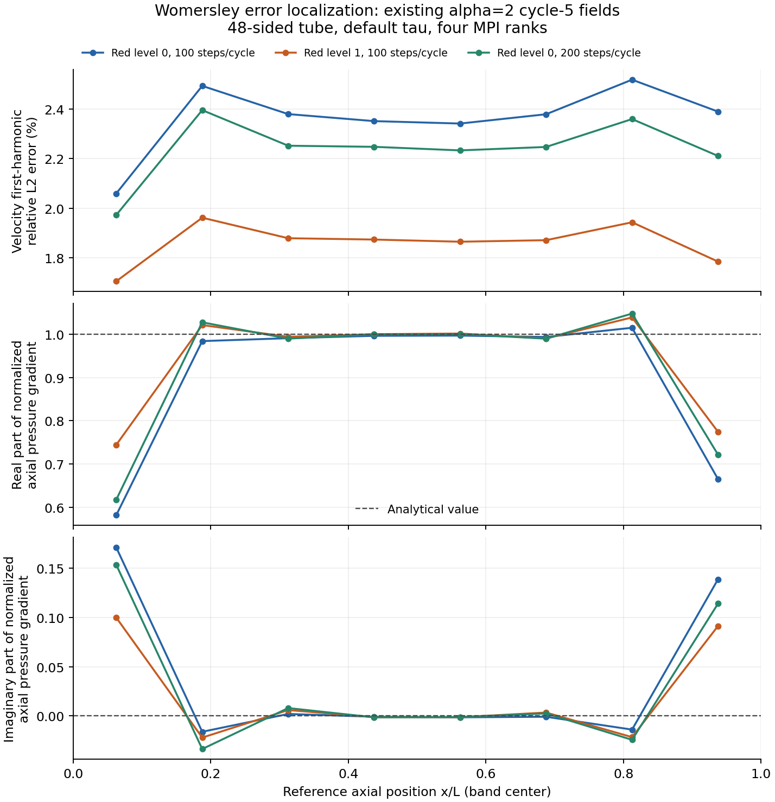

# 脉动管流：完整场误差与时间预算

2026-11-09北京时间09:12补充（执行策略说明）：步内Jacobian复用与跨步保留LU因子应分别
表述。当前`--chord`支持显式Schur或MUMPS，两条后端互斥；`--lu-reuse-window`只允许显式
MUMPS，默认关闭。每次求解仍创建新SNES，已接受的LU因子先从旧求解器分离，再用于FGMRES
对当前算子求解；有效积分系数改变时集体刷新。旧因子不是旧Jacobian，也不是应持久化的
accepted积分历史。[当前契约](../../docs/development/FLUID_PRESSURE_TIME.md)链接实际入口、
完整历史和系数刷新证据；早期只准备的实验保留其原始时间边界。本次只修正文档，不增加
数值或性能测量，也不构成整体验收。

2026-11-09北京时间08:26补充（完整轨迹与失败保留）：
[S48α1 N200完整4116文件](../../docs/research/data/womersley-alpha1-n200-lu32-complete-2026-11-09/README.md)
已封存并整档Git回读；1200步六周期的速度误差仍为1.0164445542%，超过1%。
压力.2160891315%、Q幅值.6402408209%、相位.0404516075度和周期差通过，不能覆盖速度失败。
当前N400及各项预算仍待完成，新的S96细网格策略也未采用。完整原始数据和实际失败同时
保存，使后续几何/时间改进可与原结论逐项比较；存储完成不构成物理资格。

2026-11-09北京时间07:54补充（执行准备）：后续脚本的静态检查与真实数值资格应分开。
[S96α1准备记录](../../docs/research/data/alpha1-s96-execution-preparation-2026-11-09/README.md)
的22项检查验证了两种rank策略的命令对应关系，并拒绝20项错误物理/资源配置；实际筛查
仍等待前一完整家族，因此只读预检必须返回ready=false，不能据此创建生产状态或自动采用。
只有实际成本、完整current/history和精确时钟复核通过，才为被测出的策略准备具体N400/
N800计划，之后独立记录执行前审查。原粗Q幅值FAIL不变；静态检查不新增性能或物理证据。

2026-11-09北京时间07:34补充（实现复核）：在 `7ed5a5d` 检查缓存生命周期和检查点时钟时，
十五份相关源码/测试文件与已执行验证快照逐字一致，复用原通过证据，本次没有重新跑数值测试。
预条件因子、使用计数和上次有效积分系数属于执行缓存，失败或恢复后重建；时间补偿余量
属于 accepted 算法历史，v4必须保存并恢复。两者的持久化规则不同，不能以“缓存”一词
一概处理。BE→BDF2系数变化触发任意rank共同刷新，最终当前方程的物理残量仍单独验收。
[源码复核记录](../../docs/research/data/solver-clock-source-review-2026-11-09/README.md)
同时修正架构文档中“从不保留因子”的过时描述；这不构成新的性能测量或整体验收。

2026-11-09北京时间07:10补充：新的α1 S96粗网格N400完成六周期后，速度L2误差0.705944%、
压力RMS/幅值0.870960%通过各自1%门槛；流量幅值却仍有1.447028%，超过1%。最后两周期
速度/压力场差已约4.1e-15/9.6e-15，说明周期稳定并不能消除离散误差，也不能用一个场的
通过替代另一观测量。[完整粗轨迹和分析](../../docs/research/data/womersley-alpha1-s96-coarse-n400-complete-2026-11-09/README.md)
保存全部保留相位和current/history，匹配的细网格、时间、尾项和采样预算仍须分别完成。
该结果没有改变既有S48速度失败，也没有自动采用排队中的新细网格执行方案。

α2独立N800时间控制仍在进行。它最终服务于N400目标的预算，不能因分辨率更高就宣称
N800自身已完成空间资格。新的完整归档等待器只在数值、分析和资源收尾都完成后封存，
并同时保存原N200采样预算失败。证据的完成状态必须与数值及物理结论分别记录。
此段继续保留为未发布草稿。

2026-11-09北京时间04:10补充（验证）：S96 N200/N400的解析和周期门槛全部通过，
但N200速度采样/空间差为.115648790529，超过.1；时间项U/P为.073911407822/.079631443096
通过，不能据此忽略采样失败。新N400基准重新采用同N400粗细网格空间差U.001823100329、
P.005360697553；已有N400采样项U8.7096e-5仅占新空间差约4.78%，时间项仍须独立N800。
新4800步六周期研究已启动，使用同一已验证执行策略，不改默认稳定化或任何阈值。
预算文本仅200/400→400/800的分辨率重标，逆替换字节及AST都相同。
[完整原失败和新计划证据](../../docs/research/data/womersley-s96-n400-budget-refinement-retry2-2026-11-09/README.md)
明确区分已完成的空间/采样项与待完成的时间控制；原N200失败永久保留。
[Alpha1五模式与实际交接档](../../docs/research/data/womersley-alpha1-native200-lu32-handoff-2026-11-09/README.md)
也已完整保存，短程性能通过不代表新的长期轨迹已物理合格。

2026-11-09 03:45 CST：alpha1从实际200检查点比较五种执行方案，完整1280个HDF数据集
及P1质量范数通过，旧/新legacy时钟差为零，新版之间v4时钟精确。LU32相对原旧8步、
新版默认8步和缓存8窗口的32步成本比分别.08732484/.24957066/.66758583。它仍只是
执行策略资格，正式N200/N400全家族从保留的实际种子接续，最终物理和误差预算另判。

交接的原数值进程已退出后，旧owner收尾超过预设40秒，控制器如实保留失败。确认它
随后自然退出后，新恢复器只迁移控制/分析目录，不修改种子、物理参数、预算算术或原
失败收据。首次中层采样假设错误和哈希入口类型错误也保留；原middle实际200步、100
存储相位，沿原共同相位规则比较，不能把缺失相位写成已有数据。实际采用为19:39:22UTC。

更新（2026-11-08 UTC11:01）：[native粗N200/N400完整时间对](../../docs/research/data/womersley-s96-native-coarse-time-pair-2026-11-08/README.md)
已经结束。N400六周期的U/p/Q幅值误差0.615600%/0.542559%/0.518270%，phase0.074227度，
net1.047e-17，最后两周期场差约6.14e-15，六项初步门槛通过；N200原Q幅值1.058047%
失败保留。同粗网格cycle6的200共相位U/P时间RMS差0.001636009/0.004225703，N400尾项
6.38e-16/2.36e-15。这些数只给预算分子；细层空间分母和完整time/tail/sampling仍未完成，
不能将粗层初步通过称为最终资格或改变原预算规则。

更新（2026-11-08 UTC08:39）：新原生粗网格六周期完成后，对既有四rank轨迹的全部
802个保留态、20050个数据集核验通过；当前/历史节点max1.0408341e-17，归一化P1
质量范数max1.4500918e-16，v4时钟exact。保留态包括200、400及401至1200，不声称
验证没有保存的启动步。细N200已开始，细层精度与时间预算仍待完成。

更新（2026-11-08 UTC08:14，代码`a6643c8`）：S96r8a8细网格在同一guestCPU21上，
32态四rank窗口8/32分别943.454/632.061秒，分区单rank397.683秒，原生单rank
394.727秒。窗口32实际均为2次LU；原生串行峰3.55GB，硬边界6GiB/swap0，单线程。
原生方案与四rank完整当前/历史字段max1.550409e-16、归一化P1质量max2.382260e-16；
独立回读960数据集同时检查与分区单rank的差别（max6.938894e-18），v4时钟exact。
它说明此处“一核承载四个MPI进程”的成本高于已测串行路径，不说明增加物理核无效，
也不是扩展性测量。只有相同资源、完整状态一致及总耗时同时检查后才作本地选择。

现有长期驱动的rank1路径不使用分区文件或mpiexec，因此不能直接用分区MPI单rank
的短试验代替它。两条实际启动路径都已执行并比较；匹配原生路径的粗N200、细N200、
细N400随后08:08:57开始，原预算算术不变。短试验通过仍不表示这组长期物理预算通过。

更新（2026-11-08 UTC07:32，代码`a6643c8`）：原S48细层已完成六周期及全场/尾项分析，
末周期速度场差约5.86e-15，解析速度误差仍为1.046822%而超1%。新S96r8a8粗层
六周期也已完成，速度0.691816%、压力0.679231%，但流量幅值1.058047%仍超1%。
这些结果体现不同指标独立约束；粗层改善既不证明最细通过，也不能替代N400预算。
完整原始轨迹正在归档，尚未把增长中的压缩包当作完成成果。

同次接续暴露了资源管理与结果就绪之间的差别。粗层控制器释放锁后才写完成状态，
细层在其间隙拿到锁并断言失败，尚未开始分区或求解。保留这次原始失败，再以独立
路径重试：先在锁外等结果完成，取得资源后复查，两项条件都成立才开始新筛查。
不能在持有下游所需资源时无限等上游，也不能仅凭拿到锁就假定上游分析已完成。
新细层筛查仍须完整历史、时钟、实际分解、成本和资源证据；成功启动本身不是采用。

更新（2026-11-08 UTC06:42）：[完整中层轨迹](../../docs/research/data/womersley-alpha2-middle-lu8-complete-2026-11-08/README.md)
已达1200步，末两周期场差约5.8e-15，但速度误差1.851116%仍高于1%。
[细网格第四周期](../../docs/research/data/womersley-cycle4-diagnostic-2026-11-08/README.md)
的独立只读诊断为1.046822%，也超标。前者保存3713个原始文件，后者保存1023个；
“周期稳定”“保存完整”均不能替代最细精度与最后空间差所限定的三项预算。

[S96三网格离线插值](../../docs/research/data/rounder-mesh-startup-screen-2026-11-08/README.md)
提供后续网格选择依据，但50,609节点网格的相近插值误差伴随较差形状质量，尚不能
推导其三维PDE精度。旧窗口32的启动成本比窗口8高33.66%，该候选和未开始数值工作的
细等待器均未采用。随后[有效时间系数刷新修正](../../docs/research/data/lu-time-coefficient-refresh-2026-11-08/README.md)
通过Debug/Release各6项与完整历史审计；独立局部成本复核后，新S96粗层六周期研究
于06:41:24启动。原S48完整研究继续，时间、尾项和采样门槛保持不变。新研究启动不
构成精度改善结论；仍须匹配细网格和N400对照。

更新（2026-11-08）：[细LU筛查330文件](../../docs/research/data/womersley-fine-lu-screen-2026-11-08/README.md)
已完成，同一600接受态之后八步，新默认/窗口8为474.624/116.530秒，实际分解8/1，
完整场/历史max1.03433e-16、v4时钟exact。独立回读后才于04:28:40另建从600续算的新
研究，周期4–6均使用新策略，并排匹配N400。这个局部性能结果不替代解析场、周期性
或每项小于最后空间场差10%的预算门槛；下文较早等待状态按历史记录理解。

资源标注校准（2026-11-08）：下文CPU编号及核分组来自WSL虚拟机，不能当作宿主机物理核绑定的证明。
[Windows/WSL实测记录](../../docs/research/data/execution-topology-2026-11-08/README.md)分别报告16核/24逻辑处理器与12个双线程核组。
原始档案、数值结果和门槛保留；本地耗时不支持宿主机扩展性结论。

原始证据现已补齐：[453步资源筛查76文件](../../docs/research/data/womersley-cgroup-screen-2026-11-08/README.md)
只给eligible，之后独立的[460步交接77文件](../../docs/research/data/womersley-mumps460-handoff-2026-11-08/README.md)
比较原连续463全部历史，最大4.4264e-12通过后才采用。另有
[alpha1/参考执行预检157文件](../../docs/research/data/production-followup-preflights-2026-11-08/README.md)。
归档完成与长期研究完成是不同事实；当前新增LU缓存细网格筛查仍未完成。

已完成证据补充（2026-11-08，capture5091b68，具体二进制身份另见各档案）：
[alpha1中层N200完整1563文件](../../docs/research/data/womersley-alpha1-middle-n200-2026-11-08/README.md)
显示周期场差约1e-15，但解析速度L2误差仍1.66366%，高于1%门槛。周期收敛不能
替代空间精度；后续细网格与独立时间/尾段/采样预算仍必须完成。
[原直接解筛查16文件](../../docs/research/data/womersley-direct-bounded-failure-2026-11-08/README.md)
记录3.5GiB/rank虚拟地址上限下的分配失败和完整清理，没有可用的成本比。
下文保留当时未执行状态；该试验现已完成且未采用，后续不同资源策略单独立证。

执行补充（2026-11-08，基线c509af0）：细网格直接解对照已设置每配置900秒、
每rank3.5GiB地址空间上限，并等待现有中层自然结束后的四核窗口。它使用同一完整
400步种子和三步目标；字段/正收敛/局部成本三个条件需同时满足，才能进入后续采用
评估。资源限制触发也是需保存的结果，不能自动加大资源反复尝试或写成物理不收敛。
[启动证据](../../docs/research/data/bounded-followup-startup-2026-11-08/README.md)已归档；
此时尚未执行该数值对照，也没有改变长期研究方案。

## 问题和参考解

本稿针对固定刚性直管的低频验证，不代表完整 FSI 资格。令压力梯度为
\(G\sin(\omega t)\)，\(\alpha=R\sqrt{\rho\omega/\mu}\)，并采用
\(u=\operatorname{Im}(\hat u e^{i\omega t})\)。充分发展流的对流项为零，
复振幅满足 \(i\rho\omega\hat u-\mu\nabla_r^2\hat u=G\)，壁面速度为零。
因此

\[
\hat u(r)=\frac{GR^2}{i\mu\alpha^2}
\left[1-\frac{J_0(\sqrt{-i}\alpha r/R)}{J_0(\sqrt{-i}\alpha)}\right],\qquad
\hat Q=\frac{\pi GR^4}{i\mu\alpha^2}
\left[1-\frac{2J_1(\sqrt{-i}\alpha)}{\sqrt{-i}\alpha J_0(\sqrt{-i}\alpha)}\right].
\]

这一约定下，正弦系数为实部、余弦系数为虚部。参考
[Pande 等，arXiv:2304.00543v2](https://arxiv.org/abs/2304.00543v2)式27–28，
取固定半径；根的另一符号不改变上述 Bessel 比值。实现的无依赖级数仅支持
alpha≤4，不能当作通用特殊函数库。alpha→0 单独返回 Poiseuille 极限。

## 全场误差为何不能只看谐波幅值

P1 场的平方范数通过一致质量矩阵精确积分。每个四面体上，对任一标量分量：

\[
\int_K v_h^2=\frac{V_K}{20}\left[(\sum_a v_a)^2+\sum_a v_a^2\right].
\]

在等距相位 \(\theta_j\) 上，定义数值场的正弦、余弦系数
\(s=2M^{-1}\sum_j u_j\sin\theta_j\)、\(c=2M^{-1}\sum_j u_j\cos\theta_j\)。
轴向解析速度与完整数值向量场的周期误差积分为

\[
\frac1M\sum_j\int|u_j|^2
-\int(s_x\operatorname{Re}\hat u+c_x\operatorname{Im}\hat u)
+\frac12\int|\hat u|^2.
\]

第一项保留均值、横向速度和高次谐波，不能换成仅第一谐波的能量。
参考交叉项用正权 Gauss/Duffy 四面体积分；压力参考沿轴向线性，误差平方可由
质量矩阵精确积分。压力端面牵引固定水平，不能先减去平均偏差。
所有体积积分都在实际多边形域上，圆管总流量另作比较；几何外部缺失区域没有
被偷偷计入或扣除。稳态的域单调性流量界不能直接套到复振幅问题。

## 实现和独立核验

`d280e7f` 的 `analyze_womersley.py` 读取接受态 checkpoint，并核对网格哈希、
时间/步号、物理签名、节点覆盖、owned/ghost 一致性。`compare_womersley.py`
只比较同一多边形、相同种子的嵌套 red 网格，使用仿射重现检查后插值；完整场差
在细网格上积分。它不把不同参数间的差自动命名为空间或时间误差。

三个解析检查通过；独立 SciPy 结果最大差1.22e-18。五次单纯形矩最大差4.45e-16。
包含横向二次谐波的独立时空积分与上述公式差3.2e-15。首次后处理曾因 NumPy
布尔值不能直接写入 JSON 而失败，修正标量转换后只重算分析，没有改场或门槛。

## 已执行数据与未完成部分

冻结 `b072cc8` Release 求解器的 alpha2、48边形数据见
[原始证据](../../docs/research/data/womersley-first-2026-11-07/README.md)。
首档加密后，流量幅值误差仅 .010704%，而速度全场 L2 误差仍1.86191%，未达到1%。
周期差很小也不能解决这个空间/时间精度问题。

粗网格时间步减半的速度/压力场差约为首档空间差的56.10%/53.96%，超过预设10%预算。
默认 tau 包含有效 dt，因此该差同时包含导数与稳定化参数的变化。新增可选时间尺度
控制用于辨别两者；其实际数值验收在此证据点尚未执行，不把它描述为已验证改进。
比较必须先做场向量差，再取范数；不同误差的范数不可直接相减。

粗网格实际追加周期后的差约1e-14，只证明该网格的尾项。更细网格、alpha1、几何、
时间和采样预算仍未完成。此稿没有性能结论，保持在 drafts 等待完整审查。

## 定位误差与选择下一组网格

后续离线诊断只读取上述已有场，没有重算求解。将周期场分为第一谐波和其余分量，
后者的相对范数不超过2.546e-7。level1/N100的八个网格对齐轴向区间仍有约
1.71–1.96%的第一谐波速度误差，中部约1.87%；因此不能仅用端部局部效应解释偏差。
压力梯度的明显端部偏差则保留在[分区诊断](../../docs/research/data/womersley-first-2026-11-07/README.md)中，
尚未建立它与速度误差之间的因果归属。

解析函数的节点插值可帮助筛选网格，但它既不是最佳投影，也不是数值误差下界。
例如level1的解析节点插值误差约.8583%，数值场误差却为1.8619%；三角不等式不能
把两个范数之差解释成某一种误差来源。六组网格的
[解析插值检查](../../docs/research/data/tube-mesh-screen-2026-11-08/README.md)
发现49137节点的一组网格在alpha2下有约.2744%的节点插值误差，当前91905节点网格
对应约.2140%。这只是后续真实计算的候选依据，不能据此宣称更快或已经达到1%门槛。
不同种子网格也不能直接沿用仅适用于嵌套加密的场差算法。

图中点是与网格对齐的区间统计，线只连接观察值；三组均为已有alpha2第5周期，
未产生新的求解结果。压力梯度按解析轴向负梯度归一化，实部参考为1、虚部为0。

从实际BDF2历史重建系数后，粗/level1 N100中时间项的平方占比分别约66.25%和12.47%。
保持同一个已接受流场、仅将dt减半，tau的体积与相位平均比分别约.58293和.85711。
这说明系数确实会随时间步显著变化，支持开展前述控制研究；它仍不能直接推出场误差
的大小或根因。两组N100共200份历史与独立保存的前一步完全相同；N200稀疏保存下
没有相同的逐文件交叉检查，不能把未检查写成零误差通过。

执行策略也需要可追溯。cfa5d3c将可选COO装配和Schur路径的步内chord策略写入研究
定义，旧研究不能通过一次resume默默换选项。已完成的4项元数据检查只证明身份保护，
不证明新策略更快或长期准确。实际采用前仍须在同一完整接受态上比较场、收敛和耗时，
再记录来源并新建研究；原失败或中断尝试保留。[范围与准备记录](../../docs/research/data/womersley-execution-2026-11-08/README.md)。

管端还需区分压力迹与法向应力。已有level1/N100场的端面压强差复振幅误差约5.81%，
从相邻P1单元重建的`p-2*mu*du_x/dx`差误差约3.42%；它们均不同于体积压力RMS。
仿射场积分检查的最大误差1.164e-13。弱形式施加牵引不保证有限网格上的重建强应力
逐点满足载荷，因此这些值只作分离诊断，不据此放宽门槛或断言代码错误。

相位采样也应比较同一次求解的实际密集状态。已有100相位数据相对其50点线性重建
约有.00139的归一化场RMS差，独立正弦插值公式核验通过；这不能外推成100点已经
足够。计划中的100→200预算需要真实200相位状态，且记录真实前一周期终点，不用
假定周期完全一致来补齐端点。

## 实际分离时间步与稳定化时间尺度

新增粗网格N200固定t_tau=2*(T/100)/3的1000步研究已周期稳定。N100→该N200研究的
归一化速度/压力场RMS差为.000551646/8.41201e-6；保持N200只改回默认tau时间尺度，
场差为.00409246/.00823032。两者是不同向量差的范数，不能相加当总误差分解。
默认N100第一步使用BE，其启动tau时间项不同，不能声称整个启动算子也相同。
固定参数研究的粗网格速度/压力/流量幅值精度仍未通过，不替代默认算法资格。
[1574文件和命令](../../docs/research/data/womersley-fixed-time-2026-11-08/README.md)已回读核验。

执行策略也完成了真实短程验证：COO细网格没有端到端收益，未采用。原lag=-1被PETSc
命令行拒绝；改为-2首次Newton重建后步内复用，细网格三步字段差1.03e-14，本次耗时
下降5.42%。据此显式派生新研究，保留原中断尝试，并保存200相位。它不是通用性能
结论或长期精度证明。[全部成功与失败139文件](../../docs/research/data/womersley-options-2026-11-08/README.md)已核验。

另一频率alpha1的首个粗网格六周期也已完成：默认稳定化下，速度/压力/流量幅值误差
为2.4358%/1.7679%/3.1368%，均高于1%；末两周期场差约1e-14，只证明周期稳定。
冻结b072、四rank和独立核心队列的[2071份输入与结果](../../docs/research/data/womersley-alpha1-first-2026-11-08/README.md)
已核验，后续同网格时间细化和同时间步空间细化仍在计算。两频率不能相互代替验收。

## 预条件器迭代数与完整成本

另一组三步有界对照保持同一个接受态、物理输入和停止容差，比较原GAMG、仅压力HYPRE
及两场HYPRE。细网格最大场差分别为0、3.3132e-12、7.2080e-12，均低于预定2e-9。
同次细网格观察的总时间为366.70、292.45、575.01秒；两场HYPRE虽然减少Krylov迭代，
每次作用成本却更高。粗网格中该选项较快，不能将粗网格排名直接移植到细网格。

这组四rank仅用六个逻辑CPU（三个WSL核分组），且其他独立计算同时运行，因此仅是本地
选项筛查，不是通用加速或扩展性证明。原运行研究没有更换预条件器。完整命令、求解树、
耗时、峰值内存、同态场及哈希见[94文件](../../docs/research/data/womersley-schur-options-2026-11-08/README.md)。
源码检查点c49c69c及所附脚本，冻结二进制b072/PETSc3.23.7；尚无长期策略资格。

## 把速度分量语义传给 GAMG

原 AIJ 存储中，一个流体节点的速度三分量与压力共用节点顺序，但提取速度子块后，
GAMG不会仅凭字段名知道三分量属于同一节点。新增显式`-schur_velocity_block3`先集体
检查 owned 语义、同节点分量0/1/2与子矩阵所有权，再设置速度子矩阵块大小3。
原矩阵值、物理编号、压力子块和停止准则不变；不是把生产存储改成BAIJ。
本地空 owner 允许，不完整元数据和 rank 间选项不一致须共同拒绝。

固定[PETSc3.23.7聚合实现](https://raw.githubusercontent.com/petsc/petsc/v3.23.7/src/ksp/pc/impls/gamg/agg.c)
在没有显式近零空间时依据块大小构造分量常数候选。这些只是插值候选；带壁面约束的
速度问题不能据此声称有三个精确零模态。目前选项仅开放独立Tet4/P1流体的旧Schur路径，
不外推到共享接口经过消元的FSI或其它PC树。

054b64a后实现完成1/2/4rank算子条目与真残量检查、含空owner的故障/同对象恢复，以及
真实小管三步与LU对照。Debug六项通过；Release五项通过后，原Schur四rank检查在单
WSL核分组默认MPI空等下超时。相同源码仅重试该失败项，启用空等让出后通过原100秒时限；
既没有放宽数值容差，也没有把原超时标为通过。完整失败与复用关系在
[967份核验证据](../../docs/research/data/womersley-vector-metadata-2026-11-08/README.md)中。

同一细网格200步接受态之后，三个时间步的最终场差为5.08531e-12；各步收敛理由均为正。
四rank共享一个WSL核分组的局部对照，耗时733.265→539.742秒，迭代168/168/168→94/94/95。
峰值rank RSS同时从992313344增至1063612416字节，因此耗时收益不代表内存也降低。
旧b072末态只用于字段对照，没有拿不同CPU安排的耗时作加速比。此结果满足事前局部
选择规则，但长期研究必须另建带完整来源的新定义；旧研究`--resume`不得静默换选项。
第400步原四个WSL核分组复核与后续长周期资格在此证据点仍待完成。

alpha1后续两项也已有独立结果：level1/N100的速度误差1.66523%仍失败，压力和流量幅值
通过；level0/N200的速度/压力/流量幅值误差2.29153%/1.58464%/2.46513%仍全部超过1%。
[3126份核验数据](../../docs/research/data/womersley-alpha1-followup-2026-11-08/README.md)
保留各自完整周期。两项同时改变空间和时间分辨率，不能拿两列之差单独说明哪一项
误差更大；它们也不替代另一频率alpha2或更细网格的预算。

另一个实际错误发生在新中层短预检：将流体检查点保存间隔写成0，输入校验正确拒绝，
求解尚未开始。保留失败并在独立目录改为合法正间隔后，新旧三步末态差1.717e-12通过。
同项错误也存在于尚待第400步边界的冻结probe，因此先取消只在等待的控制器，经其
finally恢复原调度，再由独立冻结的新控制器接手。五个原数值进程的身份和运行保持。

[390份队列证据](../../docs/research/data/production-queues-2026-11-08/README.md)
同时保存另一次冻结依赖遗漏的导入失败、已完成预检和带日期的运行快照。冻结意味着
不能悄悄改掉已启动控制器的源码；恢复应有明确的新尝试与状态交接。短程通过只允许
继续研究，不代表六周期、生产MPI/恢复或完整误差预算已经通过。

## 独立截面参考：几何差不能从总误差直接相减

在fa9646d之后，独立复数P2截面问题直接求解
`(-Delta+i*alpha^2)U=.01`，零壁面，R=rho=mu=1。沿用原生成器的直边多边形，
只细化内部三角形。S48的alpha1/2速度场相对圆管解析解差.497830%/.454478%，
S96为.123803%/.112978%；这是在多边形域内积分的场差，流量比较还包含域面积差。

参考本身也需要证据。三个非零复二次制造解的节点误差最大2.630e-13；独立积分、
质量矩阵、常量patch和嵌套映射检查通过。最后相邻网格场差均小于预声明1e-4，
说明观察到的参考分辨率足够用于这一诊断，但不是严格后验误差界。

细化还暴露线性代数的验证问题：S96细系统普通双精度真残量在约1.68e-11停滞，
高于1e-11门槛。扩展精度状态/残量修正后可到约8e-15；期间一个把高精度结果与
双精度oracle按高精度界限比较的检查自身失败，随后改用独立80位十进制求和。
原失败、源码与门槛都保留，没有把失败删除后只展示最终图。

[106份原始文件、命令和科学图](../../docs/research/data/womersley-polygon-reference-2026-11-08/README.md)
展示完整过程。这些几何差与三维误差是不同向量的范数，不能用两个百分数相减
来声称获得纯离散误差；三维周期、时间、尾项和采样预算仍需实际场对照。

相同原则用于后继时间控制量：细N400必须沿用已完成N200的网格、二进制和选项。
控制量及中层空间分母本身也要满足周期和质量前提，不能只检查目标N200。
[37份队列证据](../../docs/research/data/womersley-time-queue-2026-11-08/README.md)
保留了补齐这些前提的自审；等待时不持主数值锁，避免阻塞生产者的检查点交接。
此时N400计算尚未开始，不能由一份正确的排队定义推导出预算已经通过。

## 合法时限与单次计算段长度是两个条件

把待执行参数从172800修正为入口允许的86400，并不证明每段细网格计算能及时结束。
一次调用包含的接受步数仍需结合实际成本检查。新显式`--cycles-per-solve`在完整周期
检查点结束数值进程，再恢复下一段；所有attempt仍保留同一个物理终止时间，避免通过
改变终止时间而意外改变末步截短。保存相位和物理/线性求解器定义保持一致，收据记录
执行分段。未指定选项时保持原行为，入口时限也没有放宽。

[604份执行验证](../../docs/research/data/womersley-segmented-execution-2026-11-08/README.md)
记录了新v4与冻结旧v3候选各自的真实1/2rank对照。新v4全部13存储态的场、历史与时钟
完全相同；旧v3场/历史最大差6.939e-18。小问题中旧时钟恰好相同，不能据此否定长轨迹
已发现的补偿量丢失；旧格式继续按其明确的近似恢复契约处理。执行分段不替代长期
周期、解析场及误差预算验收，也必须通过独立冻结后继或完整接受态交接才能投入长研究。

后续[114份调度证据](../../docs/research/data/segmented-queue-handoff-2026-11-08/README.md)
进一步区分了“等待器已替换”和“数值轨迹已交接”：前者经过PID/启动时刻/命令核验后
取消旧等待器，保持当前数值子进程不变；后者尚须等完整周期状态和连续三步参考，并
复核恢复后的同态结果。新的后继不能在等待时占住生产者需要的主队列锁，也不能
因为源码文件已经修改就假定运行进程采用了新版本。

## 地址空间失败与完整作业内存预算

一次有界直接解尝试在每rank3.5GiB虚拟地址空间限制下，于7.085秒出现OpenBLAS分配
失败，没有获得可比较接受态。该失败不能直接推断此问题需要多少实际驻留内存，也不能
因后来换资源策略成功而改写为通过。新的试验单独声明整作业cgroup-v2限制14GiB、swap0，
并先用64MiB上限的真实分配失败和双rank继承检查确认约束生效。

Linux的`memory.max`限制组内记账内存，达到无法回收的上限时可在组内触发OOM；
内核也说明特定情况下可能短暂超出。交换空间另由`memory.swap.max`约束，因此不能
把这两个量或每进程地址空间当成同一指标。参见[内核cgroup-v2官方说明](https://docs.kernel.org/admin-guide/cgroup-v2.html#memory-interface-files)。
实验同时监测系统可用内存：开始需超过16GiB，低于8GiB停止本作业；不把所有rank的
RSS相加当作唯一的物理资源计量。对于嵌套启动研究进程再创建MPI会话的情况，资源边界
必须包含这些后代；单独的Linux会话标识不足以描述整个嵌套作业。

在同一453步完整状态上，冻结candidate162/PETSc3.23.7 Release、四个WSL核分组、
367620未知量的三步实测为MUMPS/chord181.986秒，Schur/vector/chord353.400秒。
最终场差5.2965e-12，全部HDF历史低于2e-9，旧v3时钟按1e-12近似契约通过。
观测cgroup峰10,821,701,632字节。原六进程随后全部恢复。它是一次本地选项对照，
不是扩展性或长期资格证明；完整接受态上的显式交接仍另行验收。

为可复现选择增加显式`--mumps`，不改变默认求解器；与Schur互斥，允许显式chord，
选项仍写进不可静默改变的研究定义。基于5091b68后的真实1/2rank小检查涵盖全部13态、
65/130数据集、精确v4时钟、完成态无操作和错误配置拒绝。未改变数值核或重跑全套。
实际整作业清理检查还覆盖了忽略SIGINT/SIGTERM的独立会话子进程，并确认旁侧进程存活。
[331份证据和命令](../../docs/research/data/womersley-mumps-entry-2026-11-08/README.md)
保留具体源码哈希和结论边界。后续N400仍必须与被选N200同网格、同二进制、同选项，
时间、尾项和采样三项各自小于最后空间差的10%，不能用执行收益抵扣数值误差。

## 完整轨迹、消费者绑定和证据存储

2367903后的[中层独立筛查与交接](../../docs/research/data/womersley-middle-lu8-2026-11-08/README.md)
在成本和完整历史通过后从480采用窗口8。后继N400控制器同时显式绑定新中层空间分母；
只有中层完整1200完成后才允许预算分析。五种入场情形执行检查通过，等待中层时释放
CPU/内存锁，数值预算尾部逐字不变。新控制器和后继进程启动并不等于这些预算已通过。

[细600交接档案](../../docs/research/data/womersley-lu600-handoff-2026-11-08/README.md)
保留旧轨迹到601和计划中断记录；增长中的新输出不伪装成完成档案。控制器替换时，
应明确区分筛查后的恢复、后来采用时的退休以及未运行消费者的取消。

完整细轨迹也带来存储成本。[同16文件试验](../../docs/research/data/archive-storage-validation-2026-11-08/README.md)
只改变tar.xz成员排序，17.41MB缩到11.21MB，两组都逐字还原原始HDF；这一样本节省率
不能代替完整轨迹测量。新捕获工具将大包留在D，元数据留在工作树；独立Git fixture
及实际39,834,848B完整索引回读确认，提交中的普通blob仍含全部字节，稀疏工作树
可以不重复保存大包。每个包的捕获哈希与Git内容都要分别核验，不能把外部路径当成果。
此处没有移动或删除旧证据，也没有新增物理验收结论；文章继续保留为草稿。

## 读取器、实际交接和同网格时间对照

8297a417之后对已完成alpha1启动档案增加了完整当前/上一时间层P1质量检查。
320数据集的节点/历史最大差5.4277761e-12、归一化质量最大1.9164191e-10，均通过。
旧v3与新v4间只检查已有近似时间契约，新v4互比才要求完整时钟逐字相同。
这证明读取与比较方法可用于这些已完成样本；实际第200步checkpoint尚须单独筛查，
不能将两种不同的验证对象混在一起。

这里执行一致性读取器的固定速度尺度为0.02/(4*12)，压力尺度为0.02；实际算例L=2、
R=mu=1，其Poiseuille中心速度尺度是0.02/(4*2)。前者更小六倍，筛查因此更严格，
但它并非生产解析场误差使用的速度RMS。保留原筛查尺度及1e-8门槛，不据此修改物理预算。

同样，新增粗网格N400与既有同粗网格N200的时间对照，不改变最细N200研究的空间
分母。它可揭示粗层自己的时间污染，但不能替代原最细层的时间、尾项和采样预算。
计算与审计完成之前只有固定输入和执行定义，没有新的精度结论。

## 解析门槛通过后仍需完成误差预算

独立S96/R8/A8细层在相同alpha2下完成六周期N200，原生单rank/显式LU窗口32，
最后三个周期保留全部200相位。速度相对L2为0.475826%，压力RMS/幅值为0.360074%，
流量幅值误差0.234326%、相位0.060445度，末两周期场差小于5.53e-15，净通量
1.0872e-17。这六项初步门槛通过；完整字段与历史见[封存证据](../../docs/research/data/womersley-s96-fine-n200-complete-2026-11-08/README.md)。

解析误差已经低于1%，并不说明空间差足以解释所有误差。匹配N400轨迹仍要给出时间
差，尾项及采样也须各自小于最后空间场差的10%。N200达标、N400正在运行、档案完整
是三个具体事实，都不能代替这些尚未完成的比值。原S48细层速度1.046822%的失败
和S96粗N200流量幅值1.058047%的失败继续保留，不用新网格的成功覆盖旧结果。

## 完整预算失败与本地对象存储验证

224aad5之后，S48细N400完成2400步和全部预算。速度/压力的时间项相对最后空间差
分别为.0161463/.0210419，采样项为.0387633/.0386377，尾项接近舍入量级；六项都
低于.1。但N400速度解析误差1.045991%仍超过1%，总体失败保持。这里仅能判断时间、
尾项、采样已被这一空间差控制，不能据此认证圆几何或最细解的解析精度。

完整轨迹使“tar原件放D而Git对象仍写C”的容量约束显现。依据
[Git对象库文档](https://git-scm.com/docs/gitrepository-layout)，relative alternates
从对象库目录解析；[clone的--no-local](https://git-scm.com/docs/git-clone)使用普通
Git传输。此为工具契约，不是本项目已完成远端上传的证据。

[实际独立试验](../../docs/research/data/git-cross-drive-storage-proof-2026-11-09/README.md)
用完整249028B档案验证Windows/WSL默认读回和strict fsck，以及没有alternates的独立
clone。随后实际checkout新增D对象库、相对alternate及本机junction，独特probe blob
仅存在D但双平台索引读回一致。旧C对象与D档案均保留，Gitconfig及refs未改；当地
checkout仍依赖D对象库，不能手动丢弃它。完整普通blob由正常Git传输复制，不把
外部路径提交为数据替代品。

新暂存器在写索引前核对整个选定batch及可用空间，每个对象再次通过默认Git读回。
批次收据只证明该批字节完整；最终收据必须遍历全部part。55份封存记录与实际
265116B档案完成这两步；这只是本地存储与传输证明，没有新增物理资格或远端发布。

## 2026-11-09：完整时间预算仍不能消除解析误差失败

S48 α2 N400完成2400步、六周期和400个相位采样。最终速度相对L2误差
1.0459910557%仍高于1%，N200的1.0468222496%也保持失败。压力、流量幅值、
相位、净流量和末周期场差通过，各程序身份、原稳定化和求解设置均保留在
[完整档案](../../docs/research/data/womersley-s48-n400-complete-family-2026-11-09/README.md)。

N200目标的速度时间项仅占最后空间场差1.6146%，采样项占3.8763%；压力对应
2.1042%和3.8638%，尾项均很小。六项都小于10%仍不改变解析速度失败，且该
分母与目标属于N200，不能自动转成N400的独立空间资格。新S96的N400目标
使用自身同分辨率粗细比较和另做的N800时间控制；其完整预算仍待后者完成。

此处归档8162个文件、153个完整包共3,774,516,920字节。每批普通Git包都从
索引逐字回读，完整manifest及最终收据在全部包验证后入库。分批存储用于控制
单次提交大小，不减少原始轨迹、不改变失败结论，也不代表已经上传或发布。

## 2026-11-09：α1同样达到周期稳定但解析速度尚未达标

S48 α1 的N200完整1200步显示末周期速度误差1.0164445542%，略高于1%；
末两周期速度、压力场差却已分别约3.09e-15和6.61e-15。周期差衡量同一离散
问题是否重复，并不能证明离散解与解析解足够接近。完整指标与原资源收据见
[分析证据](../../docs/research/data/alpha1-next-grid-preparation-2026-11-09/README.md)。

原S48 N400时间对照继续；另一组S96 α1先准备同400相位粗网格，后续仍需匹配
细网格、时间、空间和采样预算。目前不能将误差归因于单一几何因素，也不能
把α2的S96通过证据直接替代α1。两个频率与各自完整误差预算分别验收。

## 完整S96轨迹保留的采样预算失败

S96α2的N200和N400最后周期解析速度误差分别0.475826%和0.471078%，压力、流量幅值、
相位、净流量和周期场差也通过。但N200速度采样误差0.0003483341除以同N200最后空间差
0.0030119997等于0.11564879，仍高于0.1。另五个时间/尾项/采样预算项通过不能抵消它。
[完整3323文件原始轨迹与预算](../../docs/research/data/womersley-s96-n400-complete-family-2026-11-09/README.md)
将原passed:false原样保存。独立N400目标重新选择自身空间分母并等待N800，不是在原失败
报告上改标签。N800是时间控制，不能同时宣称自身已完成空间资格。

84个完整普通Git包共3,591,041,640字节，分批本地保存后整档回读，才记录完整metadata。
存储检查点、计算完成和验收通过分别记录；该证据未自动上传，文章仍为草稿。

## 三条实际轨迹的稳定参数路径分解（2026-11-09）

新增分析入口要求同网格、同物理与求解设置的完整六周期三条轨迹：N400默认、N800且tau时间项固定N400有效BDF2尺度、N800默认。在第六周期400个共同相位直接构造场差 `t=u_control-u_target`、`q=u_fine-u_control` 和 `total=u_fine-u_target`。以精确P1质量内积分别积累范数和交叉项，验证 `||total||²=||t||²+||q||²+2<t,q>`，避免相减两个解析误差范数来冒充场差。

这是一条指定干预路径的分解；只固定tau的时间尺度，速度项仍随求解变化，所以t不是纯连续时间截断误差，交叉项可体现抵消。默认时间预算仍须独立满足原门槛。入口以实际完整周期和质量审计为前置条件，拒绝错误时间尺度及不完整轨迹。精确常量P1积分、抵消及输入拒绝检查已运行通过；正式长程分解尚未运行。源码基线7c3191d，[命令及证据](../../docs/research/data/macos-womersley-budget-preparation-2026-11-09/tau-field-decomposition/README.md)。

## 原始数据完整性与展开副本（2026-11-09）

为了维持长程计算空间，已完成两组N400的第三周期内部状态只保留在完整无损归档中，第四至第六周期及所有周期端点继续展开。回收前逐项核对归档、原清单、现场文件和实际解码字节，随后执行真实恢复探针。此时原始数据仍完整，但原目录inventory不再完整：未来读取第三周期或重做全目录清单前必须显式恢复，不能用旧raw清单宣称每个路径都存在。后续消费者依赖源代码哈希已绑定，避免按文件年龄猜测可删除范围。源码基线39aa87e；[实际命令、恢复方法和证据](../../docs/research/data/macos-recompute-2026-11-09/storage/cycle3-materialization/README.md)。

2026-11-09实测补充：全新alpha1 S96level1N800六周期完成，速度0.426893%、压力0.394095%、Q幅值0.189047%、相位0.022713度，周期与质量门槛通过；独立预算尚在计算，不能从初步指标推断10%预算通过。二进制仍04a7aa5b，代码基线9185cac，[完整来源与raw哈希](../../docs/research/data/macos-alpha1-s96-l1-n800-2026-11-09/README.md)。

2026-11-09独立预算实测：alpha1默认N400目标的速度时间/空间比1.3272%、采样/空间比2.1719%，压力分别1.8293%和.6888%，尾项约1e-13倍空间差，全部满足事先10%门槛。计算直接比较完整实际场，采样使用真实cycle5端点；粗网格原Q幅值失败保留。该预算不替代tau干预分解或其他生产子项，N800只是时间对照。[命令、完整报告与消费raw哈希](../../docs/research/data/macos-alpha1-n400-budget-2026-11-09/README.md)。

预算完成后的存储补充：alpha1N800全部6450原始文件逐成员解码校验归档成功；随后按已完成的消费者范围回收N400/N800较早周期重复HDF，第六周期及每个周期端点继续展开。实际恢复N800 step3201并SHA校验通过。将来重做周期/预算或完整inventory必须先恢复，当前目录不再声称全部原始状态展开。[消费者依赖、命令与恢复证据](../../docs/research/data/macos-recompute-2026-11-09/storage/alpha1-post-budget/README.md)。
