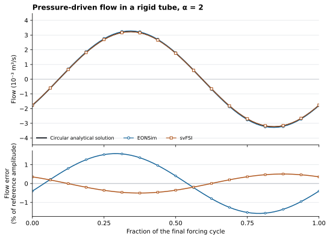

# 用振荡圆管同时验证流量和压力

刚性圆管两端施加正弦压差，黏性与惯性使流量峰值落后于压差峰值。在 EONSim 的细网格算例中，流量幅值误差为 **0.7554%**，计算端面压差幅值仍比施加载荷低 **5.6792%**。复核血流求解器时，两个量都值得记录。

## 构造可复核的参考解

圆管半径 $R=1$ m，长度 $L=2$ m，密度 $\rho=1$ kg/m³，动力黏度 $\mu=1$ Pa·s。施加 $\Delta p(t)=0.02\sin(4t)$ Pa，圆管无滑移，两端施加法向牵引并约束横向速度。这是用于验证离散方程的合成算例。令 $\alpha=R\sqrt{\omega\rho/\mu}=2$、$z^2=-i\alpha^2$，并取 $Q(t)=\mathrm{Im}(\widehat Q e^{i\omega t})$，充分发展牛顿流体的复流量为

$$
\widehat Q=\frac{\pi R^2\Delta p_0}{i\omega\rho L}
\left(1-\frac{2J_1(z)}{zJ_0(z)}\right).
$$

解析幅值为 $0.00323951534$ m³/s，相对压差的相位为 $-33.26157^\circ$。进、出口面积分均使用外法向，故数值同向流量取 $(Q_{\rm out}-Q_{\rm in})/2$。对完整末周期做正弦和余弦投影即可分别比较幅值和相位。[Womersley 原文](https://doi.org/10.1113/jphysiol.1955.sp005276) · [EONSim 边界条件与参考解](https://github.com/saitoasukakawaii/EONSim-new/blob/5781ae0c01953d123e91cd0ea9f44cd970674b93/docs/development/WOMERSLEY_FLOW.md)



图中的跨程序复算对齐了四面体连接、网格坐标、压力波形和时间步，两套程序都用谱半径为零的 generalized-α。下面的 EONSim 网格加密试验使用 BDF2，每周期 64 步，共三个周期。[绘图程序与数据来源](https://github.com/saitoasukakawaii/EONSim-new/blob/5781ae0c01953d123e91cd0ea9f44cd970674b93/docs/research/data/womersley-2026-11-20/plot_waveform.py)

## 固定周向分辨率，分别读三个误差

| 周向 / 径向 / 轴向 | 四面体数 | 流量幅值误差 | 相位误差 | 端面压差幅值低估 |
|---|---:|---:|---:|---:|
| 48 / 4 / 6 | 6,048 | 2.5372% | 0.3083° | 11.7610% |
| 48 / 8 / 12 | 25,920 | 1.5047% | 0.2858° | 7.5780% |
| 48 / 12 / 18 | 59,616 | 0.7554% | 0.2097° | 5.6792% |

施加量是端面的法向应力。这里比较的压力来自有限元压力场在端面上的面积平均。固定周向网格并加密另外两个方向，两种幅值误差都下降，速率和大小各有差异。细网格上 EONSim 与 svFSI 的复流量之差为解析幅值的 1.3046%。研究还给出了局部散度和速度场误差，适合检查单个截面积分可能掩盖的误差。[原始网格、误差定义和完整测量](https://github.com/saitoasukakawaii/EONSim-new/blob/5781ae0c01953d123e91cd0ea9f44cd970674b93/docs/research/data/womersley-2026-11-20/README.md)

## 复算最后一个周期

从 EONSim 仓库根目录执行下列命令即可解开归档，重算边界积分结果。输出目录使用独立的临时路径。

```bash
data_dir=docs/research/data/womersley-2026-11-20
study_dir="$(mktemp -d)"
tar -xJf "$data_dir/raw.tar.xz" -C "$study_dir"
python3 "$data_dir/replay.py" "$study_dir" --verify --output "$study_dir/integrals.json"
```

**读图练习。** 固定 8 个径向层和 12 个轴向段，把 48 扇区换成 24 扇区。用归档表同时比较流量幅值、相位和终点速度场的相对 $L^2$ 误差，判断仅凭流量幅值会怎样排列两张网格。[不同周向分辨率的对照](https://github.com/saitoasukakawaii/EONSim-new/blob/5781ae0c01953d123e91cd0ea9f44cd970674b93/docs/research/data/womersley-2026-11-20/README.md)
